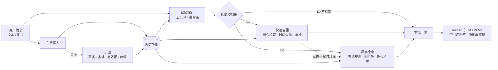

# CueMem

**线索驱动、可自我调控的多模态 Agent 长期记忆系统**
*Cue-driven, metacognitive, multimodal long-term memory for LLM agents*

> 进行中：N1 工程骨架已完成并通过联网验证，下一步是 N2 评测框架。进度见下方表格与 [路线图](docs/roadmap.md)。

## 它要解决什么

让 LLM Agent 在跨越数月、上百个会话的交互中**记得住、想得起、记得准**，而且这种能力来自记忆系统本身，不依赖"模型足够聪明"。

- **记得住**：写入时把对话整理成带有效期的事实、实体图和多粒度索引。原始日志不可变，派生记忆可重建、可溯源。
- **想得起**：由一个**解耦、可训练、可度量的检索控制器**决定这一轮要不要想起、想多深（L0 不检索 / L1 快速召回 / L2 深度检索），证据不足时自动升级。
- **记得准**：信息更新时旧事实失效但保留历史；图片在索引时压缩成描述和向量，回答时取回原图再看一眼。

## 为什么不只是把上下文做得更长

上下文窗口还会继续变大，但下面这些问题不会因此消失。它们是**信息管理**问题，不是**容量**问题。

| 问题 | 只靠长上下文 | 记忆系统的做法 |
|---|---|---|
| 成本与延迟 | 每轮重读全部历史 | 只取需要的部分，按需加深检索 |
| 有效上下文远小于名义长度 | 越长越容易漏看、误用（lost in the middle、context rot） | 只把相关证据放进上下文 |
| 知识过期 | 新旧说法并存，靠模型临场判断 | 写入时显式失效，同时保留历史版本 |
| 跨会话、跨设备 | 会话结束即消失 | 持久存储，可共享 |
| 隐私与可控 | 无法查看、修改、删除 | 每条记忆可查看、可删除、可溯源 |
| 多模态 | 图片和视频 token 昂贵，无法常驻 | 压缩索引 + 回答时再感知 |

## 架构



## 快速开始

需要 Python 3.12 与 [uv](https://docs.astral.sh/uv/)。模型使用 DeepSeek 与通义千问的 API（OpenAI 兼容接口；通义经 QwenCloud 接入）。

```bash
uv sync                                  # 安装依赖，创建 .venv
uv run cuemem configure                  # 交互式填写 API Key，写入 .env（需在真实终端里运行）
uv run cuemem doctor --live              # 检查配置与各模型的连通性
uv run cuemem ingest examples/toy_conversation.json
uv run cuemem ask "我现在在哪里工作？" --space demo --at 2025-10-10 --show-context
uv run cuemem usage --today              # 调用量与成本（名义成本 / 估算花费）
```

没有 Key 时也可以离线体验写入与检索，向量改用哈希近似：在命令前加 `CUEMEM_EMBEDDING__BACKEND=hash`，回答仍然需要 LLM。

开发：

```bash
uv run pytest                            # 离线单元测试，不需要 Key
uv run pytest -m live                    # 联网冒烟测试，需要 Key，费用极低
uv run ruff check . && uv run mypy       # 代码风格与类型检查
```

## 文档

| 文档 | 内容 |
|---|---|
| [设计文档](docs/design.md) | 动机、架构、检索控制器、多模态、评测方案、技术选型 |
| [路线图](docs/roadmap.md) | 实施节点、验收标准、进度 |
| [相关工作](docs/related-work.md) | 与 MemGPT、Mem0、Zep、HippoRAG、Adaptive-RAG、MemLens 等的对比与定位 |
| [设计决策记录](docs/decisions.md) | 每个重要取舍的背景、备选方案与理由 |

## 进度

| 节点 | 内容 | 状态 |
|---|---|---|
| N0 | 项目定位与总体设计 | 已完成 |
| N1 | 工程骨架与基础设施 | 已完成 |
| N2 | 评测框架与基线 | 下一步 |
| N3 | 写入路径：结构化、带有效期的记忆 | 未开始 |
| N4 | L1 快速召回 | 未开始 |
| N5 | L2 深度检索 | 未开始 |
| N6 | 多模态记忆 | 未开始 |
| N7 | 检索控制器（核心） | 未开始 |
| N8 | Agent Runtime 与 Demo | 未开始 |
| N9 | 完整评测与分析 | 未开始 |
| N10 | 包装 | 未开始 |

## 结果

> N2 之后逐步填写。主线是统一评测框架下的**准确率–成本帕累托曲线**（LongMemEval、LoCoMo、MemLens）。

N1 冒烟测试（示例对话、朴素 dense 检索即 B2 基线）：5 题答对 4 题，单次问答约 0.7–1.0 秒，名义成本约 $0.0002。失败的一题是"第一次提到旅行"：问题里的问法词稀释了关键词，相关记忆只排第 7。这正是查询规划（N5）、稀疏检索（N4）与检索控制器（N7）要解决的问题。
