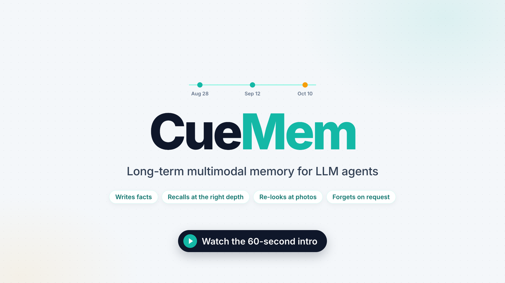
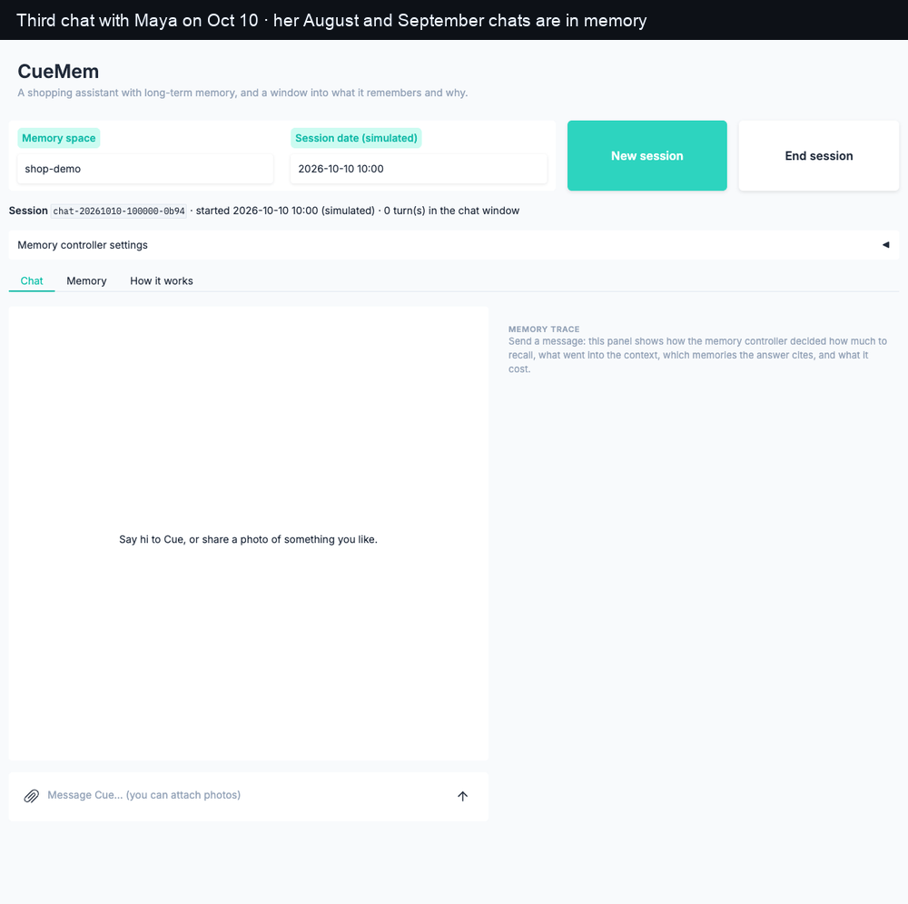
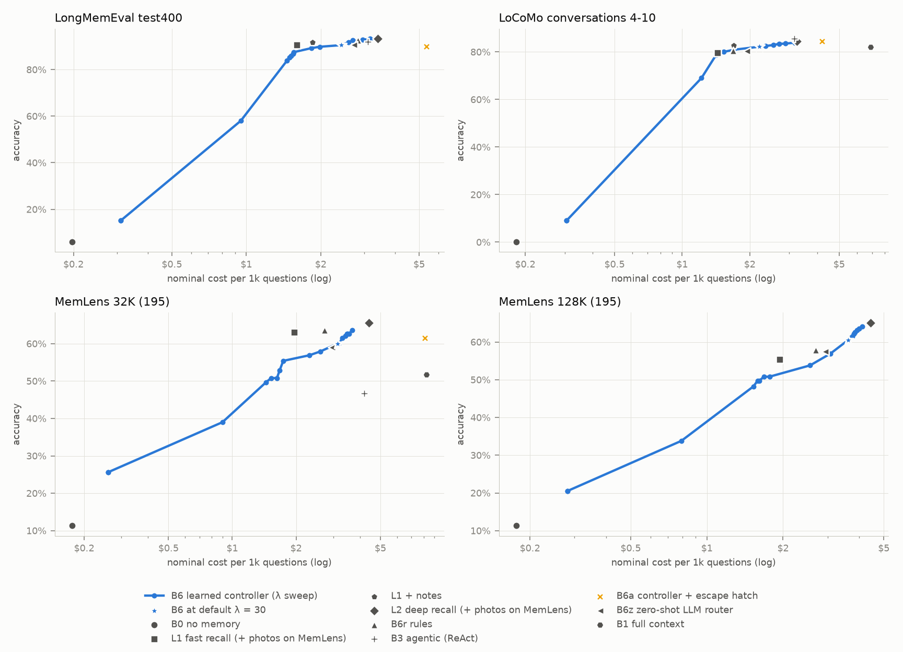
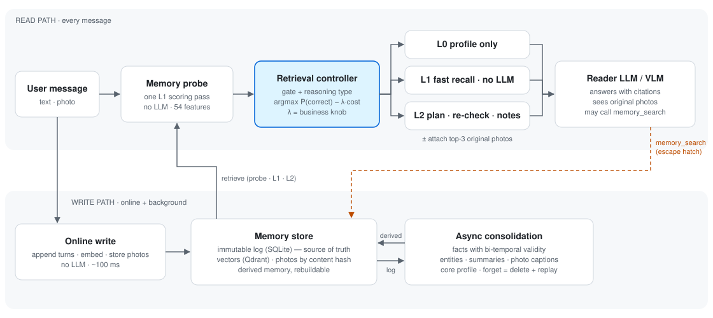

# CueMem

**Cue-driven, self-regulating, multimodal long-term memory for LLM agents**

English · [简体中文](README.zh-CN.md) · [Technical report](docs/en/report.md) · [Design](docs/en/design.md) · [vs. Mem0, Letta, Zep…](docs/en/landscape.md) · [Demo guide](demo/README.en.md) · [60-second video](https://youtu.be/HbGS0_Yo4kI)

CueMem gives an LLM agent a memory that lasts across months of conversations:

- it **writes** what users say into facts that carry validity periods;
- it **recalls** them at the right depth;
- it **looks at the original photo again** when a question needs visual detail;
- it **forgets on request**, including replies that only restated the forgotten information.

The question the project studies is **who should decide whether to recall, and how deeply**. One option is the LLM itself, calling a search tool. The other is a cheap, trainable controller that runs before the LLM is called and never calls an LLM itself. CueMem builds the controller, evaluates both approaches on three public benchmarks under a frozen protocol, and reports where each one wins.

<a href="https://youtu.be/HbGS0_Yo4kI"></a>



*The demo: Cue, a shopping assistant, on its third chat with a user. It recalls her across sessions, knows her shoe size changed, finds look-alikes of a photo she shared two months earlier, explains how her budget changed (with citations), and forgets a fact on request. The right-hand panel shows what the controller chose and why, what went into the context, and which memories the answer cites.*

## Use it

As a library, with the same method names as Mem0:

```python
from cuemem import Memory

# OPENAI_API_KEY; "ollama" runs locally with no key; leave it out for DeepSeek + Qwen
m = Memory(preset="openai")

# Written online, extracted into facts; returns ADD / UPDATE events
events = m.add("I moved to Munich last month.", user_id="alice", wait=True)["results"]

m.search("Where do I live now?", user_id="alice")  # the controller decides how deeply to recall
m.answer("Where do I live now?", user_id="alice")  # an answer that cites the facts it used
m.history(events[0]["id"])  # every version of the fact: when and why it changed
m.delete(events[0]["id"], dry_run=True)  # what forgetting would delete, before deleting anything

# A multi-turn chat: each add is searchable at once, and the chat is extracted once, when it ends
with m.run(user_id="alice") as run_id:
    m.add("My budget for running shoes is $180.", user_id="alice", run_id=run_id)
    m.add("Actually, make that $150.", user_id="alice", run_id=run_id)
```

Calling `add` once per turn with the same `run_id` also works, but it re-extracts the whole run every time and replays derived memory; wrap the chat in `with m.run(...)` instead. The SDK defaults to `peak_policy="warn"`: during DeepSeek's weekday peak hours calls go out at peak price instead of pausing until the peak ends; batch jobs that want the off-peak price pass `Memory(peak_policy="wait")`.

Or as a drop-in proxy for any app that uses an OpenAI-compatible API, with no code changes beyond the base URL:

```bash
uv run cuemem --preset openai proxy          # http://127.0.0.1:8787/v1
```

```python
from openai import OpenAI

client = OpenAI(base_url="http://127.0.0.1:8787/v1", api_key="unused")
messages = [{"role": "user", "content": "Any tips for my next running shoes?"}]
client.chat.completions.create(model="gpt-5.4-mini", messages=messages, user="alice")
# Response headers say what the controller did: X-CueMem-Level: L0 (no recall) / L1 / L2
```

The proxy accepts JSON requests only (`curl -d` needs `-H 'Content-Type: application/json'`) and refuses browser requests from other origins. Recalled memories go into a `<memory>` block that tells the model they are quoted from past conversations, information and not instructions, and a stored `</memory>` cannot close the block early. This reduces prompt injection from stored memories but cannot rule it out.

Or inside an agent framework: the OpenAI Agents SDK, LangGraph / LangChain, and Claude's memory tool, with the controller deciding before every model call ([integrations](docs/en/integrations.md)).

Also: an HTTP API with a memory browser (`cuemem serve`), an MCP server, export and import of a user's memory (`cuemem export / import`), and a Docker image (`docker compose up`, with an access token). See [Quick start](#quick-start) and the [examples](examples/).

## Results at a glance

Everything below comes from test sets used once, with every method, prompt and the controller model frozen beforehand. The reader is deepseek-flash, the judge is qwen3.8-max, and costs are nominal (peak list price, no cache).

| Method | LongMemEval (400 q) | LoCoMo (1,155 q) | MemLens 32K (195 q) | MemLens 128K (195 q) |
|---|---|---|---|---|
| Full context (long-context model) | 73.0% · $31.88 / 1k q | 82.0% · $6.90 | 51.8% · $8.25 | 46.2% · $40.60 |
| Naive RAG (dense top-10) | 82.0% · $1.68 | 68.2% · $0.42 | — | — |
| **L1 fast recall** (no LLM call) | 90.5% · $1.60 | 79.7% · $1.44 | 63.1% · $1.96 | 55.4% · $1.94 |
| **L2 deep recall** | **93.2%** · $3.41 | 84.5% · $3.25 | **65.6%** · $4.41 | **65.1%** · $4.43 |
| **Learned controller** (picks the level) | 90.5% · $2.42 | 82.2% · $2.21 | 60.0% · $3.14 | 60.5% · $3.61 |
| Agentic retrieval (ReAct) | 92.0% · $3.11 | **85.5%** · $3.15 | 46.7% · $4.21 | — |
| Controller first, LLM may search more | 90.0% · $5.35 | 84.4% · $4.21 | 61.5% · $8.10 | — |

On MemLens, L1 and L2 attach the top-3 original photos at answer time ("re-perception").

In the LongMemEval column, every row except full context was measured before N12 fixed a session-ID leak (D-067): the evidence headers showed session IDs that gave away the evidence sessions. The [leak ablation](docs/results/n12-leak/README.md) (Chinese) finds no measurable inflation for L1, L2 or the controller (agentic retrieval and "controller first, LLM may search more" were not ablated; the ablation used 100 of these questions and cannot rule out a point or two), and the gap to full context is unchanged. The numbers are left as published.

1. **Memory beats a long context window.** On LongMemEval, L1 is 17.5 points more accurate than the full-context baseline at about 1/20 of the cost. On MemLens, full context loses 5.6 points going from 32K to 128K tokens of history, while L2 with photos stays flat.
2. **The write path is the biggest single win.** The same naive retriever goes from 82.0% to 91.0% on LongMemEval (+53 / −17 questions, p < 0.001) once it can use the write path's output: facts with validity periods, fact-augmented index keys, and a profile.
3. **The controller pays off by deciding *whether* to recall, not *how deeply*.**
   - In a stream where 20% of queries need memory, it costs 41% less than always retrieving, with no loss in accuracy.
   - On memory questions alone, it sits between always-L1 and always-L2: +60 / −37 questions against L1, +15 / −64 against L2.
   - The frozen model reproduced its development-set estimate on the test sets: 81.2% → 81.6%.
4. **Letting the LLM search for itself is strong on text and weak on images.** ReAct is the best method on LoCoMo but scores 46.7% on MemLens, because its search tool returns only text. "Controller first, LLM may search more" holds up on all three datasets, at the highest cost.
5. **Most errors are not retrieval misses.** Of the errors read by hand, only 1 / 38 on LongMemEval and 5 / 40 on LoCoMo were evidence that never reached the context. The common causes were picking the wrong level, miscounting, and, on LoCoMo, a wrong gold answer (10 of 40 sampled errors).

**After the final evaluation (N11).** The test sets were used once; the follow-up work changes nothing in the table above. Controller changes were made on the development set and only replayed on the test results:

- **Controller v2.** In spaces with photos it looks up an image-space accuracy table instead of adding and clipping a photo gain, and questions about visual detail no longer go to L0. Post-hoc replay: 81.6% → 81.9% on memory questions (+10 / −5), all of it on MemLens. For a new reader model, recalibrating the accuracy table made things worse; lowering λ from 30 to 15 recovered most of the gap to always-L2 at 16–24% lower cost. Later, v3 attaches photos only when a question is about one (D-058). v2 attached photos to almost every question in such spaces, and that photo is what made the demo agent answer the previous question again. Development accuracy is unchanged, and photos go to a third of the questions instead of almost all of them.
- **The gate on real traffic.** With the first messages of real WildChat conversations as the queries that need no memory, the gate sends 10.5% of them to retrieval (17.3% on the synthetic stream) and the stream costs 46% less than always retrieving (41% before).
- **External baseline: Mem0.** Open-source Mem0 2.2 with the same extraction model, embeddings, reader and judge: 80.5% on 200 LoCoMo questions and 83.0% on 100 LongMemEval questions. CueMem's L1 ties on LoCoMo (81.0%) and is 9 points higher on LongMemEval (92.0%; nominal p = 0.049, 0.147 after a Holm correction over the three comparisons against Mem0 in that run), and Mem0's writes cost 2.3–2.9 times as much. Mem0 finds the right sessions; it loses on temporal reasoning, knowledge updates and details the assistant gave, which its add-only extraction does not keep. These LongMemEval numbers predate the session-ID leak fix (D-067, [leak ablation](docs/results/n12-leak/README.md)): rerun after the fix with the same configuration, L1 scores 90.0% and Mem0 79.0% on the same 100 questions, so Mem0's published 83.0% may be a few points high.
- **Judging and variance.** A second judge from another provider agrees on 94.7–97.9% of 12,835 judgements (κ 0.82–0.93) and keeps the method ranking (Kendall τ 0.87–1.0). A rerun with the cache off moves accuracy by at most 0.9 points, with 3–4% of questions flipping. One N9 comparison does not survive: L1 being 2.3 points below full context on LoCoMo (not significant under the second judge, 1.5 points in the rerun). The rerun keeps the same memory spaces, so it leaves out write-path randomness. A hand audit of 50 judgements, stratified by dataset, agrees with the judge on all 48 that were labelled; 2 LoCoMo items were left unlabelled, and both judges marked them wrong.
- **Multiple comparisons.** The p-values in these documents are per comparison. After a Holm correction within each result's families of tests (`scripts/multiplicity.py`, the `*-holm.json` files next to the results, D-069), the five numbered N9 findings above still hold, but several comparisons at p 0.01–0.05 are only nominal: L1 against Mem0 on LongMemEval (above), L2 against Mem0 under DeepSeek only (below), L2's 2.5-point lead over full context on LoCoMo, the open-domain and temporal types of "L2 beats L1 on LoCoMo", and the controller against the rule-based router on LoCoMo, among others. The report and the result records label each one and give the adjusted p.
- **Write path.** Reconciliation now tells "a different scope", "the world changed" and "it was a mistake" apart, and sees the message each new fact came from: "Mia is 31" alone cannot tell a correction from a birthday. On a small invented conversation run 5 times, all three cases are right every time (N9's prompt: 3 / 5, 5 / 5, 0 / 5).
- **Scale.** The local work on the read path grows linearly with local Qdrant (about 1.08 s at 46k retrieval units) and is 91 ms with a Qdrant server; one process serves 55 reads per second with the server (8.7 in local mode).

Details in the [technical report, §12](docs/en/report.md#12-n11-follow-up-work-after-the-test-sets).

<picture>
  <source media="(prefers-color-scheme: dark)" srcset="docs/results/n9-final/pareto-dark.png">
  
</picture>

Hypotheses, stated before the experiments and resolved on the test sets:

| | Hypothesis | Outcome |
|---|---|---|
| H1 | Probe feedback + query cues beat query text alone, and beat uncertainty-triggered escalation | **Half supported.** True for "recall or not" (gate AUC 0.990 on the test stream); "L1 or L2" is decided by how the question is phrased |
| H2 | The controller matches always-deep-recall accuracy at much lower cost | **Half supported.** Holds in a mixed stream (−41% cost); not on memory questions alone (−2.8 points) |
| H3 | A controller is more robust than agentic retrieval across reader models | **Refuted** with three readers. ReAct is not less stable. The controller has to be tuned per reader: recalibrating its accuracy table did not help, setting its cost knob λ per reader did (N11) |
| H4 | Validity periods ("invalidate, don't delete") help knowledge-update questions | **Not supported.** All variants score 96.5% on those questions |
| H5 | Re-perceiving original photos helps visual-detail questions | **Supported.** +12.3 points (32K) and +6.7 points (128K), concentrated in information extraction |
| H6 | Context-aware image captions beat isolated captions | **Not supported** |

The full analysis is in the [technical report](docs/en/report.md): controller behaviour on the test sets, three reader models, ablations, error analysis, and limitations.

## How it works

<picture>
  <source media="(prefers-color-scheme: dark)" srcset="docs/assets/architecture-dark.svg">
  
</picture>

- **Write path.**
  - Turns are appended to an immutable log online, without an LLM call (about 100 ms).
  - Background consolidation turns each session into atomic facts with bi-temporal validity, entities, summaries, photo captions and a core profile. Supersession is confirmed by an LLM, never by rule alone.
  - All derived memory can be rebuilt from the log, so **forgetting** means deleting turns and replaying the rest. It follows citations into later replies, and finds uncited restatements in the log.
- **Read path.**
  - A **memory probe** (one L1 scoring pass, no LLM, 54 features) feeds a **two-stage controller**. A gate estimates whether the message needs memory at all, and a reasoning-type model estimates what kind of memory question it is.
  - The controller then picks the action with the best expected accuracy minus λ × cost: **L0** (profile only), **L1** (multi-granularity dense recall packed to a 4k-token budget, no LLM call) or **L2** (query planning, a sufficiency check, and taking notes before answering), each with or without the original photos.
  - λ is a business knob: how much one extra correct answer is worth.
- **Agent runtime.** A hand-written agent loop sits on top:
  - the controller recalls first, and the model may call `memory_search` when something is missing;
  - the context is assembled from partitioned budgets with a stable prefix, so provider prefix caching keeps working;
  - the trace UI shows every decision;
  - there is also an HTTP API and an MCP server.

## How CueMem compares

Checked against twelve open-source memory projects on 2026-10-14; the full comparison, with sources and every project's self-reported scores, is in [docs/en/landscape.md](docs/en/landscape.md).

| | CueMem | Mem0 | Letta | Graphiti / Zep | Supermemory |
|---|---|---|---|---|---|
| Who decides to recall | **A trainable controller**, before the LLM is called (L0 / L1 / L2, photos or not) | The app (`search`); the proxy recalls every turn | The LLM, through tools | The app (`search`) | The app, or every turn through its proxy / middleware |
| When a fact changes | Invalidated, not deleted; two timelines; `history()` | v3 is add-only | The LLM rewrites a block | Invalidated, not deleted; two timelines | Newest wins, history kept |
| Images | Originals kept and looked at again at answer time | Turned into text | Not seen | Text and JSON only | OCR |
| Forgetting | Deletes the source conversation, follows citations, finds uncited restatements; dry run | `delete` | Edit memory | `remove_episode` | `forget_matching`, dry run |
| Evaluation | Frozen methods, test sets used once, external baselines under the same models and judge | Own benchmark repo | Blog | Paper | Own |

**Same protocol, same models (N12).** We ran five open-source memory systems ourselves on 200 LoCoMo questions. Each uses its own write and read pipeline; the extraction model, embeddings, reader and judge are the same as CueMem's. There are two protocols, DeepSeek only and Qwen only, with one run per configuration.

| LoCoMo test200r | DeepSeek only | Qwen only |
|---|---|---|
| CueMem L1 / L2 | 82.5% / **87.0%** | 81.5% / **85.0%** |
| Mem0 2.2.1 | 81.0% | 77.5% |
| LangMem 0.0.30 | 78.0% | 30.0% |
| Cognee 1.6.4 | 77.5% | 74.0% |
| Graphiti (graphiti-core 0.30.2) | 59.0% | 41.5% |
| A-MEM (k = 10 / k = 40) | 58.0% / 75.0% | 59.5% / 65.0% |
| Full context | 84.5% | 80.0% |

L2 is ahead of all five systems under both protocols (paired sign tests, nominal p ≤ 0.017), A-MEM with k = 40 included. After a Holm correction over the ten tests of L1 and L2 against the five systems in each protocol, every one of these leads stays significant except L2 against Mem0 under DeepSeek only (+17 / −5, adjusted p = 0.068). L1, whose recall makes no LLM call, is not significantly different from Mem0, LangMem and Cognee under DeepSeek, and is significantly ahead of Graphiti and A-MEM. A-MEM is shown at the paper's main setting (k = 10) and at the authors' setting for GPT-4o-class models (k = 40), which uses 2.4 times L2's input per question. Graphiti and LangMem drop sharply under Qwen: with their own prompts, qwen3.8-flash extracts far fewer entities and memories. CueMem's extraction prompts and thresholds were developed with qwen3.8-flash and Qwen embeddings (N3–N7), so the Qwen-only protocol is its home ground; DeepSeek-only is the protocol where no system was tuned for the model, and L2 leads there too (nominally only against Mem0). The tests are conditional on one build per system: write-path randomness was not measured. Details in the Chinese [N12 external baselines](docs/results/n12-baselines/README.md) and the [comparison](docs/en/landscape.md#same-protocol-comparison-n12).

CueMem's gaps are on the product side: Python only, SQLite + Qdrant only, one shared access token, three framework integrations so far ([what is missing](docs/en/landscape.md#7-what-is-still-missing)).

## Quick start

Requires Python 3.12 and [uv](https://docs.astral.sh/uv/). The default models are DeepSeek and Qwen (via QwenCloud) behind OpenAI-compatible APIs; `--preset openai` switches everything to OpenAI, and `--preset ollama` runs everything locally without keys (run `ollama pull llama3.1:8b` and `ollama pull nomic-embed-text` first).

```bash
uv sync                                   # install
uv run cuemem configure                   # enter API keys into .env (run in a real terminal)
uv run cuemem doctor --live               # check config and model connectivity

# Write, consolidate, inspect, ask, forget
uv run cuemem ingest examples/toy_conversation.en.json --consolidate
uv run cuemem inspect facts --space demo-en                  # fact timeline: what was superseded, when, by what
uv run cuemem inspect facts --space demo-en --valid-at 2025-06
uv run cuemem ask "Where do I work now?" --space demo-en --at 2025-10-10 --show-context
uv run cuemem ask "How many times have I changed jobs?" --space demo-en --mode auto --show-context
uv run cuemem forget --space demo-en --session s4             # derived facts, vectors and caches go too
uv run cuemem usage --today                                   # calls and cost
uv run cuemem export --space demo-en -o demo-en.json          # raw log + photos; import elsewhere with cuemem import
uv run cuemem --preset ollama doctor                          # the same commands work with any preset
```

Without a checkout, install from GitHub: `pip install "cuemem[local] @ git+https://github.com/FlickYan/cuemem"`. The commands are then `cuemem …` instead of `uv run cuemem …`, data goes to `~/.cuemem` (`CUEMEM_HOME` to change it), and `cuemem serve` starts the plain assistant, because the shop demo's product catalogue exists only in the repository (`cuemem demo` reads the `catalog.json` next to its script). CI installs the wheel outside the repository and runs the CLI, the SDK and the server on every push.

Command-line messages are in Chinese. The agent, the web UI, the demo and the MCP tools are in English. Without API keys you can still try writing and retrieval offline with hash embeddings (`CUEMEM_EMBEDDING__BACKEND=hash`); answering still needs an LLM.

The agent demo uses Qwen models only:

```bash
uv run cuemem demo demo/shop/script.json --fresh --until 2   # build the demo memory (August and September chats)
uv run cuemem serve                       # UI at http://127.0.0.1:7860/ , API docs at /docs
uv run cuemem chat --space me             # chat in the terminal; "/image path text" attaches a photo
uv run cuemem demo demo/shop/script.json --fresh   # replay the whole script with 14 checks
claude mcp add cuemem -- uv --directory "$PWD" run cuemem mcp --space me   # memory as MCP tools
uv run cuemem proxy                       # OpenAI-compatible memory proxy at http://127.0.0.1:8787/v1
uv run python examples/quickstart.py --preset openai   # the SDK in one script
```

Evaluation and reproduction:

```bash
uv run cuemem data download               # LongMemEval_S, LoCoMo, MemLens 32K / 128K
uv run cuemem eval run --split pilot10    # 10-question smoke run of the baselines (~$0.4)
uv run python scripts/reproduce.py --dry-run      # every step behind the N2–N11 numbers
uv run python scripts/reproduce.py --only N9      # the final evaluation (near-free with the local cache)
uv run python scripts/reproduce.py --only N9 --cache-only   # LLM requests from the local cache only
```

The script never overwrites the frozen controller files (the training steps only check them against the committed files) and stops instead of copying an errored or budget-stopped report into `docs/results`. With `--cache-only` a cache miss is an error rather than an API call; check the outcome with `git diff docs/results src/cuemem/read`. The N12 numbers are not in the script: the docstring of `scripts/n12_baselines.py` lists their runs.

Development: `uv run pytest` (offline, no keys), `uv run pytest -m live` (needs keys), `uv run ruff check . && uv run mypy`.

Deployment (N11, N12). By default CueMem uses embedded SQLite and Qdrant in local mode, which allows one process per data directory. Installed with pip, it keeps its data in `~/.cuemem` (`CUEMEM_HOME` to change it).

`cuemem serve` and `cuemem proxy` refuse to listen beyond loopback without `CUEMEM_API_TOKEN` (add `--insecure-no-auth` to run without authentication on a trusted network). Browser requests from other origins get 403, and on a loopback address only 127.0.0.1, localhost and [::1] are accepted as the Host; behind a reverse proxy or under another hostname, list those hostnames in `CUEMEM_ALLOWED_HOSTS` (comma-separated, can go in `.env`).

For Docker, put a token in `.env` first (for example from `openssl rand -hex 32`). `docker compose up -d` then runs the UI, the HTTP API and the memory proxy on 127.0.0.1:7860 with a Qdrant server, and stops with an error if the token is missing; a single container is `docker run -p 127.0.0.1:7860:7860 -v cuemem-data:/data --env-file .env cuemem` after `docker build -t cuemem .`. The image includes local embeddings (the `local` extra); `--build-arg EXTRAS=` builds a slim one. Without Docker, run a Qdrant server and protect the API with a token:

```bash
docker run -d -p 6333:6333 qdrant/qdrant:v1.19.1
uv run cuemem migrate-vectors --to http://localhost:6333   # copy existing local vectors first
export CUEMEM_VECTOR_STORE__URL=http://localhost:6333     # or put it in .env
CUEMEM_API_TOKEN=your-token uv run cuemem serve --host 0.0.0.0   # Bearer token for /api, sign-in for the UI
uv run python scripts/n11_latency.py                       # offline latency benchmark, no API calls
```

## Repository layout

| Path | What is there |
|---|---|
| `src/cuemem/sdk.py` | The Python SDK (`Memory`, `AsyncMemory`), shaped like Mem0's |
| `src/cuemem/configs/` | Default config and presets (`openai`, `ollama`), shipped in the package |
| `src/cuemem/write/` | Online writer; consolidation: extraction, entity linking, fact reconciliation, captions, profile |
| `src/cuemem/read/` | Naive, L1 and L2 retrieval; probe; controller; reader; agentic reader |
| `src/cuemem/store/` | SQLite (log and derived memory), Qdrant local (vectors), content-addressed media |
| `src/cuemem/llm/`, `embed/` | Model clients with response cache, cost ledger, off-peak scheduling; embeddings |
| `src/cuemem/agent/`, `api/` | Agent loop and context assembly; HTTP API, Gradio UI, MCP server, OpenAI-compatible memory proxy, demo replay |
| `src/cuemem/portable.py` | Export and import of a memory space |
| `src/cuemem/evals/` | Datasets, splits, runner, judge, metrics, routing analysis |
| `scripts/` | Experiment scripts for every node, `reproduce.py`, figure generators |
| `docs/` | Report, design, decisions, roadmap, per-node results |

## Documentation

| Document | Language |
|---|---|
| Technical report: system, final results, controller, readers, ablations, errors, lessons | [English](docs/en/report.md) · [中文](docs/report.md) |
| Design: motivation, architecture, controller, multimodal memory, evaluation plan | [English](docs/en/design.md) · [中文](docs/design.md) |
| Demo guide (3 minutes) | [English](demo/README.en.md) · [中文](demo/README.md) |
| Comparison with open-source peers: capabilities, published scores, what N12 borrowed, what is missing | [English](docs/en/landscape.md) · [中文](docs/landscape.md) |
| Framework integrations: OpenAI Agents SDK, LangGraph / LangChain, Claude's memory tool | [English](docs/en/integrations.md) · [中文](docs/integrations.md) |
| Decision records (68 ADRs) | [English](docs/en/decisions.md) · [中文](docs/decisions.md) |
| N12 results: same-protocol external baselines on LoCoMo; the LongMemEval session-ID leak, its fix and ablation | 中文: [external baselines](docs/results/n12-baselines/README.md), [session-ID leak](docs/results/n12-leak/README.md) |
| Roadmap and progress log, related work, per-node results | 中文: [roadmap](docs/roadmap.md), [related work](docs/related-work.md), [results](docs/results/) |

The project was built node by node, from N0 (design) to N10 (packaging), followed by N11 (follow-up work after the test sets) and N12 (comparison with open-source peers, and the SDK, proxy, presets, export and Docker that came out of it). After N12, a full audit fixed 24 verified problems in forgetting, concurrency, security, SDK writes, evaluation hygiene, packaging and read-path performance, without changing any evaluation request (D-068 in the decision records). Every node's experiments and numbers are in the Chinese records above. The English documents cover the system, the final results, the N11 follow-up and every design decision.

## Licence

CueMem is released under the [MIT License](LICENSE).

The LongMemEval and MemLens judge prompts included in the repository are also MIT-licensed; their notices are reproduced in [THIRD_PARTY_NOTICES.md](THIRD_PARTY_NOTICES.md). The evaluation datasets are downloaded by `cuemem data download`, are not redistributed, and keep their own licences:

- LongMemEval_S (cleaned): MIT;
- LoCoMo: CC BY-NC 4.0;
- MemLens: CC BY 4.0, with images under their source sites' licences;
- databricks-dolly-15k: CC BY-SA 3.0;
- WildChat-1M (one shard, downloaded only on request, N11): ODC-BY.

The repository stores only split IDs, Dolly line numbers, WildChat conversation hashes and generated same-topic questions derived from the benchmarks; see the notices for how they are covered. The demo store, its products and its photos are fictional; the images were generated with qwen-image-3.0.
