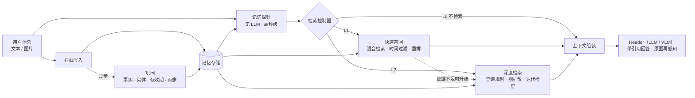

# CueMem

**线索驱动、可自我调控的多模态 Agent 长期记忆系统**
*Cue-driven, metacognitive, multimodal long-term memory for LLM agents*

> 进行中：N5 L2 深度检索已完成（查询规划、补检索、先记笔记再回答；规则版控制器与模型自主检索两条基线），下一步是 N6 多模态记忆。进度见下方表格与 [路线图](docs/roadmap.md)。

## 它要解决什么

让 LLM Agent 在跨越数月、上百个会话的交互中**记得住、想得起、记得准**，而且这种能力来自记忆系统本身，不依赖"模型足够聪明"。

- **记得住**：写入时把对话整理成带有效期的事实、实体图和多粒度索引。原始日志不可变，派生记忆可重建、可溯源。
- **想得起**：由一个**解耦、可训练、可度量的检索控制器**决定这一轮要不要想起、想多深（L0 不检索 / L1 快速召回 / L2 深度检索），证据不足时自动升级。
- **记得准**：信息更新时旧事实失效但保留历史；图片在索引时压缩成描述和向量，回答时取回原图再看一眼。

## 为什么不只是把上下文做得更长

上下文窗口还会继续变大，但下面这些问题不会因此消失。它们是**信息管理**问题，不是**容量**问题。

| 问题 | 只靠长上下文 | 记忆系统的做法 |
|---|---|---|
| 成本与延迟 | 每轮重读全部历史 | 只取需要的部分，按需加深检索 |
| 有效上下文远小于名义长度 | 越长越容易漏看、误用（lost in the middle、context rot） | 只把相关证据放进上下文 |
| 知识过期 | 新旧说法并存，靠模型临场判断 | 写入时显式失效，同时保留历史版本 |
| 跨会话、跨设备 | 会话结束即消失 | 持久存储，可共享 |
| 隐私与可控 | 无法查看、修改、删除 | 每条记忆可查看、可删除、可溯源 |
| 多模态 | 图片和视频 token 昂贵，无法常驻 | 压缩索引 + 回答时再感知 |

## 架构



## 快速开始

需要 Python 3.12 与 [uv](https://docs.astral.sh/uv/)。模型使用 DeepSeek 与通义千问的 API（OpenAI 兼容接口；通义经 QwenCloud 接入）。

```bash
uv sync                                  # 安装依赖，创建 .venv
uv run cuemem configure                  # 交互式填写 API Key，写入 .env（需在真实终端里运行）
uv run cuemem doctor --live              # 检查配置与各模型的连通性
uv run cuemem ingest examples/toy_conversation.json --consolidate   # 写入并巩固：抽取事实、实体、摘要
uv run cuemem inspect facts --space demo     # 事实时间线：哪些已被取代、何时、被谁取代
uv run cuemem inspect facts --space demo --valid-at 2025-06   # 2025 年 6 月时现实中成立的事实
uv run cuemem ask "我现在在哪里工作？" --space demo --at 2025-10-10 --show-context
uv run cuemem forget --space demo --session s4   # 遗忘一段会话：派生的事实、向量、缓存一并清除
uv run cuemem usage --today              # 调用量与成本（名义成本 / 估算花费）
uv run cuemem data download              # 下载评测数据集（LongMemEval_S、LoCoMo）
uv run cuemem eval run --split pilot10   # 10 题试跑全部基线（约 $0.4）；dev100 为正式开发集
```

没有 Key 时也可以离线体验写入与检索，向量改用哈希近似：在命令前加 `CUEMEM_EMBEDDING__BACKEND=hash`，回答仍然需要 LLM。

开发：

```bash
uv run pytest                            # 离线单元测试，不需要 Key
uv run pytest -m live                    # 联网冒烟测试，需要 Key，费用极低
uv run ruff check . && uv run mypy       # 代码风格与类型检查
```

## 文档

| 文档 | 内容 |
|---|---|
| [设计文档](docs/design.md) | 动机、架构、检索控制器、多模态、评测方案、技术选型 |
| [路线图](docs/roadmap.md) | 实施节点、验收标准、进度 |
| [相关工作](docs/related-work.md) | 与 MemGPT、Mem0、Zep、HippoRAG、Adaptive-RAG、MemLens 等的对比与定位 |
| [设计决策记录](docs/decisions.md) | 每个重要取舍的背景、备选方案与理由 |

## 进度

| 节点 | 内容 | 状态 |
|---|---|---|
| N0 | 项目定位与总体设计 | 已完成 |
| N1 | 工程骨架与基础设施 | 已完成 |
| N2 | 评测框架与基线 | 已完成 |
| N3 | 写入路径：结构化、带有效期的记忆 | 已完成 |
| N4 | L1 快速召回 | 已完成 |
| N5 | L2 深度检索 | 已完成 |
| N6 | 多模态记忆 | 下一步 |
| N7 | 检索控制器（核心） | 未开始 |
| N8 | Agent Runtime 与 Demo | 未开始 |
| N9 | 完整评测与分析 | 未开始 |
| N10 | 包装 | 未开始 |

## 结果

主线是统一评测框架下的**准确率–成本帕累托曲线**。所有方法共用同一个回答模型（deepseek-flash）与同一个判分模型（qwen3.8-max，LongMemEval 官方判分模板）。

### N5 L2 深度检索与规则版控制器：LongMemEval_S 开发集（100 题）+ LoCoMo（385 题）

L2（B5）在 L1 的打分之上多花 2–4 次便宜模型（qwen3.8-flash）调用：

- **查询规划**：把问题拆成子查询，换算时间区间，判断是否要"找全"；
- **多查询召回**：各子查询的结果按"取最好名次"融合；
- **充分性检查**：证据不够就补检索，最多 2 次；
- **笔记式阅读**：reader 先逐条记笔记再回答，计数题逐项列出、去重再数。

规则版控制器（B6r）只看问题线索：问计数、时长、先后、比较的走 L2，其余走 L1。B3 让 reader 带 `memory_search` 工具自己决定检索。

| 方法 | dev100 准确率（95% 置信区间） | 多会话 / 时间推理 | LLM 调用 / 题 | 每题名义成本 | LoCoMo 准确率 |
|---|---|---|---|---|---|
| B4 L1（N4 定稿，带 BM25） | 83%（75–90） | 54% / 80% | 1.00 | $0.0016 | 84.9% |
| L1（N5 起的默认，不用 BM25） | 81%（73–89） | 58% / 72% | 1.00 | $0.0016 | 86.2% |
| L1 + 先记笔记再回答（对照） | 86%（79–93） | 62% / 84% | 1.00 | $0.0019 | 88.6% |
| **B5 L2 深度检索** | **89%（83–95）** | **79% / 84%** | 3.25 | $0.0034 | **89.1%** |
| **B6r 规则版控制器** | **88%（81–94）** | 79% / 80% | 2.45 | $0.0028 | 86.0% |
| B3 模型自主检索（ReAct） | 86%（79–92） | 62% / 84% | 2.59 | $0.0033 | — |
| ORACLE 只给证据会话（上限参照） | 83%（75–90） | 67% / 72% | 1.00 | $0.0021 | 87.5% |

<picture>
  <source media="(prefers-color-scheme: dark)" srcset="docs/results/n5-dev100-l2/pareto-dark.png">
  
</picture>

1. **两个数据集上 L2 都最高，但对 L1 的优势只在一处显著**：dev100 上 B5 对 B4 +10 / −4（p = 0.18），对当前 L1 +11 / −3（p = 0.057），多会话题 54% → 79%（+8 / −2，p = 0.11）。LoCoMo（没有参与任何调参）上对 B4 +27 / −11（**p = 0.014**），对当前 L1 +21 / −10（p = 0.071），多跳 80% → 88%，时间 88% → 93%。路线图的验收（分题型显著提升）**没有完全达到**：方向一致，但每类只有几十题。
2. **最大的杠杆是阅读方式，不是检索**：同样的 L2 证据，不记笔记 dev100 只有 81%（−8，p = 0.077）；L1 的证据加上笔记就有 86%（LoCoMo 88.6%，只比 L2 少 2 题）。"ORACLE 也答错"的阅读类错题从 B4 的 11 题降到 6 题。
3. **检索上起作用的是补检索**（去掉后 −4，+4 / −0），约四分之一的题会触发。查询规划在纯检索上让多会话题召回 +10 个点，端到端只差 1 题：没有规划时，充分性检查自己会提出补充查询。
4. **规则版控制器在 dev100 上有效，换到 LoCoMo 就失灵**：dev100 上 62% 的题走 L2，88%，比 always-L2 便宜 18%、只少 1 题，对 L1 +8 / −1（p = 0.039）；LoCoMo 的问法里很少有"几次、多久、哪个先"这类词，只有 8% 的题走 L2，结果等于 L1。事后选"最便宜且答对的一档"的理想路由在两个数据集上都约 92%、成本接近 L1：这是 N7 可学习控制器要追的空间。
5. **被数据否掉的组件**：
   - 图扩散（个性化 PageRank）：对话抽取出的实体图是"用户连着 95% 的事实"的星形图，补了提及边与相似事实边，dev100 召回仍在 ±0.5 个点内；LoCoMo 上多答对 4 题（不显著），留到 N9 复测（[D-031](docs/decisions.md)）；
   - 重排（qwen3-rerank）：只提高预算内部的排序、不提高预算内的召回，成本是规划的 10 倍（[D-032](docs/decisions.md)）；
   - BM25：qwen3.7 下在各种预算下都不提高召回，L1、L2 默认去掉；B4 保持 N4 的配置评测（[D-026](docs/decisions.md) 修订）。
6. **多查询融合不能用 RRF**：名次分求和奖励"几个查询都排中游"的轮，多查询完全没有收益；改成每条取最好名次后，多会话题召回 76.8% → 87.6%（[D-030](docs/decisions.md)）。

配对比较、纯检索调参、消融与各组件的数据见 [docs/results/n5-dev100-l2/README.md](docs/results/n5-dev100-l2/README.md)；完整报告见 [dev100](docs/results/n5-dev100-l2/report.md) 与 [LoCoMo](docs/results/n5-locomo-3conv/report.md)。N5 合计花费约 $4.6（计入错峰折扣），DeepSeek 调用全部在非高峰时段。

### N4 L1 快速召回：LongMemEval_S 开发集（100 题）+ LoCoMo（385 题）

L1（B4）除了一次查询向量化之外不调用模型。轮、事实、会话摘要各走 dense 与 BM25 两路召回；模态内按分数取最大，模态间用 RRF 融合；按问题里的时间表达加分。上下文按 token 预算（4k）装入，每条证据标注"距提问几天"。本节点把向量模型换成了 qwen3.7-text-embedding（[D-014](docs/decisions.md)），下表都是新向量模型下的数字，所以 B2 与 N2、N3 时不同。

| 方法 | dev100 准确率（95% 置信区间） | 平均轮数 | 平均输入 tokens | 每题名义成本 | LoCoMo 准确率 |
|---|---|---|---|---|---|
| B1 全上下文 | 72%（63–81） | 全部 | 105,262 | $0.0317 | — |
| B2 朴素检索 | 76%（67–84） | 10 | 5,250 | $0.0017 | 75.6% |
| B2F 朴素检索 + 事实记忆（N3） | 80%（72–87） | 10 | 6,372 | $0.0020 | 78.7% |
| **B4 L1 快速召回** | **83%（75–90）** | 8.2 | **4,973** | **$0.0016** | **84.9%** |
| ORACLE 只给证据会话（上限参照） | 83%（75–90） | — | 6,645 | $0.0021 | 87.5% |

<picture>
  <source media="(prefers-color-scheme: dark)" srcset="docs/results/n4-dev100-l1/pareto-dark.png">
  
</picture>

1. **dev100 上追平 ORACLE，花费是检索类方法里最低的**：B4 每题输入比 B2 少 5%、比 B2F 少 22%。dev100 已接近饱和，B4 对 B2（+9 / −2，p = 0.065）、对 B2F（+6 / −3）都不显著。
2. **LoCoMo 上显著领先**（385 题；按预算打包这一项是看过 LoCoMo 的结果后加的，见 D-029，其余参数只在 dev100 上调）：B4 84.9%，对 B2F 配对 +37 / −13（p = 0.001），对 B2 +56 / −20（p < 0.001）；与 ORACLE 87.5% 的差异不显著。多跳题 B2F 62% → B4 81%。
3. **最大的杠杆是按 token 预算打包**（[D-029](docs/decisions.md)）。两个数据集里一"轮"的长度差约 12 倍：LongMemEval 一轮约 490 tokens，4k 预算装 8 轮左右；LoCoMo 一轮只有一句话（约 40 tokens），按预算会装满 40 轮的上限。固定取 10 轮时，LoCoMo 只有 77.1%（对 B4 −30 题，p < 0.001）。
4. **换向量模型的收益超过所有检索技巧**：同一份代码只换向量模型，B2 在 dev100 上 65% → 76%，在 LoCoMo 上 71.2% → 75.6%。N1 选型时只看了速度，没有量化语义召回（[D-014](docs/decisions.md)）。
5. **被数据推翻或没被证实的直觉**：
   - 把各路结果全部做 RRF 会让排序变差："助手说过"类题 NDCG 96% → 52%，因为 RRF 丢掉了分数大小（[D-025](docs/decisions.md)）。
   - BM25 在 text-embedding-v4 时代有用；换成 qwen3.7 后，纯检索 NDCG 反而低 3.5 个点，端到端在两个数据集上都不显著（[D-026](docs/decisions.md)；N5 复议后 L1、L2 默认去掉）。
   - dev100 里只有 12 道题带可解析的时间表达，时间区间加分没有可测的效果。"距提问几天"的标注在 dev100 上多答对 4 题，不显著（[D-027](docs/decisions.md)）。
6. **延迟**：L1 检索 p50 99 ms、p95 132 ms，含一次不走缓存的查询向量化（约 80 ms）。本地检索与融合约 20 ms。目标是 p95 ≤ 300 ms。

配对比较、纯检索指标、延迟拆分与向量模型对比见 [docs/results/n4-dev100-l1/README.md](docs/results/n4-dev100-l1/README.md)；完整报告见 [dev100](docs/results/n4-dev100-l1/report.md) 与 [LoCoMo](docs/results/n4-locomo-3conv/report.md)。N4 合计花费约 $2.9（计入错峰折扣），DeepSeek 调用全部避开了高峰时段（[D-024](docs/decisions.md)）。

### N3 写入路径：LongMemEval_S 开发集（100 题）

本节数字使用 N1 选的向量模型 text-embedding-v4。B2F 的检索算法与 B2 完全相同（dense top-10），区别只在用上了写入路径的产出：事实增强键、带有效期的事实、核心记忆（[D-023](docs/decisions.md)）。这样提升只可能来自写入路径。

| 方法 | 准确率（95% 置信区间） | 平均输入 tokens | 每题名义成本 |
|---|---|---|---|
| B1 全上下文 | 72%（63–81） | 105,262 | $0.0317 |
| B2 朴素检索 | 65%（55–74） | 4,830 | $0.0015 |
| **B2F 朴素检索 + 事实记忆** | **80%（72–88）** | 6,280 | $0.0020 |
| ORACLE 只给证据会话（上限参照） | 83%（75–90） | 6,645 | $0.0021 |

<picture>
  <source media="(prefers-color-scheme: dark)" srcset="docs/results/n3-dev100-facts/pareto-dark.png">
  
</picture>

1. **写入路径让朴素检索接近上限**：同一批题上，B2F 答对而 B2 答错的有 18 题，反过来只有 3 题（配对符号检验 p = 0.001）；与只给证据会话的 ORACLE 没有显著差异。每题回答成本约为全上下文的 1/16。
2. **提升主要来自检索**：发言召回 87% → 96%，NDCG 58% → 80%，"检索未命中"的错题从 12 道降到 2 道。只用事实增强键、不把事实放进上下文的消融已经达到 78%。
3. **分题型**：时间推理 48% → 72%（增强键带到 64%，再加上带绝对日期的事实到 72%）；知识更新 80% → 100%；偏好题 50% → 83%（主要来自核心记忆）。
4. **一个被数据推翻的设计**：首轮里登记过的单值谓词（住址、工作）按规则直接取代。抽样核对发现精确率只有约 10%：抽取模型的谓词标签不稳定。错误的"已失效"标签还让 2 道知识更新题答错。改为由 LLM 确认后，知识更新题全部答对（[D-019](docs/decisions.md)）。
5. **局限**：四个消融与完整版的差异都不显著（n = 100），"有效期标注本身是否有帮助"（H4）在这个开发集上还说不清。多会话计数题上，完整版（50%）反而不如只用增强键（62%）：上下文里的事实只是部分清单，偶尔还带着抽取时算错的日期，reader 却过于相信它们（留给 N5 的计数工具与溯源校验）。
6. **写入成本**：每千条发言约 25.7 万输入 / 7.6 万输出 tokens，名义成本 $0.074（加上轮次向量化共约 $0.087）。LongMemEval 每份历史只问一道题，写入成本摊不薄：按题算总账，B2F 约 $0.045，反而高于全上下文的 $0.032。真实场景中一份记忆会被反复提问，写入是一次性成本（见下面的 LoCoMo）。

**跨数据集检查：LoCoMo 前 3 段对话（385 题，不含对抗题）**。没有在 LoCoMo 上调过任何参数。B2 71.2% → **B2F 77.7%**（配对符号检验 +42 / −17，p = 0.002），ORACLE 87.5%。多跳题提升最大（42% → 61%），时间题持平（88%）。token F1 从 0.196 升到 0.238。这里一段对话平均被问约 128 次，巩固成本摊到每题约 $0.0002，B2F 每题总成本约 $0.0008。完整报告见 [docs/results/n3-locomo-3conv/report.md](docs/results/n3-locomo-3conv/report.md)。

完整报告见 [docs/results/n3-dev100-facts/report.md](docs/results/n3-dev100-facts/report.md)，抽取模型对比见 [extractor-comparison.md](docs/results/n3-dev100-facts/extractor-comparison.md)。复现：`uv run cuemem eval run --split dev100 --methods B2,B2F --name dev100-n3`。首次约 40 分钟、约 $4，主要花在抽取上；缓存命中后几分钟即可跑完。

在示例对话上（`examples/toy_conversation.json`，真实模型）：

```text
$ cuemem ask "我现在在哪工作？" --space demo --at 2025-10-10
你现在在新加坡的一家电商公司工作，担任AI产品经理（2025年8月跳槽过去的）。
$ cuemem ask "我换工作之前是做什么的？" --space demo --at 2025-10-10
换工作之前，你在北京一家互联网公司做产品经理，当时在做短视频推荐相关的功能项目。
$ cuemem forget --space demo --session s4 --yes     # 遗忘"跳槽到新加坡"那段对话
已删除 4 条轮次（会话 s4）；事实 19 → 14 条（已按剩余日志重建）；清理向量缓存 10 条、LLM 缓存 3 条
$ cuemem ask "我现在在哪工作？" --space demo --at 2025-10-10
你在北京一家互联网公司工作，职位是产品经理。
```

N1 冒烟测试里答错的"我第一次提到想去旅行是什么时候"，现在也答对了：抽出的事实"用户计划在 2025 年底去巴厘岛旅行"作为检索键，把原对话带了出来。

### N2 基线：LongMemEval_S 开发集（100 题）

向量模型为 text-embedding-v4。

| 方法 | 准确率（95% 置信区间） | 平均输入 tokens | 每题名义成本 |
|---|---|---|---|
| B0 无记忆 | 6%（2–11） | 458 | $0.0002 |
| B1 全上下文 | 72%（63–81） | 105,262 | $0.0317 |
| B2 朴素检索（dense top-10） | 65%（55–74） | 4,830 | $0.0016 |
| ORACLE 只给证据会话（上限参照） | 83%（75–90） | 6,645 | $0.0021 |

<picture>
  <source media="(prefers-color-scheme: dark)" srcset="docs/results/n2-dev100-baselines/pareto-dark.png">
  
</picture>

三点观察：

1. **长上下文不等于记忆**：B1 能看到全部信息，却比只看证据的 ORACLE 低 11 个百分点（置信区间部分重叠）：关键信息被淹没在约 10 万 tokens 里。
2. **检索很划算，但还不够好**：朴素检索只用 B1 约 1/20 的成本，准确率 65% 对 72%（置信区间重叠）。
3. **错误主要出在检索**：B2 答错的 35 道题里，12 道检索没命中证据，14 道命中了但证据不全或干扰多（ORACLE 能答对），只有 9 道是连 ORACLE 也答错的阅读推理问题。这正是 N3–N5 的改进空间。

完整报告见 [docs/results/n2-dev100-baselines/report.md](docs/results/n2-dev100-baselines/report.md)。复现：`uv run cuemem eval run --split dev100 --name dev100-baselines`，约 15 分钟、约 $4（缓存命中后重跑几乎免费）。

置信区间在 N3 改为按题目 ID 排序后再做 bootstrap（与运行顺序无关），与最初发布的数字相比有 ±1 个百分点的变化。
