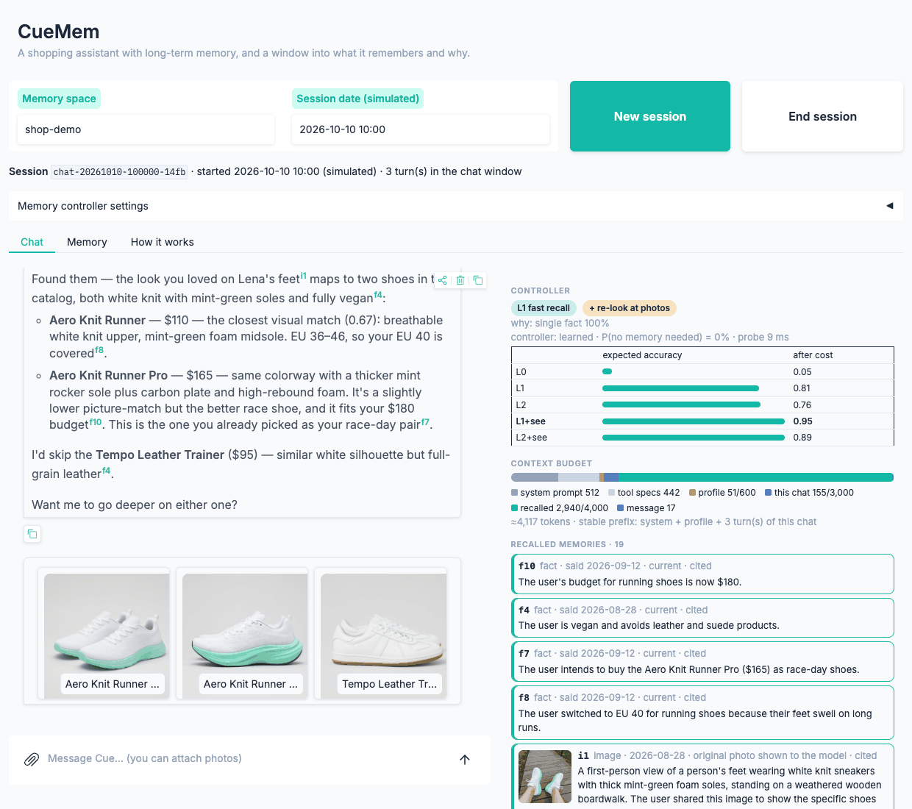
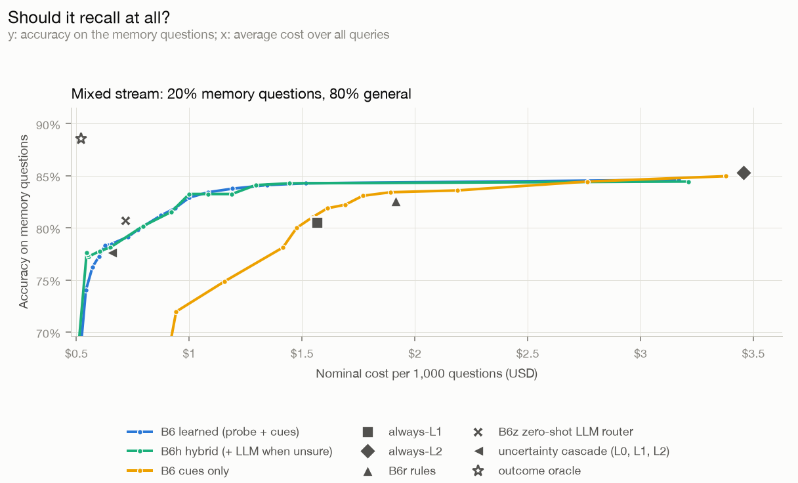
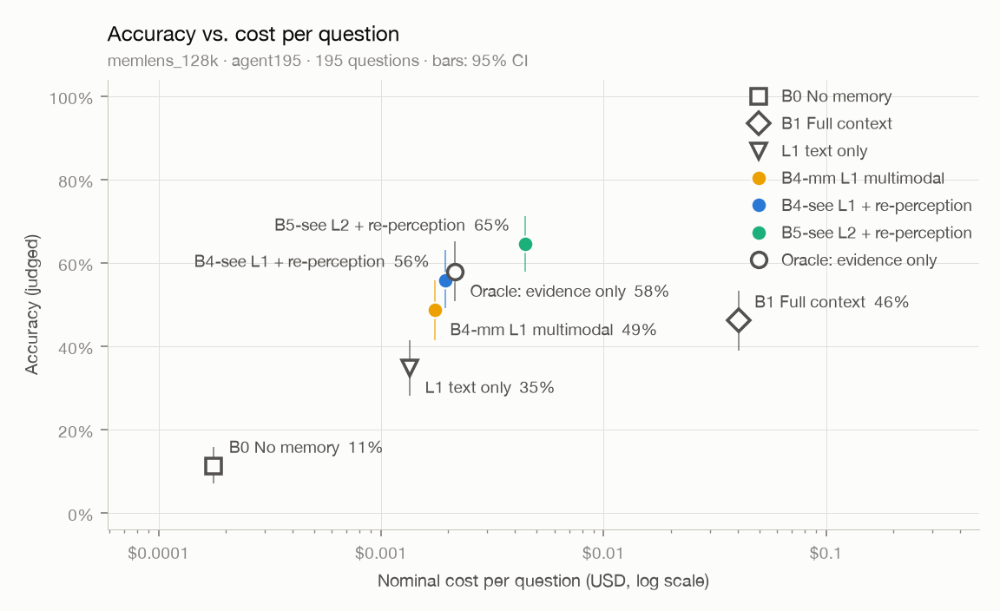
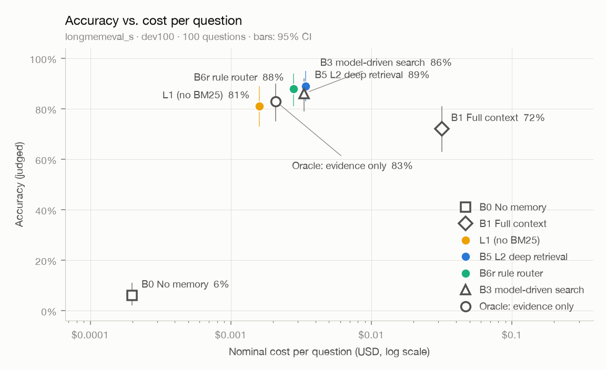
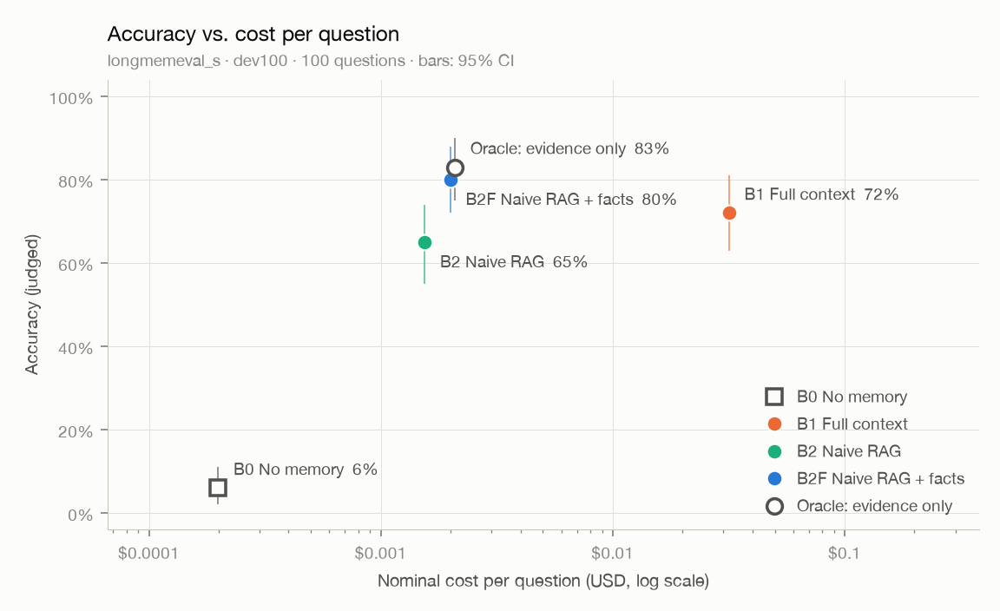
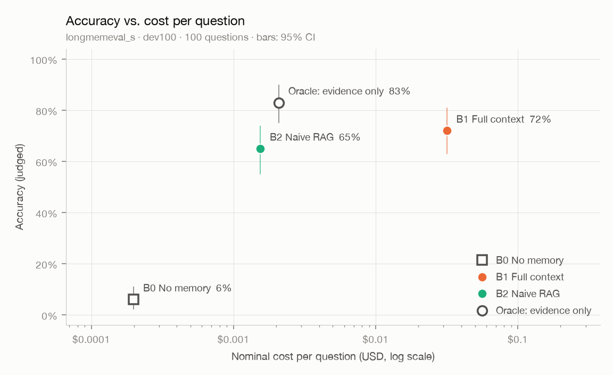

# CueMem

**线索驱动、可自我调控的多模态 Agent 长期记忆系统**
*Cue-driven, metacognitive, multimodal long-term memory for LLM agents*

[English](README.md) · 简体中文 · [技术报告](docs/report.md) · [设计文档](docs/design.md) · [演示指南](demo/README.md) · [60 秒介绍视频](https://youtu.be/XbGL0nc12-I)

> N0–N11 已完成（N11 是测试集之后的补做：控制器 v2、外部基线 Mem0、第二判分与重复运行、真实流量上的门控检验、延迟基准与部署）。测试集上的最终评测见[技术报告](docs/report.md)，英文文档见 [README](README.md) 与 [docs/en/](docs/en/)。各节点的实验与决策见[路线图](docs/roadmap.md)与[决策记录](docs/decisions.md)。

<a href="https://youtu.be/XbGL0nc12-I"></a>


## 它要解决什么

让 LLM Agent 在跨越数月、上百个会话的交互中**记得住、想得起、记得准**，而且这种能力来自记忆系统本身，不依赖"模型足够聪明"。

- **记得住**：写入时把对话整理成带有效期的事实、实体图和多粒度索引。原始日志不可变，派生记忆可重建、可溯源。
- **想得起**：由一个**解耦、可训练、可度量的检索控制器**决定这一轮要不要想起、想多深（L0 只给画像 / L1 快速召回 / L2 深度检索）；模型觉得还缺什么，可以自己调用检索工具补查。
- **记得准**：信息更新时旧事实失效但保留历史；图片在索引时压缩成描述和向量，回答时取回原图再看一眼。

## 为什么不只是把上下文做得更长

上下文窗口还会继续变大，但下面这些问题不会因此消失。它们是**信息管理**问题，不是**容量**问题。

| 问题 | 只靠长上下文 | 记忆系统的做法 |
|---|---|---|
| 成本与延迟 | 每轮重读全部历史 | 只取需要的部分，按需加深检索 |
| 有效上下文远小于名义长度 | 越长越容易漏看、误用（lost in the middle、context rot） | 只把相关证据放进上下文 |
| 知识过期 | 新旧说法并存，靠模型临场判断 | 写入时显式失效，同时保留历史版本 |
| 跨会话、跨设备 | 会话结束即消失 | 持久存储，可共享 |
| 隐私与可控 | 无法查看、修改、删除 | 每条记忆可查看、可删除、可溯源 |
| 多模态 | 图片和视频 token 昂贵，无法常驻 | 压缩索引 + 回答时再感知 |

## 架构

<picture>
  <source media="(prefers-color-scheme: dark)" srcset="docs/assets/architecture-dark.svg">
  
</picture>

- **写**：在线只追加原始日志、建索引、存原图（不调用 LLM，约 100 ms）；后台把会话巩固成带双时间轴有效期的事实、实体、摘要、图片描述与画像。派生记忆都能从日志重放，遗忘 = 删日志 + 重放，并沿引用扩散、追查没有引用的转述。
- **读**：记忆探针（一次 L1 打分，不调用 LLM，54 个特征）→ 两段式控制器按"预计答对概率 − λ × 成本"在 L0（只给画像）、L1（快速召回，不调用 LLM）、L2（规划、补检索、先记笔记再回答）之间选，有图时再决定要不要附原图。
- **Agent**：控制器先选档召回，模型可以用 `memory_search` 自己补查；上下文按分区预算组装、前缀稳定；另有 HTTP 接口、可解释的界面与 MCP Server。
- N0 规划里的 L1 重排、L2 图扩散、证据不足时自动升级都实现了，但实测没有收益或收益不抵成本，默认关闭。
- **部署**：默认用嵌入式的 SQLite 与 Qdrant 本地模式，单进程；可以切到 Qdrant 服务端（见下），HTTP 接口可选访问令牌。

## 快速开始

需要 Python 3.12 与 [uv](https://docs.astral.sh/uv/)。模型使用 DeepSeek 与通义千问的 API（OpenAI 兼容接口；通义经 QwenCloud 接入）。

```bash
uv sync                                  # 安装依赖，创建 .venv
uv run cuemem configure                  # 交互式填写 API Key，写入 .env（需在真实终端里运行）
uv run cuemem doctor --live              # 检查配置与各模型的连通性
uv run cuemem ingest examples/toy_conversation.json --consolidate   # 写入并巩固：抽取事实、实体、摘要
uv run cuemem inspect facts --space demo     # 事实时间线：哪些已被取代、何时、被谁取代
uv run cuemem inspect facts --space demo --valid-at 2025-06   # 2025 年 6 月时现实中成立的事实
uv run cuemem ask "我现在在哪里工作？" --space demo --at 2025-10-10 --show-context
uv run cuemem ask "我一共换过几次工作？" --space demo --mode auto --show-context   # 检索控制器选档（L0 / L1 / L2）
uv run cuemem ask "我一共换过几次工作？" --space demo --mode auto --router hybrid --lam 10   # 拿不准时问 LLM；λ 越小越舍得花钱
uv run cuemem forget --space demo --session s4   # 遗忘一段会话：派生的事实、向量、缓存一并清除
uv run cuemem usage --today              # 调用量与成本（名义成本 / 估算花费）
uv run cuemem search-image photo.jpg --space demo   # 以图搜图："我之前给你看过这个吗？"
uv run cuemem data download              # 下载评测数据集（LongMemEval_S、LoCoMo、MemLens 32K / 128K 与图片）
uv run cuemem eval run --split pilot10   # 10 题试跑全部基线（约 $0.4）；dev100 为正式开发集
```

没有 Key 时也可以离线体验写入与检索，向量改用哈希近似：在命令前加 `CUEMEM_EMBEDDING__BACKEND=hash`，回答仍然需要 LLM。

对话 Agent 与演示（N8，只用通义）：

```bash
uv run cuemem demo demo/shop/script.json --fresh --until 2   # 建好演示用的记忆：8 月、9 月两段导购对话
uv run cuemem serve                      # 界面 http://127.0.0.1:7860/ ，接口文档 /docs
uv run cuemem chat --space me            # 在终端里对话；/image 路径 文字 附图，/end 结束会话并巩固
uv run cuemem demo demo/shop/script.json --fresh   # 整段剧本回放并核对（14 项检查）
claude mcp add cuemem -- uv --directory "$PWD" run cuemem mcp --space me   # 把记忆作为 MCP 工具交给 Claude Code
```

演示步骤见 [demo/README.md](demo/README.md)。

部署相关（N11）：

```bash
docker run -d -p 6333:6333 qdrant/qdrant:v1.19.1        # Qdrant 服务端（本地模式同一时间只允许一个进程打开数据目录）
uv run cuemem migrate-vectors --to http://localhost:6333  # 已有的本地向量原样复制过去
export CUEMEM_VECTOR_STORE__URL=http://localhost:6333    # 之后都用服务端（也可以写进 .env）
CUEMEM_API_TOKEN=换成你的令牌 uv run cuemem serve --host 0.0.0.0   # 接口要带 Bearer 令牌，界面先登录
uv run python scripts/n11_latency.py                      # 离线延迟基准（不调用 API）
```

开发：

```bash
uv run pytest                            # 离线单元测试，不需要 Key
uv run pytest -m live                    # 联网冒烟测试，需要 Key，费用极低
uv run ruff check . && uv run mypy       # 代码风格与类型检查
```

## 文档

| 文档 | 内容 |
|---|---|
| [技术报告](docs/report.md)（[English](docs/en/report.md)） | 系统、测试集上的最终结果、控制器、换回答模型、消融、错误分析、假设的结论、局限与教训 |
| [设计文档](docs/design.md)（[English](docs/en/design.md)） | 动机、架构、检索控制器、多模态、评测方案、技术选型 |
| [路线图](docs/roadmap.md) | 实施节点、验收标准、进度 |
| [相关工作](docs/related-work.md) | 与 MemGPT、Mem0、Zep、HippoRAG、Adaptive-RAG、MemLens 等的对比与定位 |
| [设计决策记录](docs/decisions.md)（[English](docs/en/decisions.md)） | 每个重要取舍的背景、备选方案与理由 |
| [演示指南](demo/README.md)（[English](demo/README.en.md)） | 3 分钟演示：准备、步骤、讲什么 |

## 许可

代码与文档以 [MIT 许可证](LICENSE) 发布。

- 仓库里照搬的 LongMemEval 与 MemLens 判分提示词同样是 MIT 许可，原作者的声明见 [THIRD_PARTY_NOTICES.md](THIRD_PARTY_NOTICES.md)。
- 评测数据集由 `cuemem data download` 从发布方下载、不随仓库分发，各自的许可不变：LongMemEval_S（MIT）、LoCoMo（CC BY-NC 4.0）、MemLens（CC BY 4.0，图片沿用来源站点的许可）、databricks-dolly-15k（CC BY-SA 3.0）；WildChat-1M（只取一个分片、点名才下载，ODC-BY，N11）。
- 仓库只存划分用的题号、Dolly 的行号、WildChat 的会话哈希，以及由基准题目生成的同话题问题。这些文件的归属在第三方声明里写明。

## 进度

| 节点 | 内容 | 状态 |
|---|---|---|
| N0 | 项目定位与总体设计 | 已完成 |
| N1 | 工程骨架与基础设施 | 已完成 |
| N2 | 评测框架与基线 | 已完成 |
| N3 | 写入路径：结构化、带有效期的记忆 | 已完成 |
| N4 | L1 快速召回 | 已完成 |
| N5 | L2 深度检索 | 已完成 |
| N6 | 多模态记忆 | 已完成 |
| N7 | 检索控制器（核心） | 已完成 |
| N8 | Agent Runtime 与 Demo | 已完成 |
| N9 | 完整评测与分析 | 已完成 |
| N10 | 包装 | 已完成 |
| N11 | 测试集之后的补做 | 已完成 |

## 结果

主线是统一评测框架下的**准确率–成本帕累托曲线**。所有方法共用同一个回答模型（deepseek-flash）与同一个判分模型（qwen3.8-max，LongMemEval 官方判分模板）。

### N11 测试集之后的补做（事后，不再用测试集做选择）

N10 之后自查出 11 处不足，逐项处理。控制器的改动在开发集上定，测试集只把冻结的模型重放一遍；冻结的 v1 另存，N9 的数字不动。

1. **控制器 v2**：有图的空间直接查图片空间的准确率表（看图增益不再相加截断），问画面细节时不放到 L0。开发集 81.2% → 81.7%，测试集事后重放 81.6% → 81.9%（+10 / −5，收益全在 MemLens）。N9 归因于饱和的 6 道题确实救回来了，但新表在别处也改了选择，净值为零；净收益来自保底规则。之后的 v3 只在问到图时才看图（D-058）：v2 在有图的空间里几乎每题都附原图，演示里 Agent 把上一题又答一遍就是被这张图带偏的；开发集准确率不变，看图比例从几乎全部降到三分之一。
2. **换回答模型**：重新标定准确率表反而更差；按回答模型调 λ 有效（λ = 15 补回与总是 L2 的大部分差距，成本仍低 16–24%）。
   **门控在真实流量上**：无关查询换成 WildChat 里真实用户消息的第一句，门控误送去检索 10.5%（构造的混合流 17.3%），比总是检索省 46%（原来 41%）。
3. **外部基线 Mem0**：开源版 2.2，用同样的抽取模型、向量、回答模型与判分，LoCoMo 200 题 80.5%、LongMemEval 100 题 83.0%。CueMem 的 L1 在 LoCoMo 上与它打平（81.0%），在 LongMemEval 上高 9 个点（92.0%，p = 0.049）；Mem0 的写入成本是 2.3–2.9 倍。它找得到证据会话，丢分在时间推理、知识更新与助手说过的细节：只增不改的抽取留不住这些。
4. **判分与随机性**：换一家的判分模型重判 12,835 条回答，一致率 94.7–97.9%（κ 0.82–0.93），方法排序基本不变；关掉缓存重跑，准确率变化不超过 0.9 个点，3–4% 的题翻转。N9 的结论里只有一条不稳：LoCoMo 上 L1 比全上下文低 2.3 个点（换判分后不显著，重跑后 1.5 个点）。人工抽检 50 条判分（按数据集分层）：勾选的 48 条全部同意；另有 2 条 LoCoMo 题未勾选，两个判分模型都判它们为错。
5. **写入与遗忘**：对账提示分清"范围不同""现实变了""说错了"，并附上新事实出自的原话（只看"Mia 31 岁"分不清是更正还是过了生日）；新编的小对话重复 5 次，三类都对（N9 的提示：3 / 5、5 / 5、0 / 5）。Agent 的回答缓存按会话归属，遗忘不再清掉别的会话的缓存。
6. **规模与部署**：读路径的本机部分在本地模式下随规模线性增长（4.6 万个检索单元约 1.08 s），换 Qdrant 服务端后 91 ms；单进程并发 8.7 → 55 次 / 秒。本地库被占用时明确报错，`cuemem migrate-vectors` 迁到服务端，可选访问令牌。

详见 [N11 结果](docs/results/n11-improvements/README.md) 与[技术报告 §12](docs/report.md#12-n11测试集之后的补做)。

### N9 最终评测：三个测试集，方法事先冻结，测试集只用一次

测试集：LongMemEval test400、LoCoMo 后 7 段对话（1,155 题）、MemLens 官方 195 题（32K / 128K），以及 1,750 道记忆题 + 3,500 条无关查询的混合流。控制器用 N7 导出的冻结模型（λ = 30）。准确率 / 每千题名义成本；MemLens 上的 L1、L2 都附原图。

| 方法 | LongMemEval | LoCoMo | MemLens 32K | MemLens 128K |
|---|---|---|---|---|
| B1 全上下文 | 73.0% / $31.88 | 82.0% / $6.90 | 51.8% / $8.25 | 46.2% / $40.60 |
| B2 朴素检索 | 82.0% / $1.68 | 68.2% / $0.42 | — | — |
| L1 快速召回 | 90.5% / $1.60 | 79.7% / $1.44 | 63.1% / $1.96 | 55.4% / $1.94 |
| L1 + 先记笔记 | 91.8% / $1.86 | 82.8% / $1.70 | — | — |
| L2 深度检索 | **93.2%** / $3.41 | 84.5% / $3.25 | **65.6%** / $4.41 | **65.1%** / $4.43 |
| B6 学到的控制器 | 90.5% / $2.42 | 82.2% / $2.21 | 60.0% / $3.14 | 60.5% / $3.61 |
| B3 模型自主检索 | 92.0% / $3.11 | **85.5%** / $3.15 | 46.7% / $4.21 | — |
| B6a 控制器先选、模型兜底 | 90.0% / $5.35 | 84.4% / $4.21 | 61.5% / $8.10 | — |

<picture>
  <source media="(prefers-color-scheme: dark)" srcset="docs/results/n9-final/pareto-dark.png">
  
</picture>

1. **记忆系统比全上下文又准又便宜**：LongMemEval 上 L1 高 17.5 个点、成本约 1/20；MemLens 上全上下文从 32K 到 128K 掉 5.6 个点，L2 + 再感知几乎不变。
2. **写入路径是最大的单项收益**：同样的朴素检索加上写入路径的产出，LongMemEval 82.0% → 91.0%（+53 / −17）。L2 对 L1 在 LoCoMo 上 +4.8 个点，四类题各自显著。
3. **冻结的控制器复现了开发集的估计**（记忆题 81.2% → 81.6%）：混合流里比总是检索便宜 41%、准确率不降；纯记忆题上比总是 L2 低 2.8 个点。价值在"要不要想起"，不在"想多深"。
4. **测试集上发现了控制器的两个问题，当时只记录、不回头改**（N11 在开发集上做了 v2，见上）：
   - 看图增益相加后截断到 1.0，L1 + 看图与 L2 + 看图打平，代价项总选 L1（MemLens 上 B6 低于总是 L2 的主要原因）；
   - "各档准确率"按主回答模型标定，换成小模型后照样大量选 L1。
5. **模型自主检索读文字最强、看图失灵**：它的检索工具只返回文字。"控制器先选、模型兜底"三个数据集都稳，但最贵。换三个回答模型后，它也不比控制器更不稳（H3 不成立）；大模型一档因余额未跑。
6. **错题里"检索没取到"的很少**（LongMemEval 1 / 38）。多的是控制器选错档（LongMemEval 16 / 38）、计数漏数，以及 LoCoMo 标准答案本身的问题（抽查 40 道里 10 道）。

B6 的真实运行与离线重放逐题一致；N9 合计约 $48.3（名义 $86.5）。详见 [N9 结果](docs/results/n9-final/README.md)、[完整表格](docs/results/n9-final/tables.md) 与 [技术报告](docs/report.md)。

### N8 Agent Runtime 与 Demo：会记事的导购助手

把记忆系统接进一个真正的多轮 Agent（自研 agent loop，没有用 agent 框架），做成可以演示的服务：

- **每条消息**：检索控制器先决定想起多少，召回的记忆只放在最后一条消息里；模型可以调用 `memory_search` 自己补查，也可以调用领域工具（按文字找商品、按图找同款）；回答用 [p2] / [f2] / [m3] 引用记忆；这一轮在线写回，会话结束后在后台抽取事实、更新画像。
- **上下文**：分区预算，系统提示、画像快照、本次对话的原话组成稳定前缀；本次对话里已有的内容不再检索。
- **界面**：对话 + 记忆轨迹（控制器为什么这样选、上下文里放了什么、回答引用了哪些记忆、花了多少）+ 记忆浏览器（事实时间线、实体图、图库、遗忘）；另有 HTTP 接口与 MCP Server。



1. **演示剧本 14 项检查全部通过**（三段模拟日期的会话 + 一次遗忘）：
   - 记得名字和更新后的尺码；
   - 按八月分享的照片找到同款，原图从记忆里召回、再交给模型看；
   - 说清预算的变化（$120 → $180）；
   - 遗忘之后不再说出妹妹的生日。
2. **控制器先选、模型兜底**：门控在导购对话里失准，把"预算怎么变的"判为与记忆无关；模型调用 `memory_search` 自己查到被取代的 $120 与现在的 $180，带引用答对。13 轮里 3 轮用了这个逃生通道。另一处偏差：有照片的空间里控制器几乎总是附原图（从 MemLens 学来的）。
3. **稳定前缀在长对话里才显出价值**：16 轮的长会话里，输入有 70% 命中供应商的前缀缓存；把召回内容放进系统提示的对照布局只有 52%，每次调用要现算的输入多 41%。每轮召回很多、历史很短的对话里两者差不多。
4. **遗忘要沿引用扩散**：第一次真实回放时，遗忘之后助手仍说出了生日——新会话的问候引用过它。现在删一条事实会删掉它出自的整轮对话，以及后来引用过它的回复，trace 里的原话也一并删除。
5. **延迟与成本**：探针加检索约 170 ms，模型平均 5.6 秒（每轮 1.77 次调用），每轮约 $0.0006。N8 合计约 $0.95（其中生图 $0.75）。

详见 [docs/results/n8-agent/README.md](docs/results/n8-agent/README.md)。

### N7 检索控制器：要不要想起、想多深（三个开发集 585 题 + 混合流 1,170 条无关查询）

控制器在 L0（只用核心记忆）、L1 快速召回、L2 深度检索之间选，有图时再决定要不要回看原图。

- **记忆探针**：每一问先做一次不调用 LLM 的检索（L1 的打分，选了 L1 时候选直接复用），得到 54 个特征——问题线索、检索分数分布、命中的分散程度、实体与图片命中、记忆规模。
- **两段式控制器**：先判"要不要记忆"与推理类型，再查各档在这类题上的准确率，按 P̂(答对) − λ · 成本选动作。λ 是运行时旋钮。
- **训练数据**：离线时每道题的每个动作都跑过、判过分。结果按对话历史交叉拟合，测试集没有动。

| 策略 | 记忆题准确率 | 每千题成本：纯记忆题 | 每千题成本：混合流（20% 记忆题） |
|---|---|---|---|
| always-L1（总是检索） | 80.5% | $1.57 | $1.57 |
| always-L2 | 85.3% | $3.46 | $3.46 |
| B6r 规则版（N5） | 82.6% | $2.01 | $1.92 |
| 按模型不确定度逐级升级（L0 → L1 → L2） | 77.6% | $2.10 | $0.66 |
| B6z 零样本 LLM 路由（每问多一次调用） | 80.7% | $2.15 | $0.72 |
| **B6 学到的控制器（λ = 30，不调用 LLM）** | **81.2%** | $2.14 | **$0.87** |
| 已知真实题型的路由（参照） | 84.4% | $2.44 | — |
| 事后理想路由（参照） | 88.5% | $1.41 | $0.52 |

<picture>
  <source media="(prefers-color-scheme: dark)" srcset="docs/results/n7-controller/mixed-dark.png">
  
</picture>

1. **控制器的价值在"要不要想起"**：混合流里 B6 比总是检索便宜 45%，记忆题准确率不降。
   - 区分记忆题与无关查询的 AUC：只看问题线索 0.79，加上检索反馈 0.98。
   - 按模型不确定度升级最差：回答模型在 L0 上自信地答了 13% 的记忆题。
2. **"想多深"能挣的很少**：事后理想路由大多是在吃回答的随机翻转。
   - 同一道题 L1、L2 的证据只差一点，回答就会翻转：L2 救回 45 题，又弄错 17 题。
   - 已知真实题型的路由也只比 always-L2 省 29%。
   - 学到的深度决策没有赢过规则版；"L1 + 先记笔记再回答"比所有路由都划算。
3. **零样本 LLM 路由判得更准，代价是每问多一次调用（p50 0.58 秒）**。它看不到记忆，会把偏好类问题、指代已分享图片的问题判成"不需要记忆"。混合方案 B6h 只在门控拿不准时问它（19% 的查询）。
4. **不能零样本跨对话风格迁移，但几十条目标数据就够**：没见过 LoCoMo 时，门控把它的第三人称问题当成无关查询，86.5% → 43.9%。加上 LoCoMo 里随机 20 条带标注的样本，回到 85.7%。

5. **H3 不成立：换一个回答模型，模型自主检索反而最好**。回答模型换成 qwen3.8-flash 后，固定档位与控制器掉 2–7 个点，B3 在 LongMemEval 上 91%、LoCoMo 上 90.1%，比 always-L2 更准也更便宜。"自己决定检索"好不好取决于模型会不会用工具，N9 把它作为控制器的一档。

H1 部分成立，H2 在纯记忆题上不成立。完整的表格、特征消融、跨数据集与混合流的构建方法见 [docs/results/n7-controller/README.md](docs/results/n7-controller/README.md)。真实运行与离线重放逐题一致；N7 合计花费约 $3.59，DeepSeek 调用全部在非高峰时段。

### N6 多模态记忆：MemLens 图文多会话记忆基准（官方 195 题子集，32K 与 128K）

图片写入时有三种表示：
- **原图**：按内容哈希存放，回答时可以取回来再看一眼。
- **图文向量**：tongyi-embedding-vision-plus，可以以文搜图。
- **描述**：qwen3.8-flash 生成，模型同时看图和前后的对话，并抄下图中的文字。

描述会填回原话里图片的位置，参与事实抽取，图片里的信息因此也进入事实。检索时，描述像事实一样作为"键"指回原话所在的轮；回答时可以把最相关的 3 张原图附给回答模型（再感知）。

| 方法 | 32K 准确率 | 128K 准确率 | 每题名义成本 32K / 128K |
|---|---|---|---|
| B1 全上下文（长上下文模型直接看图） | 52.3% | 46.2% | $0.0083 / $0.0406 |
| B4-text 纯文本记忆（图片只留占位） | 36.9% | 34.9% | $0.0013 |
| B4-mm L1：对话 + 图片描述 + 以文搜图 + 事实 | 50.8% | 48.7% | $0.0018 |
| **B4-see** B4-mm + 再感知 3 张原图 | **63.1%** | 55.9% | $0.0020 |
| **B5-see** L2 + 再感知 | **65.6%** | **64.6%** | $0.0044 |
| ORACLE 只给证据会话（图片按原位，上限参照） | 55.9% | 57.9% | $0.0021 |

<picture>
  <source media="(prefers-color-scheme: dark)" srcset="docs/results/n6-memlens/agent195-128k/pareto-dark.png">
  
</picture>

1. **回答时再看原图（H5）成立**：
   - 附 3 张原图，对只用描述的 B4-mm，32K +26 / −2（p < 0.001），128K +19 / −5（p = 0.007）。
   - 提升集中在信息抽取题（41% → 72%）：颜色、数量、图中文字这类细节，描述写不全。
   - 代价是每题多约 670 个 token（每张图约 220），+$0.0002。
2. **长上下文模型随长度退化，记忆系统靠 L2 保持稳定**：
   - 同一批题从 32K 换到 128K，全上下文掉 6 个点（p = 0.012），成本涨 5 倍。
   - L1 的 B4-see 也掉了 7 个点（p = 0.016）。
   - 只有 L2 的 B5-see 不变（p = 0.86）。
   - B5-see 比全上下文高 13–18 个点，成本只有它的 1/2–1/9。
3. **"给对的东西"胜过"给全部相关的东西"**：B5-see 在 32K 上比只给证据会话的 ORACLE 还高 10 个点（p = 0.004）。
4. **两个没有得到支持的直觉**：
   - **上下文感知描述并不比孤立描述好（H6）**：开发集上孤立描述反而多对 3 题，n.s.；MemLens 多问画面细节。
   - **以文搜图检索更准，答得并不更好**：它让关键图片所在轮的召回 +18 到 +29 个点，但端到端在开发集和两档测试集上都没有差异。
5. **纯文本记忆的错多是"看不到"**：纯文本记忆有 88 次回答"不知道"（32K），加描述后 49 次，再感知后 20 次。

开发集上的组件对比、配对检验、纯检索指标与成本拆分见 [docs/results/n6-memlens/README.md](docs/results/n6-memlens/README.md)。判分提示词逐字照搬官方，判分模型不同（QwenCloud 上没有 Qwen3-VL-235B），所以与论文数字只能作参考。N6 合计花费约 $23.7（构建 $11.7、回答 $7.0、判分 $4.5）：构建只用通义的模型，放在 DeepSeek 高峰时段跑；DeepSeek 调用全部在非高峰时段。

### N5 L2 深度检索与规则版控制器：LongMemEval_S 开发集（100 题）+ LoCoMo（385 题）

L2（B5）在 L1 的打分之上多花 2–4 次便宜模型（qwen3.8-flash）调用：

- **查询规划**：把问题拆成子查询，换算时间区间，判断是否要"找全"；
- **多查询召回**：各子查询的结果按"取最好名次"融合；
- **充分性检查**：证据不够就补检索，最多 2 次；
- **笔记式阅读**：reader 先逐条记笔记再回答，计数题逐项列出、去重再数。

规则版控制器（B6r）只看问题线索：问计数、时长、先后、比较的走 L2，其余走 L1。B3 让 reader 带 `memory_search` 工具自己决定检索。

| 方法 | dev100 准确率（95% 置信区间） | 多会话 / 时间推理 | LLM 调用 / 题 | 每题名义成本 | LoCoMo 准确率 |
|---|---|---|---|---|---|
| B4 L1（N4 定稿，带 BM25） | 83%（75–90） | 54% / 80% | 1.00 | $0.0016 | 84.9% |
| L1（N5 起的默认，不用 BM25） | 81%（73–89） | 58% / 72% | 1.00 | $0.0016 | 86.2% |
| L1 + 先记笔记再回答（对照） | 86%（79–93） | 62% / 84% | 1.00 | $0.0019 | 88.6% |
| **B5 L2 深度检索** | **89%（83–95）** | **79% / 84%** | 3.25 | $0.0034 | **89.1%** |
| **B6r 规则版控制器** | **88%（81–94）** | 79% / 80% | 2.45 | $0.0028 | 86.0% |
| B3 模型自主检索（ReAct） | 86%（79–92） | 62% / 84% | 2.59 | $0.0033 | — |
| ORACLE 只给证据会话（上限参照） | 83%（75–90） | 67% / 72% | 1.00 | $0.0021 | 87.5% |

<picture>
  <source media="(prefers-color-scheme: dark)" srcset="docs/results/n5-dev100-l2/pareto-dark.png">
  
</picture>

1. **两个数据集上 L2 都最高，但对 L1 的优势只在一处显著**：dev100 上 B5 对 B4 +10 / −4（p = 0.18），对当前 L1 +11 / −3（p = 0.057），多会话题 54% → 79%（+8 / −2，p = 0.11）。LoCoMo（没有参与任何调参）上对 B4 +27 / −11（**p = 0.014**），对当前 L1 +21 / −10（p = 0.071），多跳 80% → 88%，时间 88% → 93%。路线图的验收（分题型显著提升）**没有完全达到**：方向一致，但每类只有几十题。
2. **最大的杠杆是阅读方式，不是检索**：同样的 L2 证据，不记笔记 dev100 只有 81%（−8，p = 0.077）；L1 的证据加上笔记就有 86%（LoCoMo 88.6%，只比 L2 少 2 题）。"ORACLE 也答错"的阅读类错题从 B4 的 11 题降到 6 题。
3. **检索上起作用的是补检索**（去掉后 −4，+4 / −0），约四分之一的题会触发。查询规划在纯检索上让多会话题召回 +10 个点，端到端只差 1 题：没有规划时，充分性检查自己会提出补充查询。
4. **规则版控制器在 dev100 上有效，换到 LoCoMo 就失灵**：dev100 上 62% 的题走 L2，88%，比 always-L2 便宜 18%、只少 1 题，对 L1 +8 / −1（p = 0.039）；LoCoMo 的问法里很少有"几次、多久、哪个先"这类词，只有 8% 的题走 L2，结果等于 L1。事后选"最便宜且答对的一档"的理想路由在两个数据集上都约 92%、成本接近 L1：这是 N7 可学习控制器要追的空间。
5. **被数据否掉的组件**：
   - 图扩散（个性化 PageRank）：对话抽取出的实体图是"用户连着 95% 的事实"的星形图，补了提及边与相似事实边，dev100 召回仍在 ±0.5 个点内；LoCoMo 上多答对 4 题（不显著），留到 N9 复测（[D-031](docs/decisions.md)）；
   - 重排（qwen3-rerank）：只提高预算内部的排序、不提高预算内的召回，成本是规划的 10 倍（[D-032](docs/decisions.md)）；
   - BM25：qwen3.7 下在各种预算下都不提高召回，L1、L2 默认去掉；B4 保持 N4 的配置评测（[D-026](docs/decisions.md) 修订）。
6. **多查询融合不能用 RRF**：名次分求和奖励"几个查询都排中游"的轮，多查询完全没有收益；改成每条取最好名次后，多会话题召回 76.8% → 87.6%（[D-030](docs/decisions.md)）。

配对比较、纯检索调参、消融与各组件的数据见 [docs/results/n5-dev100-l2/README.md](docs/results/n5-dev100-l2/README.md)；完整报告见 [dev100](docs/results/n5-dev100-l2/report.md) 与 [LoCoMo](docs/results/n5-locomo-3conv/report.md)。N5 合计花费约 $4.6（计入错峰折扣），DeepSeek 调用全部在非高峰时段。

### N4 L1 快速召回：LongMemEval_S 开发集（100 题）+ LoCoMo（385 题）

L1（B4）除了一次查询向量化之外不调用模型。轮、事实、会话摘要各走 dense 与 BM25 两路召回；模态内按分数取最大，模态间用 RRF 融合；按问题里的时间表达加分。上下文按 token 预算（4k）装入，每条证据标注"距提问几天"。本节点把向量模型换成了 qwen3.7-text-embedding（[D-014](docs/decisions.md)），下表都是新向量模型下的数字，所以 B2 与 N2、N3 时不同。

| 方法 | dev100 准确率（95% 置信区间） | 平均轮数 | 平均输入 tokens | 每题名义成本 | LoCoMo 准确率 |
|---|---|---|---|---|---|
| B1 全上下文 | 72%（63–81） | 全部 | 105,262 | $0.0317 | — |
| B2 朴素检索 | 76%（67–84） | 10 | 5,250 | $0.0017 | 75.6% |
| B2F 朴素检索 + 事实记忆（N3） | 80%（72–87） | 10 | 6,372 | $0.0020 | 78.7% |
| **B4 L1 快速召回** | **83%（75–90）** | 8.2 | **4,973** | **$0.0016** | **84.9%** |
| ORACLE 只给证据会话（上限参照） | 83%（75–90） | — | 6,645 | $0.0021 | 87.5% |

<picture>
  <source media="(prefers-color-scheme: dark)" srcset="docs/results/n4-dev100-l1/pareto-dark.png">
  
</picture>

1. **dev100 上追平 ORACLE，花费是检索类方法里最低的**：B4 每题输入比 B2 少 5%、比 B2F 少 22%。dev100 已接近饱和，B4 对 B2（+9 / −2，p = 0.065）、对 B2F（+6 / −3）都不显著。
2. **LoCoMo 上显著领先**（385 题；按预算打包这一项是看过 LoCoMo 的结果后加的，见 D-029，其余参数只在 dev100 上调）：B4 84.9%，对 B2F 配对 +37 / −13（p = 0.001），对 B2 +56 / −20（p < 0.001）；与 ORACLE 87.5% 的差异不显著。多跳题 B2F 62% → B4 81%。
3. **最大的杠杆是按 token 预算打包**（[D-029](docs/decisions.md)）。两个数据集里一"轮"的长度差约 12 倍：LongMemEval 一轮约 490 tokens，4k 预算装 8 轮左右；LoCoMo 一轮只有一句话（约 40 tokens），按预算会装满 40 轮的上限。固定取 10 轮时，LoCoMo 只有 77.1%（对 B4 −30 题，p < 0.001）。
4. **换向量模型的收益超过所有检索技巧**：同一份代码只换向量模型，B2 在 dev100 上 65% → 76%，在 LoCoMo 上 71.2% → 75.6%。N1 选型时只看了速度，没有量化语义召回（[D-014](docs/decisions.md)）。
5. **被数据推翻或没被证实的直觉**：
   - 把各路结果全部做 RRF 会让排序变差："助手说过"类题 NDCG 96% → 52%，因为 RRF 丢掉了分数大小（[D-025](docs/decisions.md)）。
   - BM25 在 text-embedding-v4 时代有用；换成 qwen3.7 后，纯检索 NDCG 反而低 3.5 个点，端到端在两个数据集上都不显著（[D-026](docs/decisions.md)；N5 复议后 L1、L2 默认去掉）。
   - dev100 里只有 12 道题带可解析的时间表达，时间区间加分没有可测的效果。"距提问几天"的标注在 dev100 上多答对 4 题，不显著（[D-027](docs/decisions.md)）。
6. **延迟**：L1 检索 p50 99 ms、p95 132 ms，含一次不走缓存的查询向量化（约 80 ms）。本地检索与融合约 20 ms。目标是 p95 ≤ 300 ms。

配对比较、纯检索指标、延迟拆分与向量模型对比见 [docs/results/n4-dev100-l1/README.md](docs/results/n4-dev100-l1/README.md)；完整报告见 [dev100](docs/results/n4-dev100-l1/report.md) 与 [LoCoMo](docs/results/n4-locomo-3conv/report.md)。N4 合计花费约 $2.9（计入错峰折扣），DeepSeek 调用全部避开了高峰时段（[D-024](docs/decisions.md)）。

### N3 写入路径：LongMemEval_S 开发集（100 题）

本节数字使用 N1 选的向量模型 text-embedding-v4。B2F 的检索算法与 B2 完全相同（dense top-10），区别只在用上了写入路径的产出：事实增强键、带有效期的事实、核心记忆（[D-023](docs/decisions.md)）。这样提升只可能来自写入路径。

| 方法 | 准确率（95% 置信区间） | 平均输入 tokens | 每题名义成本 |
|---|---|---|---|
| B1 全上下文 | 72%（63–81） | 105,262 | $0.0317 |
| B2 朴素检索 | 65%（55–74） | 4,830 | $0.0015 |
| **B2F 朴素检索 + 事实记忆** | **80%（72–88）** | 6,280 | $0.0020 |
| ORACLE 只给证据会话（上限参照） | 83%（75–90） | 6,645 | $0.0021 |

<picture>
  <source media="(prefers-color-scheme: dark)" srcset="docs/results/n3-dev100-facts/pareto-dark.png">
  
</picture>

1. **写入路径让朴素检索接近上限**：同一批题上，B2F 答对而 B2 答错的有 18 题，反过来只有 3 题（配对符号检验 p = 0.001）；与只给证据会话的 ORACLE 没有显著差异。每题回答成本约为全上下文的 1/16。
2. **提升主要来自检索**：发言召回 87% → 96%，NDCG 58% → 80%，"检索未命中"的错题从 12 道降到 2 道。只用事实增强键、不把事实放进上下文的消融已经达到 78%。
3. **分题型**：时间推理 48% → 72%（增强键带到 64%，再加上带绝对日期的事实到 72%）；知识更新 80% → 100%；偏好题 50% → 83%（主要来自核心记忆）。
4. **一个被数据推翻的设计**：首轮里登记过的单值谓词（住址、工作）按规则直接取代。抽样核对发现精确率只有约 10%：抽取模型的谓词标签不稳定。错误的"已失效"标签还让 2 道知识更新题答错。改为由 LLM 确认后，知识更新题全部答对（[D-019](docs/decisions.md)）。
5. **局限**：四个消融与完整版的差异都不显著（n = 100），"有效期标注本身是否有帮助"（H4）在这个开发集上还说不清。多会话计数题上，完整版（50%）反而不如只用增强键（62%）：上下文里的事实只是部分清单，偶尔还带着抽取时算错的日期，reader 却过于相信它们（留给 N5 的计数工具与溯源校验）。
6. **写入成本**：每千条发言约 25.7 万输入 / 7.6 万输出 tokens，名义成本 $0.074（加上轮次向量化共约 $0.087）。LongMemEval 每份历史只问一道题，写入成本摊不薄：按题算总账，B2F 约 $0.045，反而高于全上下文的 $0.032。真实场景中一份记忆会被反复提问，写入是一次性成本（见下面的 LoCoMo）。

**跨数据集检查：LoCoMo 前 3 段对话（385 题，不含对抗题）**。没有在 LoCoMo 上调过任何参数。B2 71.2% → **B2F 77.7%**（配对符号检验 +42 / −17，p = 0.002），ORACLE 87.5%。多跳题提升最大（42% → 61%），时间题持平（88%）。token F1 从 0.196 升到 0.238。这里一段对话平均被问约 128 次，巩固成本摊到每题约 $0.0002，B2F 每题总成本约 $0.0008。完整报告见 [docs/results/n3-locomo-3conv/report.md](docs/results/n3-locomo-3conv/report.md)。

完整报告见 [docs/results/n3-dev100-facts/report.md](docs/results/n3-dev100-facts/report.md)，抽取模型对比见 [extractor-comparison.md](docs/results/n3-dev100-facts/extractor-comparison.md)。复现：`uv run cuemem eval run --split dev100 --methods B2,B2F --name dev100-n3`。首次约 40 分钟、约 $4，主要花在抽取上；缓存命中后几分钟即可跑完。

在示例对话上（`examples/toy_conversation.json`，真实模型）：

```text
$ cuemem ask "我现在在哪工作？" --space demo --at 2025-10-10
你现在在新加坡的一家电商公司工作，担任AI产品经理（2025年8月跳槽过去的）。
$ cuemem ask "我换工作之前是做什么的？" --space demo --at 2025-10-10
换工作之前，你在北京一家互联网公司做产品经理，当时在做短视频推荐相关的功能项目。
$ cuemem forget --space demo --session s4 --yes     # 遗忘"跳槽到新加坡"那段对话
已删除 4 条轮次（会话 s4）；事实 19 → 14 条（已按剩余日志重建）；清理向量缓存 10 条、LLM 缓存 3 条
$ cuemem ask "我现在在哪工作？" --space demo --at 2025-10-10
你在北京一家互联网公司工作，职位是产品经理。
```

N1 冒烟测试里答错的"我第一次提到想去旅行是什么时候"，现在也答对了：抽出的事实"用户计划在 2025 年底去巴厘岛旅行"作为检索键，把原对话带了出来。

### N2 基线：LongMemEval_S 开发集（100 题）

向量模型为 text-embedding-v4。

| 方法 | 准确率（95% 置信区间） | 平均输入 tokens | 每题名义成本 |
|---|---|---|---|
| B0 无记忆 | 6%（2–11） | 458 | $0.0002 |
| B1 全上下文 | 72%（63–81） | 105,262 | $0.0317 |
| B2 朴素检索（dense top-10） | 65%（55–74） | 4,830 | $0.0016 |
| ORACLE 只给证据会话（上限参照） | 83%（75–90） | 6,645 | $0.0021 |

<picture>
  <source media="(prefers-color-scheme: dark)" srcset="docs/results/n2-dev100-baselines/pareto-dark.png">
  
</picture>

三点观察：

1. **长上下文不等于记忆**：B1 能看到全部信息，却比只看证据的 ORACLE 低 11 个百分点（置信区间部分重叠）：关键信息被淹没在约 10 万 tokens 里。
2. **检索很划算，但还不够好**：朴素检索只用 B1 约 1/20 的成本，准确率 65% 对 72%（置信区间重叠）。
3. **错误主要出在检索**：B2 答错的 35 道题里，12 道检索没命中证据，14 道命中了但证据不全或干扰多（ORACLE 能答对），只有 9 道是连 ORACLE 也答错的阅读推理问题。这正是 N3–N5 的改进空间。

完整报告见 [docs/results/n2-dev100-baselines/report.md](docs/results/n2-dev100-baselines/report.md)。复现：`uv run cuemem eval run --split dev100 --name dev100-baselines`，约 15 分钟、约 $4（缓存命中后重跑几乎免费）。

置信区间在 N3 改为按题目 ID 排序后再做 bootstrap（与运行顺序无关），与最初发布的数字相比有 ±1 个百分点的变化。
