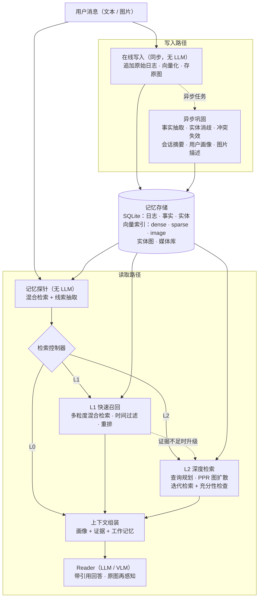

# CueMem 设计文档

> v0.4 · 2026-10-12 · N0 草案；N1 确定了模型供应商（DeepSeek + 通义千问，后者经 QwenCloud 接入，成本按美元计），并把多模态调整到控制器之前；N3 回填了数据模型与写入路径的实现（§4.3、§5）；N4 回填了 L1 快速召回（§6.4）
>
> 本文回答"做什么、为什么这样做"。实现细节在各节点完成后回填；重要取舍记录在 [decisions.md](decisions.md)，与相关工作的逐条对比见 [related-work.md](related-work.md)。

## 0. TL;DR

- **问题**：LLM Agent 如何在跨越数月、上百个会话的交互中，正确地记住、想起和更新用户的信息（包括用户分享的图片）。
- **三个判断**
  1. **长上下文 ≠ 记忆。** 窗口再大，"记什么、何时想起、哪条仍然有效"依然是信息管理问题。
  2. **质量应由记忆系统驱动，而不是由模型能力驱动。** "要不要检索、检索多深"不应完全交给 LLM 自主判断。
  3. **多模态记忆不能只存文字描述。** 索引时可以压缩，回答时要能回看原图。
- **方案**：三根支柱，加上评测先行
  - **写入**：不可变的原始日志 → 异步巩固为带双时间轴有效期的事实、实体图、多粒度索引和用户画像。
  - **读取**：不调用 LLM 的记忆探针（几十毫秒）→ **检索控制器**在 L0 不检索 / L1 快速召回 / L2 深度检索之间做成本感知的决策，证据不足时级联升级。
  - **多模态**：上下文感知的图片描述 + 视觉向量做索引，回答时按需**再感知**原图。
- **交付**：在 LongMemEval、LoCoMo（文本）和 MemLens（图文）上，用统一评测框架给出准确率–成本帕累托曲线、消融与错误分析；再做一个能看到"为什么想起这一条"的可解释 Demo。

## 1. 问题与动机

### 1.1 为什么长上下文不等于记忆

| # | 问题 | 说明 |
|---|---|---|
| 1 | 成本随历史线性增长 | 每轮重读全部历史：单轮成本 O(N)，整个对话生命周期 O(N²)。Prompt caching 降低的是价格，不是模型需要处理的信息量。 |
| 2 | 有效上下文远小于名义长度 | Lost in the Middle、RULER、NoLiMa、Chroma 的 Context Rot 报告都显示，输入越长，模型越难用好其中的信息；需要非字面匹配的推理时更明显。LongMemEval 也报告长上下文 LLM 与商业助手在长期交互记忆上明显掉点。 |
| 3 | 知识会过期 | 历史里同时存在"我住在北京"和"我搬到新加坡了"。长上下文把冲突留给模型临场判断；记忆系统可以在写入时显式处理，同时保留历史版本。 |
| 4 | 持久化与共享 | 上下文随会话结束而消失；记忆需要跨会话、跨设备，甚至在多个 Agent 之间共享。 |
| 5 | 可治理 | 用户应能查看、修改、删除 Agent 记住的内容（新加坡 PDPA、欧盟 GDPR）。塞在上下文里的信息做不到这一点。 |
| 6 | 多模态代价 | 图片和视频的 token 开销大。MemLens 发现长上下文视觉语言模型（LVLM）随对话增长明显退化。 |

> **上下文窗口解决的是"装得下多少"，记忆系统解决的是"该装什么"。**

### 1.2 核心问题：谁来决定"要不要想起"

| 方案 | 谁决定 | 优点 | 问题 |
|---|---|---|---|
| 总是检索（Naive RAG） | 固定流程 | 简单、稳定 | 简单问题浪费 token 并引入干扰；难问题检索深度不够 |
| 模型自主（Agentic RAG、MemGPT 式） | LLM 通过工具调用 | 灵活 | 依赖模型能力，小模型尤其差；行为难预测、难评测；多一次 LLM 往返；**系统的价值被模型能力掩盖** |
| 规则触发 | 人工规则 | 可控、可解释 | 脆弱，覆盖不全 |
| **解耦的检索控制器（本项目）** | 轻量可训练策略 + 记忆侧信号 | 可度量、可训练、与底座无关、成本可调 | 需要训练标签（用"最便宜且答对的动作"自动构造） |

**关键洞察（待 H1 验证）**：在通用知识 RAG 中，"要不要检索"约等于"模型知不知道"，所以 FLARE、DRAGIN 等方法依据模型的不确定度触发检索。但对**私人记忆**来说，模型参数里本来就没有用户的信息。问"我的狗叫什么"，模型可能自信地编一个名字，也可能直接拒答，它的不确定度并不可靠。真正起决定作用的是**这一轮是否依赖用户的过去**，而这可以用两类廉价信号判断：

- **查询中的线索**：第一人称与所有格（"我的"）、指代（"那个""上次"）、时间表达（"上周""三月份"）、聚合与顺序词（"一共几次""第一次"）、视觉细节词（"照片里""什么颜色"）。
- **记忆探针的反馈**：用当前查询做一次几十毫秒的混合检索，观察分数分布（有没有强命中、命中集中在一个会话还是分散在多个会话）、实体命中、是否存在被取代的旧事实。

这与 2026 年领先系统的方向一致：Agent Zero Memory 明确追求 *memory-driven rather than model-driven* 的质量，读路径设有 intent gate，在 8 种 LLM 底座上准确率只相差 3.4 个百分点。本项目的不同在于把控制器当作**可学习、可单独评测**的一等组件：明确的标签构造、成本旋钮 λ、帕累托分析，以及与"模型自主检索"在同一框架下的正面对比。

本项目不排斥模型自主检索：它是对照基线（B3），也作为"逃生通道"保留在 L2 中（reader 可主动调用 `memory_search`）。

### 1.3 多模态记忆的难点

MemLens（2026，789 道图文多会话问题，80.4% 含图片证据）的发现指出了缺口：

- 长上下文 LVLM 靠直接看图，短上下文时准确率高，但随对话增长而退化；
- 记忆增强智能体对长度稳定，但**存储时压缩**（例如把图片转成文字描述）丢失了视觉细节；
- 去掉证据图片后，前沿 LVLM 的准确率跌到 2% 以下，说明图片本身不可替代；
- 多会话推理让大多数系统低于 30%，两类方法单独都解决不了问题。

另一个常被忽略的问题是**图片的含义来自对话**。一张金毛的照片在视觉上只是"一只金毛犬"，但用户说了"这是我刚领养的 Max"之后，它应当与实体"Max"绑定，以后"Max 是什么品种"才答得出来。

本项目的回应：**索引时**用上下文感知的描述和视觉向量压缩（获得长度稳定性），**回答时**由控制器决定是否取回原图再感知（恢复视觉保真度）。

## 2. 目标与非目标

**目标**

- **G1** 跨会话长期记忆，正确处理知识更新与时间推理。
- **G2** 自适应检索：成本可调、可度量、与 LLM 底座无关。
- **G3** 多模态：图片是一等公民（视频为扩展目标）。
- **G4** 可解释、可控制：每条进入上下文的记忆可溯源；用户可查看、修改、删除。
- **G5** 严谨评测：公开基准、统一口径、消融、成本核算。
- **G6** 工程质量：类型化、可测试、可复现，能在 8GB 内存的笔记本上运行。

**非目标**

- 不训练或微调大模型（控制器只是小模型）。
- 不追逐排行榜绝对 SOTA。2026 年文本记忆基准的报告值已达 93%–96%（例如 Agent Zero Memory：LongMemEval 95.60%、LoCoMo 93.60%），且依赖强底座与各自的评测设置。本项目关注同一框架下的相对比较与帕累托效率。
- 不做分布式生产部署，但在文档中给出扩展方案。
- MVP 不包含视频（列为扩展项）。

## 3. 设计原则

1. **Memory-driven, not model-driven**：质量来自记忆结构与检索策略；LLM 是可替换组件，用多个底座验证。
2. **先走便宜的路，必要时升级**：L0 → L1 → L2 级联。
3. **写时智能与读时智能并重**：写入时就整理、去重、处理冲突，不把负担全部留到检索时。
4. **原始日志是唯一事实来源**：事实、摘要、画像、图片描述都是派生数据，可重建、可溯源、可按来源级联删除。
5. **一切可度量**：每个组件有指标，每一轮的决策都有 trace。
6. **笔记本优先**：模型（LLM、VLM、向量）全部走 API；存储全部嵌入式；8GB 内存的笔记本就能跑。

## 4. 系统总览

### 4.1 架构



### 4.2 记忆类型

参照 CoALA 对语言智能体记忆的划分：

| 记忆类型 | 本项目的实现 | 存储 | 何时进入上下文 |
|---|---|---|---|
| 工作记忆 | 最近 N 轮对话 + 当前任务状态 | 内存 | 每轮 |
| 核心记忆（用户画像） | 身份、长期偏好、当前目标等高重要度且仍有效的事实（约 400 tokens 上限） | SQLite | 每轮常驻（L0） |
| 情景记忆 | 原始轮次、会话摘要（多粒度） | SQLite + 向量索引 | L1 / L2 检索 |
| 语义记忆 | 带有效期的原子事实 + 实体图 | SQLite + 向量索引 + 图 | L1 / L2 检索 |
| 多模态记忆 | 原图 + 上下文感知描述 + 视觉向量 + 实体绑定 | 文件 + 向量索引 + 图 | L1 / L2 检索，按需再感知 |
| 程序性记忆（可选） | 用户偏好的交互方式（如"回答要简短"） | 并入核心记忆 | L0 |

### 4.3 数据模型（N3 实现，简化）

完整定义见 `src/cuemem/core/models.py`。

```python
class Turn:  # 原始轮次：唯一事实来源，不可变
    id: str
    space_id: str
    session_id: str
    role: Literal["user", "assistant"]
    speaker: str | None  # 多人对话（如 LoCoMo）里的说话人
    text: str
    media_ids: list[str]
    ts: datetime


class Episode:  # 会话片段，提供"摘要"粒度（目前一个会话一个片段）
    id: str
    session_id: str
    turn_ids: list[str]
    start_ts: datetime
    end_ts: datetime
    summary: str


class Entity:  # 人、宠物、地点、组织、物品、事件……
    id: str
    name: str
    type: str
    aliases: list[str]  # 只收专名（"Maxie"），不收泛称（"我的狗"）
    description: str
    first_seen: datetime
    last_seen: datetime
    mentions: int  # 被提及的会话数


class Fact:  # 原子事实（语义记忆），双时间轴
    id: str
    subject_id: str  # 主语实体
    predicate: str  # snake_case，如 lives_in、job_title、5k_personal_best
    object: str
    statement: str  # 自包含的一句话：已消解代词、已换算为绝对日期
    category: str  # attribute / preference / possession / relationship / event / plan / other
    cardinality: Literal["single", "multi"]  # 单值：新值取代旧值；多值：累积
    negated: bool  # "不再喜欢……"
    valid_from: str | None  # 事件时间轴：现实中何时开始成立（ISO 日期，可以只到月或年）
    valid_to: str | None  # 事件时间轴：何时不再成立（None = 仍然成立）
    recorded_at: datetime  # 记录时间轴：系统何时得知（取对话时间，重放结果确定）
    invalidated_at: datetime | None  # 记录时间轴：系统何时不再采信这个版本
    superseded_by: str | None  # 被哪条事实取代
    supersede_reason: Literal["changed", "corrected"] | None  # 现实变了 / 认知变了
    importance: int  # 1–5
    entity_ids: list[str]
    source_turn_ids: list[str]  # 溯源：来自哪些原始轮次


class CoreMemory:  # 核心记忆：重要且当前有效的事实的物化视图（D-022）
    text: str
    fact_ids: list[str]


class MediaItem:  # 图片（视频 / 音频为扩展）：N3 定下结构，N6 实现
    id: str
    sha256: str
    path: str
    caption: str
    ocr_text: str
    tags: list[str]  # 上下文感知描述
    entity_ids: list[str]
    source_turn_id: str
    ts: datetime
```

几点说明：

- **事件时间用"部分日期"**：对话里常常只说"五月""去年"，硬补成某一天会制造虚假的精度。同一格式的 ISO 字符串可以直接按字典序比较；比较精度不同的日期时按共同精度比（"2025-05"与"2025-05-07"只比到月）。
- **去掉了置信度字段**：LLM 自报的置信度校准很差。可信程度改由溯源（多少轮次支持这条事实）体现。
- **检索单元是统一视图**：轮、事实、会话摘要、实体都是 `MemoryUnit`，向量索引里用 `kind` 区分，payload 里带时间、会话和有效状态，便于过滤。

所有记录都属于一个**记忆空间**（`space_id`）：线上对应一个用户，评测时对应一个样本，彼此严格隔离。

## 5. 写入路径

### 5.1 在线写入（同步，不调用 LLM）

1. 把原始轮次追加到日志（SQLite），记录会话与时间戳。
2. 文本向量化并写入索引（dense + sparse）。
3. 图片：按内容哈希存原图，计算视觉向量，投递"图片描述"任务。
4. 更新工作记忆。

目标：每轮写入不阻塞对话，延迟 < 100ms（不含模型冷启动）。

### 5.2 异步巩固（Consolidation）

**触发**：在线写入只为每个会话登记一个巩固任务（几毫秒，不调用 LLM）。任务由后台线程在空闲时执行（`ConsolidationWorker`），也可以同步执行（命令行 `cuemem consolidate`、评测）。思路参考 Sleep-time Compute：把计算挪到空闲时间，降低在线延迟。

**流水线**（D-020）：

```text
待处理任务 ──并行──▶ A 抽取：每个会话一次 LLM 调用，输出事实、实体、摘要（无状态，可缓存）
           ──批量──▶ B 向量化：所有新陈述、实体描述、摘要一次算完
           ──串行──▶ C 按会话时间顺序：实体消歧 → 事实对账 → 先写向量、后写数据库（一个事务）
           ────────▶ D 重新生成核心记忆
```

| 步骤 | 做什么 | 成本控制 |
|---|---|---|
| 抽取 | 一次 LLM 结构化输出：事实（主语-谓词-宾语 + 一句自包含陈述 + 类别 + 基数 + 事件日期 + 重要度 + 来源轮次）、实体、会话摘要 | qwen3.8-flash（D-018）；助手回复只保留开头 600 字符；响应缓存，共用的会话只抽一次 |
| 实体消歧 | 新实体与已有实体合并（"Max""Maxie"），"用户名叫林晓"让"林晓"指向用户本人 | 名字或别名精确匹配 → 描述向量相似度 → 只有灰区才调用 LLM |
| 事实对账 | 与已有事实比较，执行 ADD / SUPERSEDE / MERGE / NOOP（见 5.3） | 合并、否定、多值累积由规则判定；取代由 LLM 确认，同一会话的灰区事实合并成一次调用 |
| 多粒度索引 | 事实、会话摘要、实体进入向量索引；事实作为"增强键"指回原始轮次 | 批量向量化 + 内容哈希缓存 |
| 画像更新 | 选取重要且当前有效的事实，限长生成核心记忆 | 规则生成，不调用 LLM（D-022） |
| 图片描述 | 带上图片前后的对话，让 VLM 生成描述、OCR 文本、标签与实体绑定（见 §7） | N6 实现；每张图只处理一次 |

工程约束：

- **幂等**：任务键 = 记忆空间 + 会话 + 会话内容指纹 + 流水线版本；
- **可重放**：派生记忆可以整体清空后从原始日志重建；抽取逻辑升级（版本号变化）时自动重建；
- **原子**：每个会话的结果在一个事务里提交，失败的会话下次重试，不影响其他会话；
- **缓存**：LLM 响应与向量全部缓存，重建几乎免费。

"事实增强键"来自 LongMemEval 论文的发现：用抽取出的事实扩展检索键，返回原始轮次作为证据（键与值分离），可以提升召回。

### 5.3 知识更新：双时间轴有效期

每条事实有两条时间轴（借鉴 Zep / Graphiti）：

- **事件时间** `valid_from` / `valid_to`：这件事在现实中何时成立、何时不再成立；
- **记录时间** `recorded_at` / `invalidated_at`：系统何时得知、何时不再采信这个版本。

示例（`examples/toy_conversation.json`，N3 实测）：

| 时间 | 用户说 | 系统动作 |
|---|---|---|
| 2025-03-01 | "我在北京一家互联网公司做产品经理。" | ADD：works_at = 北京一家互联网公司；ADD：job_title = 产品经理 |
| 2025-09-10 | "上个月我跳槽了，现在在新加坡一家电商公司做 AI 产品经理。" | 新事实 works_at = 新加坡电商公司，valid_from = 2025-08；与旧工作冲突，LLM 确认为 update → SUPERSEDE 旧工作：valid_to = 2025-08，invalidated_at = 2025-09-10 |
| 查询 | "我现在在哪工作？" | 取当前有效的新事实 |
| 查询 | "我换工作之前是做什么的？" | 取已被取代的旧事实（历史没有被删除） |
| 查询（事件时间） | "2025 年 6 月我在哪工作？" | `valid_at = 2025-06` → 北京 |
| 查询（记录时间） | "9 月 1 日那天，系统认为用户在哪工作？" | `known_at = 2025-09-01` → 北京（那时还没听说跳槽） |

**取代分两种**（D-019）——这正是需要两条时间轴的原因：

- **现实变了**（搬家、换工作、新的个人最好成绩）：旧事实 `valid_to` = 新事实的开始时间；
- **认知变了**（"我说错了，其实是……"、补充细节）：旧事实只设 `invalidated_at`，`valid_to` 为空——它在现实中没有"结束"，只是系统不再采信。

谓词的**基数**决定冲突规则：

- **单值事实**（登记过的谓词如住在哪、在哪工作、职位，或抽取模型标注为单值的）：遇到同谓词或相似的已有事实，交给 LLM 在 update / correct / duplicate / add 中选择。最初设计是登记过的谓词直接按规则取代，dev100 实测抽样精确率只有约 10%（抽取模型的谓词标签不稳定），已改为 LLM 确认（D-019）；
- **登记过的多值谓词**（喜欢、拥有、去过……）：累积；明确否定已有事实时（"不再喜欢……"）按规则取代；
- **未登记的多值谓词**：与已有事实高度相似时交给 LLM，否则新增；
- **合并**：同谓词同宾语，或陈述几乎相同且宾语一致，只追加溯源。向量对数字不敏感，所以不能只凭相似度合并；
- **时间先后**：两条事实都带明确的事件时间时按事件时间比较，否则按说出的先后。

**迟到的旧消息不覆盖新状态**：如果新事实的事件时间早于当前事实（例如后导入一段更早的对话），它直接作为历史版本写入。测试验证了"先导入新会话、再导入旧会话"与按时间顺序导入的结果一致。

### 5.4 遗忘与隐私

- **不做自动删除**：受 MemoryBank（艾宾浩斯遗忘曲线）启发，"记忆强度"随时间衰减、随访问增强，但只影响**排序**，不删除数据（N4）。
- **显式遗忘**（D-021）：派生记忆是原始日志的函数，所以遗忘 = 从日志删除 + 用剩下的日志重放派生记忆。被删会话取代过的旧事实会自动恢复为当前有效。同时清理缓存：被删会话的抽取缓存、该空间的对账与回答缓存、不再出现的文本的向量。SQLite 开启 `secure_delete` 并在遗忘后 `VACUUM`，测试直接读取数据库文件的字节，确认被删的内容不存在。
- **隔离**：不同记忆空间之间不共享任何数据。
- **已知限制**：trace 文件里有提问与回答原文，目前不随遗忘清理（N8 做服务时加脱敏与保留期限）。

## 6. 读取路径

### 6.1 L0：常驻上下文

每轮都放入：系统指令 + 核心记忆（用户画像）+ 工作记忆（最近 N 轮）。前两部分构成**稳定前缀**，可以命中 prompt cache。很多轮次（寒暄、通用问题、紧接上一轮的追问）只需要 L0。

### 6.2 记忆探针（Probe）

每轮都执行，**不调用 LLM**，目标几十毫秒：一次查询向量化（反正都要做）、一次混合检索（top-K）、规则化的线索抽取。产出控制器的特征：

| 特征组 | 示例 | 直觉 |
|---|---|---|
| 查询线索 | 第一人称与所有格、指代词、时间表达及其类型（绝对 / 相对 / 顺序）、聚合词、比较与顺序词、视觉细节词、疑问类型 | 是否依赖用户的过去；是否需要多跳或时间推理；是否需要看图 |
| 探针反馈 | top-1 分数、top-1 与 top-2 的差、top-K 分数熵、命中会话的分散度、命中类型分布（事实 / 轮次 / 摘要 / 图片）、命中中是否有被取代的事实、实体命中数 | 记忆里有没有；命中集中还是分散；是否存在版本冲突 |
| 对话状态 | 距上次检索的轮数、查询与工作记忆的相似度、话题切换程度 | 答案是否已经在上下文里 |
| 其他 | 查询长度、语言、是否附带图片 | — |

### 6.3 检索控制器 ★

**动作空间**：A = {L0, L1, L2} × {再感知开 / 关}。多模态（N6）先于控制器（N7）完成，所以控制器从一开始就决定"要不要回看原图"。

**决策规则**（效用最大化）：

$$
\pi_\lambda(x) = \arg\max_{a \in A} \Big[ \hat{P}(\text{correct} \mid x, a) - \lambda \cdot \hat{c}(a \mid x) \Big]
$$

- $x$ 是探针特征；$\hat{P}$ 是校准后的"采取动作 $a$ 能答对"的概率；$\hat{c}$ 是动作 $a$ 的预期成本（token、LLM 调用次数或延迟，统一折算）。
- **λ 是运行时旋钮**：不同场景对成本的容忍度不同（客服要求低延迟，深度个人助理可以多花一点），调 λ 即可，不需要重新训练。扫描 λ 就得到帕累托曲线。

**标签从哪里来**（离线、全信息）：离线时可以把每个动作都跑一遍。对训练集中的每个查询分别执行 L0、L1、L2，用 judge 判分，记录正确性与实际成本。

- 简单版：标签 = "最便宜且答对的动作"（Adaptive-RAG 的思路）；三者都答错时标为 L2（或剔除，作为消融）。
- 进阶版：为每个动作学习校准后的 $\hat{P}$，运行时按上式决策。

**模型**：规则基线 → 逻辑回归 / LightGBM（可解释、训练快、能看特征重要性）→ 可选的小型文本编码器。

**反应式升级**：L1 之后，reader 在结构化输出中给出 `evidence_sufficient`；若为 false（或基于检索后特征重新估计的 $\hat{P}$ 低于阈值），升级到 L2。比较三种模式：仅预测式、仅反应式、两者结合。

**在线学习（扩展）**：线上只能观察到所选动作的结果（部分反馈），问题自然变成上下文 bandit（LinUCB / Thompson Sampling），奖励 = 正确性 − λ · 成本，用户纠正（"你记错了"）作为负反馈。先用离线日志仿真验证。

**如何评测控制器**：

- 相对 oracle（每题选最便宜且答对的动作）的路由准确率与 regret；升级率；
- 帕累托曲线：横轴平均成本，纵轴准确率；
- 对照：always-L1、always-L2、模型自主检索（B3）、零样本 LLM 路由器（让小模型判断用哪一档）；
- 特征消融：仅查询文本 / + 查询线索 / + 探针反馈；
- 泛化：LoCoMo 训练、LongMemEval 测试（及反向）；跨 reader 底座的稳定性。

### 6.4 L1 快速召回（不调用 LLM，N4 实现）

> N3 先实现了过渡版本 B2F（`read/facts.py`）：dense 检索 + 事实增强键 + 带有效期的事实。N4 在此基础上实现完整的 L1（`read/l1.py`，评测中的 B4）。

1. **统一多粒度索引**：轮、事实、会话摘要、实体（以及 N6 的图片描述）都是"记忆单元"，同一个向量集合里用 `kind` 区分，payload 带时间、会话与有效状态。
2. **多路召回**：轮、事实、摘要各走 dense（qwen3.7-text-embedding，D-014）与 sparse（BM25，D-026）两路，每路取前 30。
3. **融合**（D-025）：先在同一模态内部按分数取最大——轮自己的分数与它来源事实的分数取最大（事实增强键：键是事实，值仍是原始对话）；再在 dense 与 sparse 两种模态之间做 RRF（sparse 权重 0.5）。只看名次的按类型 RRF 会把强的直接命中挤下去：dev100 上 NDCG 低 4 个点，"助手说过"类题从 96% 掉到 52%（text-embedding-v4 时 NDCG 低 14 个点）。
4. **时间感知**（D-027）：规则解析中英文时间表达，以**问题发生时间**（而非系统当前时间）为参照换算成区间；区间内的轮（或来源事实的事件时间在区间内的轮）加分，按区间宽度打折。"今天 / 今晚"不当作线索。
5. **打分重排**：会话摘要先验、"最近 / 最早"新旧加分都实现了，但在 dev100 上降低了排序质量，默认关闭；重要度与有效性留给 N5 按问题类型启用；cross-encoder 重排留给 N5。
6. **时间感知打包**：按时间排序；每条证据标注绝对日期、**距提问几天**和有效状态，让 reader 不必自己做日期运算。例如问题发生在 2025-10-10 时：

```text
Notes from memory: short facts summarized from earlier conversations ...
[f1] (said on 2025-03-01, 223 days before the question; no longer true from 2025-08, see [f2]) 用户在北京一家互联网公司工作。
[f2] (said on 2025-09-10, 30 days before the question; since 2025-08; current) 用户于 2025 年 8 月跳槽到新加坡一家电商公司。

Retrieved conversation excerpts:
[m1] 2025-09-10 (Wed) 19:00 · 30 days (about 4 weeks) before the question · session s4
User: 告诉你个消息：上个月我跳槽了，现在在新加坡一家电商公司做 AI 产品经理。
```

7. **预算**（D-029）：按分数从高到低装入轮，直到用完 token 预算（默认 4k，至少 1 轮、最多 40 轮）；另加事实 10 条（含版本链补齐）与核心记忆。一"轮"的长度因数据集而异：LongMemEval 约 490 tokens，平均装 8 轮；LoCoMo 一轮只有一句话（约 40 tokens），装满 40 轮。固定条数会让两个数据集拿到的上下文差十几倍。

**N4 的结论**（qwen3.7-text-embedding）：dev100 上 B4 83%，与 ORACLE 持平，每题输入 4,973 tokens，是检索类方法里最便宜的；但 dev100 已接近饱和，对 B2（76%）、B2F（80%）的差异不显著。LoCoMo 385 题上 B4 84.9%，显著优于 B2F 78.7%（p = 0.001），多跳题 62% → 81%。最大的杠杆是按 token 预算打包（LoCoMo 上固定取 10 轮只有 77.1%；这一项参考过 LoCoMo 的结果，见 D-029）；时间区间加分与 BM25 在两个数据集上都没有显著作用。检索延迟 p95 132 ms，其中查询向量化约 110 ms。剩下的错题主要是多会话聚合与推理，留给 L2。

### 6.5 L2 深度检索（调用 LLM）

1. **查询规划**（1 次便宜模型调用，结构化输出）：拆解子问题；把时间约束换算成绝对区间；识别目标实体；判断答案类型（计数、日期、列表、是非……）。
2. **多路检索**：每个子问题执行 L1 的各路检索；加上**实体图扩散**：以查询链接到的实体为种子，在"实体–事实–片段–图片"图上运行个性化 PageRank（借鉴 HippoRAG），一步召回多跳相关的事实与片段；再加上图片路。
3. **融合与整理**：RRF 融合、重排、去重、按时间排序，预算约 4–6k tokens。
4. **充分性检查**（1 次 LLM 调用）：证据是否足以回答？缺什么？据此生成补充查询，最多再检索 R = 2 轮（借鉴 CRAG 的"评估后纠正"）。
5. **拒答**：仍不充分就明确回答"我没有这方面的记忆"（LongMemEval 与 MemLens 都有拒答类问题）。
6. **工具**：日期计算；对事实列表做计数与聚合（避免 LLM 算错）；`memory_search`（reader 可主动补充检索）。

### 6.6 上下文组装与 Reader

```text
[System]             角色、引用格式、拒答规则        ┐
[Core Memory]        用户画像（≤ ~400 tokens）      ┘ 稳定前缀，可命中 prompt cache
[Retrieved Memories] 带编号、时间、有效状态的证据     ← 每轮变化，按预算截断
[Working Memory]     最近 N 轮对话
[User]               当前消息（+ 图片 / 再感知取回的原图）
```

Reader 的结构化输出：`answer`、`citations`（引用的记忆编号）、`evidence_sufficient`、`confidence`。引用让每个回答都能溯源，也让"检索是否命中证据"可以被评测。

### 6.7 Trace

每一轮记录一条结构化 trace：探针特征、各动作的效用估计与最终决策、各路检索命中的记忆及分数、各分区 token 数、各阶段延迟、LLM 调用次数。它同时服务于 Demo 的"记忆轨迹"面板、错误分析，以及控制器的训练数据。

## 7. 多模态记忆

### 7.1 图片的三种表示

| 表示 | 用途 | 生成方式 |
|---|---|---|
| 视觉向量 | 以文搜图、以图搜图 | QwenCloud 多模态向量 API（tongyi-embedding-vision-plus）；本地 SigLIP 2 作备选 |
| 上下文感知描述 + OCR + 标签 | 文本检索；作为 L1 / L2 中可读的证据 | VLM，输入图片**及其前后的对话** |
| 实体绑定 | 图扩散与多跳（"Max 是什么品种？"） | 巩固阶段抽取，写入实体图 |

中国大陆千问 AI 平台上的 qwen3-vl-embedding 还支持把图片和文字融合成一个向量：把图片连同它前后的对话一起编码，是"上下文感知"的另一种实现。QwenCloud 目前没有这个模型；如果 N6 时可用，再与"上下文感知描述"对比（H6）。

### 7.2 检索

- **以文搜图**：描述路（dense + sparse）与视觉向量路，RRF 融合；
- **以图搜图**：用户上传新图问"我之前给你看过这个地方吗？"，走图片向量近邻；
- 结果与文本记忆一起进入重排与打包。

### 7.3 回答时再感知

- 当问题需要视觉细节（颜色、数量、图中文字、"照片里……"），或命中的图片是关键证据时，控制器开启再感知：取回 top-m 张原图（m ≤ 3，缩放后）与文本证据一起交给 VLM。
- 否则只用描述，节省图片 token。
- 图片 token 计入成本（与 MemLens 的跨模态 token 计数方式一致），纳入帕累托分析。

### 7.4 扩展：视频与语音（☆）

视频按镜头切分，抽关键帧 + 语音转写，形成"片段级情景记忆"，复用同一套索引、控制器与再感知机制。这与短视频平台的场景直接相关；M3-Agent（字节跳动 Seed）在长视频记忆方向做了系统性工作，可作为参照。

## 8. 评测方案

### 8.1 数据集

| 数据集 | 模态 | 规模 | 用途 |
|---|---|---|---|
| LongMemEval_S（清洗版，MIT） | 文本 | 500 题，五种能力（信息抽取、多会话推理、时间推理、知识更新、拒答），其中拒答题 30 道；每题历史约 48 个会话、243 次用户发言、约 10 万 tokens（DeepSeek 分词） | 主文本基准 |
| LoCoMo（CC BY-NC 4.0） | 文本（910 条发言附图片，以 BLIP 描述的形式并入文本） | 10 段两人长对话，每段 370–690 条发言；1986 题：单跳 841、多跳 282、时间 321、开放域 96、对抗 446 | 次文本基准；控制器的跨数据集泛化。与文献一致，默认不评对抗题 |
| MemLens | 图文交错 | 789 题，五种能力，32K–256K 四档长度；官方提供 195 题的记忆智能体子集 | 主多模态基准 |
| Mem-Gallery（可选） | 图文 | ACL 2026 | 多模态补充 |
| Mixed-Stream（自建） | 文本 / 图文 | 记忆相关问题与无关查询（通用知识、闲聊、任务指令）混合 | 评测"该不该想起"（L0 决策） |
| BEAM（可选） | 文本 | 百万到千万 token | 规模压力测试 |

**划分**：

- LongMemEval_S 按（题型，是否拒答）分层抽 100 题做开发集 `dev100`（调参、训练控制器，含 6 道拒答题），其余 400 题为 `test400`，只在最终评测时使用；划分文件提交在 `evals/splits/`。从 dev100 再分层抽 10 题为 `pilot10`，用于正式运行前试跑、估算成本。为便于横向参考，最终也报告全量 500 题结果并注明。
- MemLens 195 题子集中划出约 45 题做开发，其余做测试。

### 8.2 指标

- **质量**：准确率与分题型准确率。LLM 判分逐字照搬 LongMemEval 官方模板（有回归测试对照官方代码），调用方式也一致：只发一条 user 消息、temperature 0、max_tokens 10、回复含 "yes" 即正确；judge 固定为 qwen3.8-max，与主 reader 不同家族（D-008）。LoCoMo 没有官方 LLM 判分，沿用同一套模板，另报 token F1（D-015）。MemLens 官方 judge 是 Qwen3-VL-235B，N6 接入时确认能否通过 QwenCloud 调用同款模型。
- **检索**（只对检索类方法、不含拒答题）：会话召回（任一 / 全部）、发言召回（任一）、发言 NDCG。命中单位是"轮"，一轮包含证据发言即为相关；理想排序的相关轮数由证据会话重建得到。
- **成本**：每题输入 / 输出 token（含图片 token）、LLM 调用次数、费用；写入成本（每千轮 token）。
- **延迟**：分阶段 p50 / p95（探针、L1、L2、reader）。
- **控制器**：路由准确率、regret、升级率。
- **稳定性**：更换 reader 底座后的准确率方差。

### 8.3 基线

所有方法使用**同一个 reader 和同一个 judge**：

| 编号 | 方法 | 说明 |
|---|---|---|
| B0 | 无记忆 | 下限；拒答题天然答对 |
| B1 | 全上下文 | 把全部历史塞给长上下文模型（最贵，只在开发集与最终评测各跑一次） |
| B2 | Naive RAG | 轮次级 dense top-k（k = 10），每轮都检索 |
| B2F | Naive RAG + 事实记忆（N3） | 检索算法与 B2 相同，只是用上写入路径的产出：事实增强键、带有效期的事实、核心记忆（D-023）；另有四个消融变体 |
| ORACLE | 只给证据会话 | 上限参照，不可部署：衡量"检索完美时 reader 能答对多少"，用来区分检索错误与阅读错误 |
| B3 | 模型自主检索 | reader 带 `memory_search` 工具，自己决定是否检索、检索几次（ReAct） |
| B4 | 本系统 always-L1（N4） | 去掉控制器：L1 快速召回 + 事实 + 核心记忆，按 token 预算打包；另有六个消融变体 |
| B5 | 本系统 always-L2 | 去掉控制器 |
| B6 | 本系统 + 控制器 | 完整方案（扫描 λ） |
| 可选 | Mem0 开源版 | 在本框架下复现 |

### 8.4 消融

去掉事实抽取 / 去掉有效期（冲突时直接覆盖）/ 去掉 PPR 图扩散 / 去掉时间感知打包 / 去掉重排 / 仅描述（无再感知）/ 孤立图片描述（不带对话上下文）/ 控制器特征子集。

N3 已实现写入路径的四个消融（都以 B2F 为基础，检索算法不变）：只用事实增强键（不展示事实与画像，即 LongMemEval 论文的做法）、只给当前事实（相当于覆盖式更新）、事实不标有效期、不给核心记忆。

N4 实现了 L1 的六个消融（都以 B4 为基础）：固定取 10 轮、固定取 5 轮、预算 2k tokens、不做时间加分、不标相对时间、去掉 BM25。

### 8.5 可信度保障

- 温度 0 + 响应缓存，结果可复现；
- 判分模板逐字照搬官方，回归测试直接对照官方代码；
- 人工抽检 50 条判分（判对、判错各半，`cuemem eval audit` 导出并统计一致率）；
- 先用 `pilot10` 试跑：逐条看错题，确认问题出在方法、Reader 还是判分，再跑全量；
- bootstrap 95% 置信区间；
- 开发集与测试集分离；
- 每个结果都附带成本；
- 错误归因：报告自动把检索类方法的错题分成"检索未命中""命中证据但答错、ORACLE 答对（干扰多或证据不全）""ORACLE 也答错（阅读与推理）"三类；更细的分类（时间推理、知识更新、误拒答、幻觉）靠人工看错题；
- 横向参考他人报告的数字时注明设置差异（reader、judge、prompt 不同，数字不能直接比较）。

**主图**：准确率–成本帕累托曲线。各基线是图上的点，B6 随 λ 变化形成一条曲线。

### 8.6 研究假设

| 编号 | 假设 | 验证节点 |
|---|---|---|
| H1 | 判断"检索多深"时，探针反馈 + 查询线索特征优于仅用查询文本，也优于基于模型不确定度的触发 | N7 |
| H2 | 控制器能在与 always-L2 相近的准确率下显著降低平均成本 | N7 |
| H3 | 相比模型自主检索，控制器在不同 reader 底座之间更稳定，在小模型上优势更大 | N7 / N9 |
| H4 | 有效期机制（失效而不删除）提升知识更新类问题，且不损害历史状态类问题 | N3（dev100 上尚无定论：B2F 的知识更新题 15/15，但"只给当前事实""不标有效期"两个消融与完整版的差异不显著；原始对话仍在上下文里，历史状态题各版本都能答对。需要更有针对性的题集，留到 N9） |
| H5 | 回答时再感知原图显著提升需要视觉细节的问题，图片 token 成本可由控制器控制 | N6 |
| H6 | 上下文感知的图片描述优于孤立描述，在实体绑定类问题上尤其明显 | N6 |

假设可能被否证。那同样是有价值的结论，必须如实报告。

### 8.7 成本控制

- 写入成本与历史 token 数线性相关（LongMemEval_S 约 500 × 115k tokens），因此：开发阶段只用 100 题子集；做**会话级内容哈希缓存**（同一会话只抽取一次）；抽取用便宜模型。
- B1 全上下文基线最贵，只跑必要的次数。
- 成本统一按名义标价（高峰时段、未命中缓存）计算，保证不同时间运行的实验可以比较；实际花费（扣除缓存命中，未计错峰折扣与免费额度）单独统计（D-010）。
- 每次评测运行记录总 token 与费用。N2 实测：一次 dev100 评测（4 种方法 × 100 题）名义成本 $4.35，其中 B1 全上下文占 73%，写入（向量化 889 万 tokens）$0.62，判分 $0.17；扣除缓存后实际约 $4，耗时约 15 分钟（受向量接口按分钟配额限制）。缓存命中后重跑几乎免费。
- N3 实测（巩固）：dev100 的 100 份历史共 4,806 个会话、49,831 条发言，抽取与对账名义成本 $3.71（每份历史 $0.037，每千条发言 $0.074），首次运行每份历史 p50 约 2 分钟（QwenCloud 上 qwen3.8-flash 输出约 50 tokens/秒，并发 24）；抽取时只保留助手回复的开头，输入 token 少一大半。LongMemEval 每份历史只问一题，写入成本摊不薄；真实场景中写入是一次性成本，会被之后的所有提问分摊。
- N4 实测：换向量模型后 dev100 的 100 份历史重新向量化（720 万 tokens，$0.50，一次性）；最终评测 B4 每题回答名义成本 $0.0016，约为全上下文的 1/20。DeepSeek 的调用全部放在非高峰时段（D-024），N4 合计花费约 $2.9。

## 9. 技术选型与资源约束

### 9.1 开发环境约束

开发机：Apple M2、**8GB 内存**、可用磁盘约 **29GB**（2026-10-12 检查）。因此：

- 本地不运行任何模型：LLM、VLM 用 DeepSeek 与通义千问的 API，向量也用通义的 API（D-004）；
- 向量按内容哈希缓存，同一段文本只付一次费；LLM 响应同样缓存，重复实验不重复计费；
- 除非确有需要，不下载 LongMemEval_M、MemLens 256K 等大文件；
- 存储全部嵌入式，不依赖 Docker；单个记忆空间超过约 2 万条时，可切换到 Qdrant 服务端（D-005）。

### 9.2 选型

| 层 | 默认选择 | 理由 | 备选 |
|---|---|---|---|
| 工程 | Python 3.12 + uv + ruff + pytest + pydantic v2 | 现代 Python 工程标准，依赖锁定可复现 | conda |
| LLM / VLM | DeepSeek + 通义千问，OpenAI 兼容接口，按角色配置（见 9.3） | 两家都提供 OpenAI 兼容接口；跨家族才能做跨底座实验，也能降低 judge 偏差 | — |
| 文本向量 | 通义 qwen3.7-text-embedding（API，1024 维，只取 dense） | N4 实测语义召回明显高于 text-embedding-v4（同一代码下朴素检索 dev100 65% → 76%）；查询约 80 ms；精确匹配由本地 BM25 承担（D-014 修订、D-026）；不占本地内存 | text-embedding-v4；本地 BGE-M3 |
| 图像向量 | QwenCloud 多模态向量 API（tongyi-embedding-vision-plus） | 文本与图片在同一向量空间，可以以文搜图、以图搜图；不占本地内存 | 本地 SigLIP 2 |
| 重排 | 规则特征打分；可选通义 rerank API | 规则打分零成本、可解释；模型重排作为消融 | 本地 bge-reranker-v2-m3 |
| 向量库 | Qdrant（本地模式，可配置切到服务端） | 命名向量（dense / sparse / image）+ payload 过滤；N1 实测 5k 条以内稠密检索约 5 ms（D-005） | LanceDB |
| 结构化存储 | SQLite | 零运维、单文件、可移植 | Postgres |
| 图计算 | scipy.sparse 实现 PPR | 规模小、速度快、无额外服务 | NetworkX；Neo4j |
| 控制器 | scikit-learn / LightGBM | 可解释、训练快 | 小型编码器 |
| 服务与界面 | FastAPI + Gradio | 快速做出可交互、可解释的 Demo | Streamlit |
| 评测 | 自研 harness + pandas + matplotlib | 统一口径、可控 | — |

N1 已完成存储的技术验证（D-005）；向量接口的延迟与质量在拿到 API Key 后用 `scripts/spike_embeddings.py` 实测。

### 9.3 模型分工

| 角色 | 默认模型 | 理由 |
|---|---|---|
| extractor（写入时抽取） | qwen3.8-flash | 调用量最大，选单价最低的（$0.15 / $0.47 每百万 tokens） |
| planner（L2 规划与充分性检查） | qwen3.8-flash | 在读路径上，要快且便宜 |
| reader（主实验的回答模型） | deepseek-flash（关闭思考模式） | 1M 上下文，可直接跑全上下文基线；支持图片输入，文本与图文实验可用同一个 reader，对比更公平 |
| vlm（图片描述、再感知） | deepseek-flash | 同上；N6 实测后可能换成 qwen3-vl-plus |
| judge（评测判分） | qwen3.8-max | 强模型，且与主 reader 不同家族，降低自我偏好（D-008） |
| 跨底座实验 | deepseek-v4-pro、qwen3.7-plus、qwen3.8-flash 等 | 覆盖不同能力档位，验证 H3 |

模型 ID 与价格以 `configs/default.yaml` 为准，`cuemem doctor --live` 会核对连通性。DeepSeek V4 系列默认开启思考模式，抽取与回答时在请求中显式关闭。

### 9.4 代码结构

```text
rag/
├── src/cuemem/
│   ├── core/          # 数据模型、配置、trace
│   ├── llm/           # OpenAI 兼容客户端、结构化输出、缓存、成本记账
│   ├── embed/         # 文本 / 图像向量模型（懒加载 + 缓存）
│   ├── store/         # SQLite、向量索引、实体图、媒体库
│   ├── write/         # 在线写入、异步巩固（抽取 / 消歧 / 对账 / 摘要 / 画像）
│   ├── read/          # 探针、控制器、L1、L2、重排、上下文打包
│   ├── multimodal/    # 图片描述、视觉检索、再感知
│   ├── agent/         # 自研 agent loop 与工具
│   ├── api/           # FastAPI 服务
│   └── evals/         # 评测：数据加载、划分、方法、判分、运行器、指标、报告
├── evals/splits/      # 开发集 / 测试集划分（题目 ID 列表，提交进仓库）
├── demo/              # Gradio 界面与演示剧本
├── tests/
├── configs/           # YAML 配置
├── scripts/
└── docs/
```

## 10. 风险与应对

| 风险 | 影响 | 应对 |
|---|---|---|
| API 成本与限流 | 评测跑不起或很慢 | 响应缓存；会话级去重；开发子集；便宜模型做抽取；每次运行记账 |
| 8GB 内存 | 本地模型 OOM 或频繁换页 | 懒加载、fp16、控制批大小；必要时向量也改走 API |
| 磁盘余量约 29GB | 数据集或模型放不下 | 不下载超大数据；模型统一缓存目录；定期清理 |
| LLM judge 偏差 | 结论不可信 | 固定 judge 与 prompt；人工抽检一致性；置信区间 |
| 文本基准接近饱和 | 绝对提升不显著 | 以帕累托效率、控制器分析和多模态为主线；如实报告 |
| 控制器过拟合 | 换数据集就失效 | 跨数据集评测；简单可解释的模型；特征消融 |
| 范围蔓延 | 做不完 | 先走 MVP 路径；扩展项明确标注 |
| 数据许可 | 合规问题 | 仅用于研究；遵循各数据集许可（MemLens 数据为 CC-BY-4.0，图片保留来源站点许可） |

## 11. 待决问题

| 问题 | 何时决定 |
|---|---|
| 图片向量用 tongyi-embedding-vision-plus（API）还是本地 SigLIP 2？如果有可用的图文融合向量，是否优于"描述 + 向量"？ | N6 |
| ~~sparse 路用 text-embedding-v4 的词项权重还是 BM25？~~ 已定：BM25，去掉角色标签、数字整体保留（D-026） | N4 |
| ~~文本向量用 text-embedding-v4 还是 qwen3.7-text-embedding？~~ 已定：qwen3.7-text-embedding，只取 dense；语义召回高得多，写入慢是一次性代价（D-014 修订） | N4 |
| 控制器用每个动作一个校准分类器，还是单个多分类器？ | N7 |
| 图结构用"实体–事实–片段"三部图，还是只用实体图？ | N5 |
| 证据格式用结构化（JSON）还是自然语言？是否采用 Chain-of-Note 式阅读？（LongMemEval 对阅读阶段做过相关分析，需要在本系统复验）N4 用的是自然语言加日期与有效期标注，Chain-of-Note 留给 N5 | N5 |
| ~~巩固在会话结束、每 N 轮还是空闲时触发？~~ 已定：写入时按会话登记任务，后台线程空闲时执行（§5.2） | N3 |
| ~~抽取用 qwen3.8-flash 还是 deepseek-flash？~~ 已定：qwen3.8-flash（D-018） | N3 |

## 12. 扩展到大规模部署（设想）

本项目在笔记本上运行，但架构在设计时考虑了如何扩展到海量用户：

- **按记忆空间分片**：每个用户的记忆天然独立。检索服务无状态，向量库按租户分区（Qdrant 服务端支持按 payload 分区的多租户）。
- **写路径异步化**：在线写入只追加原始日志并投递到消息队列；巩固 worker 异步消费，同一用户的任务串行处理以保证一致性。幂等任务键与"先写向量、后写数据库"的顺序（D-012）在分布式环境同样适用。
- **冷热分层**：用户画像与近期记忆放缓存，长尾记忆放低成本存储；检索先查热层，必要时再查冷层。
- **成本控制**：检索控制器让大多数轮次停在 L0 / L1，昂贵的 L2 只用于少数难问题；成本旋钮 λ 按场景配置（客服要求低延迟，深度个人助理可以多花一点）。稳定前缀设计让供应商的前缀缓存持续生效。
- **合规与隐私**：遵循新加坡 PDPA、欧盟 GDPR 等法规；按溯源关系级联删除（被遗忘权）；记录审计日志。
- **持续学习**：线上的隐式反馈（例如用户纠正"你记错了"）作为奖励信号，用上下文 bandit 在线更新控制器。

## 附录：术语

| 术语 | 含义 |
|---|---|
| 记忆空间（space） | 一个用户（或一个评测样本）的全部记忆，彼此隔离 |
| 记忆探针（probe） | 每轮执行的、不调用 LLM 的廉价检索与线索抽取 |
| 检索控制器（controller / gate） | 决定走 L0 / L1 / L2 的轻量策略模型 |
| L0 / L1 / L2 | 不检索 / 快速召回（无 LLM）/ 深度检索（LLM 参与规划与检查） |
| 巩固（consolidation） | 异步地把原始日志整理为事实、实体、摘要、画像 |
| 双时间轴（bi-temporal） | 事件时间（现实中何时成立）+ 记录时间（系统何时得知） |
| 再感知（re-perception） | 回答时取回原图交给 VLM，而不是只看文字描述 |
| λ | 成本旋钮：越大越省，越小越准 |
| RRF | Reciprocal Rank Fusion，按排名倒数融合多路检索结果 |
| PPR | Personalized PageRank，从种子节点出发的图扩散 |
