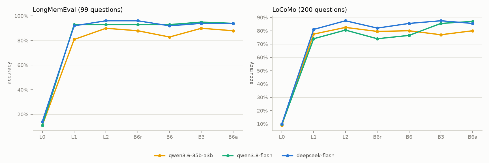

# CueMem technical report

> v1.1 · 2026-10-13 · English edition of [docs/report.md](../report.md). This report covers the system, the final evaluation (N9), and the follow-up work done after the test sets were used (N11, §12). The node-by-node experiments and development-set results are recorded in Chinese in [docs/results/](../results/); the design decisions are in [decisions.md](decisions.md) (cited below as D-xxx).

## Abstract

CueMem is a long-term memory system for LLM agents. It has four parts:

- **Write path.** An immutable log, consolidated in the background into facts that carry validity periods.
- **Retrieval.** Three levels: L0 gives the profile only, L1 is fast recall, L2 is deep recall.
- **Controller.** A retrieval controller that never calls an LLM. It decides for each message whether to recall, and how deeply.
- **Multimodal memory.** The original photos are retrieved and looked at again at answer time.

The final evaluation used three test sets: LongMemEval test400, the last 7 LoCoMo conversations (1,155 questions) and MemLens (195 questions). Every method and setting was frozen in advance, and each test set was used once.

- **Memory beats a long context window on both accuracy and cost.** On LongMemEval, L1 scores 90.5% against 73.0% for full context, at about 1/20 of the cost. On MemLens 128K, L2 with photos scores 65.1% against 46.2%.
- **The write path is the largest single gain.** Giving naive retrieval the write path's output takes LongMemEval from 82.0% to 91.0%.
- **The frozen controller reproduced its development-set estimate on the test sets** (81.2% → 81.6% on memory questions).
  - In a stream where 20% of queries need memory, it is 41% cheaper than always retrieving, with no loss of accuracy.
  - On memory questions alone, it stays below always-L2 (2.8 points lower overall).
  - Its value is in deciding *whether* to recall, not *how deeply*.
- **Letting the model retrieve for itself (ReAct) wins on some data and loses on other data.** It is the strongest method on text memory (LoCoMo 85.5%) and fails on image memory (MemLens 46.7%). "Controller first, LLM may search more" holds up on all three datasets, at the highest cost.
- **Few errors are true retrieval misses.** Most come from the controller picking the wrong level, from miscounting, and from wrong LoCoMo gold answers (10 of 40 sampled errors).
- **Every number can be replayed from the local cache with one command.** The controller's live runs match offline replay of the frozen model question by question.

## 1. Problem

An LLM agent that talks to someone over months and hundreds of sessions needs to **retain, recall and stay accurate**: preferences, plans, a changed job or budget, photos shared once, all answerable weeks later, and answered with the latest version.

Putting the whole history in the context window is not the answer:

- the cost grows linearly with the history;
- models use information in long inputs increasingly badly (LongMemEval, Lost in the Middle);
- when old and new statements coexist, the model has to sort them out on the spot.

This project treats memory as an information-management problem. It asks one concrete question: **who should decide whether to recall this turn, and how deeply?** One answer is the LLM, calling a retrieval tool. The other is a cheap, trainable, measurable controller.

## 2. System

```text
user message ──► memory probe (no LLM, p50 0.2–0.5 s) ──► controller ──► L0 profile only
                                                         ├──► L1 fast recall (no LLM)
                                                         └──► L2 deep recall (plan, re-check, notes)
                                                               (with photos: attach the originals or not)
             ──► online write (log, vectors, photos) ──► background consolidation
                                                          (facts, entities, validity, profile, captions)
```

### 2.1 Write path: raw log plus asynchronous consolidation (N3)

- **The raw log is immutable** and is the only source of truth. Online writing appends turns, indexes vectors and stores photos by content hash. It calls no LLM.
- **Consolidation** runs per session in the background (qwen3.8-flash):
  - extract atomic facts and entities;
  - link entities;
  - reconcile facts;
  - write session summaries, photo captions and a core memory (the profile).

  All derived memory can be replayed from the log.
- **Bi-temporal validity.** Facts carry event time (valid_from / valid_to) and record time (recorded_at / invalidated_at).
  - "I moved to Singapore" means reality changed. "Sorry, I meant Shanghai" means our knowledge changed.
  - Both invalidate the old fact, with different meanings.
  - Old facts are kept, so "where did I live before?" still has an answer.
- **Reconciliation.** Rules only merge, negate and accumulate multi-valued facts; every "supersedes" is confirmed by an LLM. With rules alone, supersession precision in the first round was about 10%, and a wrong "invalidated" label is worse than none (D-019).
- **Forgetting.** Delete from the log, replay the derived memory from what remains, and purge caches by ownership (D-021).
  - From N8, whole rounds are deleted and the deletion follows citations into later replies (D-046).
  - From N10, it also finds uncited restatements in the log (D-051).

### 2.2 Retrieval: three levels (N4, N5, N7)

| Level | What it does | Extra LLM calls |
|---|---|---|
| L0 | Resident context only (core memory, i.e. the profile) | none |
| L1 | Multi-route dense recall over turns, facts, summaries and photo captions; max within a modality, reciprocal rank fusion across modalities; a boost for temporal expressions; packed to a 4k-token budget, each item labelled "N days before the question" | none (one query embedding) |
| L2 | Query planning (sub-queries, time ranges) → multi-query "best rank" fusion → sufficiency check and follow-up retrieval → take notes, then answer | 2–4 calls to a cheap model |

L1 was tuned on pure retrieval metrics.

- **The largest single lever was packing to a token budget.** A LoCoMo turn is one sentence, so taking a fixed 10 turns loses three quarters of the context (D-029).
- **Switching the embedding model** (text-embedding-v4 → qwen3.7-text-embedding) gained more than every retrieval trick combined (D-014).

In L2, the largest lever is "take notes, then answer". Graph diffusion and reranking were implemented but did not help, and are off by default (D-030 to D-032).

### 2.3 Retrieval controller (N7)

- **Memory probe.** One L1 scoring pass; if L1 is chosen, its candidates are reused. It produces 54 features:
  - question cues: first person, references to past conversations, temporal and aggregation expressions, visual words, and so on;
  - the score distribution and how spread out the hits are, in content and in time;
  - superseded facts among the hits;
  - entity and photo hits;
  - the size of the memory.
- **Two-stage controller.**
  - A gate estimates the probability that the message has nothing to do with memory, and a seven-way reasoning-type model estimates what kind of memory question it is.
  - The controller looks up how accurate each level is on that kind of question, and picks the action that maximises P̂(correct) − λ · cost. The actions are L0, L1 and L2, each with or without photos when photos exist.
  - The labels go through reasoning type rather than "was this question answered correctly", because per-question outcomes are polluted by random answer flips (D-038).
- **λ is a business knob**: how much you are willing to pay for one more correct answer.
  - The default λ = 30 was chosen in advance as the cheapest setting that is no worse than always retrieving (D-040).
  - The parameters are exported as JSON; at run time the controller is two matrix multiplications.

### 2.4 Multimodal memory (N6)

Each image has three representations:

- the original, stored by content hash;
- a visual embedding in the same space as text, which allows text-to-image and image-to-image search;
- two captions, one written with the surrounding conversation in view and one written from the image alone.

Captions are filled back into the turn for fact extraction, and also serve as index keys.

**Re-perception at answer time** attaches the 3 most relevant original photos. Storage compresses an image into a fixed-length description, and answering retrieves the original to get the visual detail back (D-003, D-037).

### 2.5 Agent runtime (N8)

- **The loop.** A hand-written conversation loop. The controller recalls first, and the model may call `memory_search` when something is missing (D-042).
- **The context.** It is assembled from partitioned budgets. The system prompt, a profile snapshot and the raw turns of the current conversation form a stable prefix; recalled memories go only into the last message (D-043).
- **Writing.** Every turn is written online, and the session is consolidated in the background when it ends (D-045).
- **Interfaces.** A FastAPI service, an explainable Gradio UI (memory trace panel, memory browser) and an MCP server.

## 3. Evaluation setup

### 3.1 Data and splits

| Dataset | Test set (used only in N9) | Development set (N2–N8) |
|---|---|---|
| LongMemEval_S (about 48 sessions and 115k tokens of history per question) | test400 | dev100 (plus pilot10 for dry runs) |
| LoCoMo (10 long two-person conversations; adversarial questions excluded) | Last 7 conversations, 1,155 questions | First 3 conversations, 385 questions |
| MemLens (interleaved images and text; 80% of questions need image evidence) | The official 195-question memory-agent subset, at 32K and 128K | 100 questions stratified from outside the subset (32K) |
| Mixed stream (queries that need no memory; built in N7) | Test version: 1,750 Dolly requests disjoint from the development set, plus a same-topic general question generated for each test question | Development version: 585 + 585 |

The methods to compare, the controller (the model exported in N7, λ = 30), retrieval and prompts were all fixed before looking at the test sets. N9 added a single method, B6a (the N8 agent's approach), defined before the test sets were opened.

### 3.2 Methods

| ID | Method |
|---|---|
| B0 | No memory |
| L0 | Core memory (profile) only |
| B1 | Full context: the whole history in a long-context model (on MemLens, images are inserted in place) |
| B2 / B2F | Naive retrieval (dense top-10) / the same retrieval plus the write path's output (fact-augmented keys, facts with validity, profile) |
| B4-nobm25 | L1 fast recall (called L1 below) |
| B4-note | L1, take notes first, then answer |
| B5 | L2 deep recall |
| B6r / B6 / B6h / B6z | Rule-based controller / learned controller (λ = 30) / ask an LLM when the gate is unsure / zero-shot LLM router |
| B3 | Agentic retrieval (ReAct with `memory_search` and `date_diff`, at most 5 steps) |
| B6a | Controller first, LLM may search more: B6's recalled memories come with the question, and the model may call `memory_search` for anything missing |
| ORACLE | Only the annotated evidence sessions (a reference, not deployable) |

On MemLens, L1 and L2 also have re-perception versions (B4-see, B5-see); B4-mm is L1 without the original photos.

### 3.3 Readers and judging

- **The main reader** is deepseek-flash (thinking mode off, can read images).
- **The judge** is qwen3.8-max, from a different model family than the main reader (D-008). The judge prompts are copied verbatim from the official LongMemEval template (also used for LoCoMo, D-015) and the official MemLens prompts (D-034).
- **Swapping the reader (H3).** Three more readers were planned, each evaluated on `test100r` (100 questions stratified from test400) and `test200r` (200 questions stratified from the LoCoMo test set):
  - a small model, qwen3.6-35b-a3b (a mixture of experts, about 3B parameters active per token);
  - qwen3.8-flash;
  - a large model, deepseek-v4-pro (not run, because the account balance ran out; see §6).

  qwen3.8-flash shares a family with the judge, so its absolute accuracy cannot be compared with other readers; comparisons between methods under the same reader remain valid.

### 3.4 Cost and statistics

- **Cost.** Costs are nominal (peak list price, no cache), so that experiments run at different times compare.
  - Actual spend is tracked separately (D-010). It excludes local cache hits and includes the provider's cache discount and DeepSeek's 50% off-peak discount.
  - All DeepSeek calls ran off-peak (D-024).
- **Statistics.** Confidence intervals are 95% bootstrap intervals. Two methods on the same questions are compared with a paired sign test, which only counts questions where one is right and the other wrong.
- **Replay.** The local response cache makes every result free to replay. The level a controller chooses issues a request byte-identical to the fixed-level method, so it hits the cache. That is why the live B6 run and the offline replay of the frozen model can be checked against each other question by question.

## 4. Main results on the test sets

Accuracy / nominal cost per 1,000 questions. On MemLens, L1 and L2 attach the original photos (re-perception). Full tables, with per-type results, confidence intervals and tokens per question, are in [tables.md](../results/n9-final/tables.md) (Chinese headers).

| Method | LongMemEval test400 | LoCoMo (1,155 q) | MemLens 32K (195 q) | MemLens 128K (195 q) |
|---|---|---|---|---|
| B0 no memory | 6.0% / $0.20 | 0.1% / $0.18 | 11.3% / $0.18 | 11.3% / $0.18 |
| L0 profile only | 15.2% / $0.31 | 9.1% / $0.31 | 25.6% / $0.26 | 20.5% / $0.28 |
| B1 full context | 73.0% / $31.88 | 82.0% / $6.90 | 51.8% / $8.25 | 46.2% / $40.60 |
| B2 naive retrieval | 82.0% / $1.68 | 68.2% / $0.42 | — | — |
| B2F naive retrieval + write path | 91.0% / $2.02 | — | — | — |
| L1 fast recall | 90.5% / $1.60 | 79.7% / $1.44 | 63.1% / $1.96 | 55.4% / $1.94 |
| L1 + take notes first | 91.8% / $1.86 | 82.8% / $1.70 | — | — |
| L2 deep recall | **93.2%** / $3.41 | 84.5% / $3.25 | **65.6%** / $4.41 | **65.1%** / $4.43 |
| B6 learned controller | 90.5% / $2.42 | 82.2% / $2.21 | 60.0% / $3.14 | 60.5% / $3.61 |
| B3 agentic retrieval | 92.0% / $3.11 | **85.5%** / $3.15 | 46.7% / $4.21 | — |
| B6a controller first, LLM may search more | 90.0% / $5.35 | 84.4% / $4.21 | 61.5% / $8.10 | — |
| ORACLE evidence sessions only | 89.8% / $1.91 | 84.8% / $0.54 | 55.9% / $2.14 | 57.9% / $2.14 |

<picture>
  <source media="(prefers-color-scheme: dark)" srcset="../results/n9-final/pareto-dark.png">
  
</picture>

- **Memory versus full context.**
  - LongMemEval: L1 is 17.5 points above full context (+84 / −14 questions) at about 1/20 of the cost. Full context is worst on multi-session questions (62.9%) and temporal questions (52.0%).
  - LoCoMo: a conversation is only about 20k tokens, so full context is not long here. L1 is 2.3 points lower (p = 0.038) and L2 2.5 points higher (p = 0.021), at less than half the cost. (N11: L1 being lower is not significant under a second judge and shrinks to 1.5 points in a rerun, so the two should be read as close; see §12.3.)
  - MemLens: full context drops 5.6 points from 32K to 128K, while L2 with photos barely moves (65.6% → 65.1%). L2 with photos beats full context +33 / −6 (32K) and +47 / −10 (128K).
- **The write path.**
  - The same naive retrieval, given the write path's output, goes from 82.0% to 91.0% on LongMemEval (+53 / −17, p < 0.001). The output is facts with validity, fact-augmented index keys and a profile.
  - Multi-session and temporal questions each gain about 16.5 points.
  - On top of that, L1's retrieval improvements gain nothing more on LongMemEval (90.5% vs 91.0%, +9 / −11), while on LoCoMo L1 is 11.5 points above naive retrieval (+168 / −36).
- **L2 versus L1.**
  - LoCoMo: +4.8 points (+76 / −20, p < 0.001), significant within each of the four question types (multi-hop, open-domain, temporal, single-hop). This is the per-type significance that N5 could not reach on the development set.
  - LongMemEval: +2.7 points (p = 0.071).
  - MemLens (with photos): +2.5 points at 32K (n.s.), +9.7 points at 128K (p < 0.001).
  - The price: L2 costs 2.1–2.3 times as much as L1. On LongMemEval's unanswerable questions L2 gets 4 fewer right than L1: the deeper the search, the more likely it finds something related and answers anyway.
- **Agentic retrieval.**
  - B3 is the best method on LoCoMo and on par with L2 on LongMemEval (+9 / −14, n.s.).
  - It scores only 46.7% on MemLens. Its search tool returns text only, so it gets just 24.6% of the information-extraction questions, and 58 of its errors are false refusals.
  - B6a recalls with the controller first (photos included) and then lets the model search more. It is solid on all three datasets, and the most expensive.
- **ORACLE is not an upper bound.** It provides raw evidence sessions without structured facts, date labels or notes, and it scores below L2 on LongMemEval and MemLens.

## 5. The retrieval controller on the test sets

### 5.1 The development-set estimate held

The N7 numbers are estimates on the 585 development questions, cross-fitted by conversation history. The test sets use the exported, frozen model. The three test sets give 1,750 memory questions (MemLens counted at 32K only); the mixed stream weights memory questions at 20%.

| Policy | Memory questions: dev (cross-fitted) | Memory questions: test (frozen) | Mixed stream cost / 1k: dev → test | False recall: dev → test | Missed recall: dev → test |
|---|---|---|---|---|---|
| Always L1 | 80.5% / $1.57 | 80.3% / $1.53 | $1.57 → $1.53 | 100% → 100% | 0 → 0 |
| Always L2 | 85.3% / $3.46 | 84.4% / $3.42 | $3.46 → $3.42 | 100% → 100% | 0 → 0 |
| B6r rule-based | 82.6% / $2.01 | 81.4% / $2.07 | $1.92 → $1.95 | 100% → 100% | 0 → 0 |
| B6z zero-shot LLM router | 80.7% / $2.15 | 80.3% / $2.23 | $0.72 → $0.74 | 0.4% → 0.8% | 5.3% → 3.0% |
| B6h ask an LLM when unsure | 80.2% / $2.21 | 81.3% / $2.41 | $0.80 → $0.85 | 10.3% → 11.0% | 3.9% → 1.8% |
| **B6 (λ = 30)** | **81.2% / $2.14** | **81.6% / $2.36** | **$0.87 → $0.90** | 19.2% → 17.3% | 2.4% → 1.1% |

- **In the mixed stream, B6 is 41% cheaper than always retrieving, and 1.3 points more accurate on memory questions.** The development estimate was 45%.
  - The gate separates memory questions from unrelated queries with AUC 0.990 (development: 0.983).
  - The probe takes 163–487 ms at p50, depending on the size of the memory.
- **On memory questions alone, it sits between the two fixed levels.** It beats always-L1 +60 / −37 (p = 0.025) and loses to always-L2 +15 / −64 (p < 0.001). H2 comes out as in N7: the mixed-stream half holds and the memory-only half does not.
- **B6 and the zero-shot LLM router each have their strengths.**
  - B6z almost never recalls when it should not, but misses 3% of memory questions and costs one extra LLM call per message.
  - B6 calls no LLM and misses less, but still retrieves for 17% of unrelated queries.
- **The live runs matched offline replay question by question**: 400 / 400, 1,155 / 1,155, 195 / 195 × 2. The level a controller chooses issues a request byte-identical to the fixed-level method, so every policy above is "the frozen model plus the real results of each level".

### 5.2 By dataset

| Dataset | Always L1 | Always L2 | B6r | B6 | Where B6 loses to always-L2 (by the level B6 chose) |
|---|---|---|---|---|---|
| LongMemEval | 90.5% / $1.60 | 93.2% / $3.41 | 92.5% / $2.83 | 90.5% / $2.42 | 6 at L0, 11 at L1 (6 won back at L1) |
| LoCoMo | 79.7% / $1.44 | 84.5% / $3.25 | 80.6% / $1.69 | 82.2% / $2.21 | 1 at L0, 33 at L1 (7 won back) |
| MemLens 32K | 63.1% / $1.96 | 65.6% / $4.41 | 63.6% / $2.73 | 60.0% / $3.14 | 5 at L0, 8 at L1 (2 won back) |
| MemLens 128K | 55.4% / $1.94 | 65.1% / $4.43 | 57.9% / $2.70 | 60.5% / $3.61 | 4 at L0, 7 at L1 (2 won back) |

- **On LongMemEval, B6 did not beat always-L1**: +10 / −10, at 51% higher cost.
  - The gate sent 7 questions to L0 and 6 of them were answered wrongly (L1 answers all six correctly). That cancelled what L2 gained.
  - The rule-based B6r did better (+12 / −4, p = 0.077). Its cue words happen to cover LongMemEval's multi-session and temporal questions, as already seen in N7.
- **On LoCoMo, B6 beats the rules** (+34 / −16, p = 0.015); the rules almost never fire on multi-hop questions.
- **"L1 + take notes first" is still more cost-effective than any routing.** It scores 91.8% at $1.86 on LongMemEval and 82.8% at $1.70 on LoCoMo, more accurate and cheaper than B6 (+56 / −44 over the two datasets, n.s.). The N7 conclusion holds on the test sets too.

### 5.3 A design flaw on MemLens: saturated photo gain

With photos in the memory, the controller estimates the success of "L1 + photos" and "L2 + photos" by adding the photo gain for this kind of question to the no-photo success rate, then clipping at 1.0 (`action_proba`). On the development set the photo gain was large. After adding it, both levels are often clipped to 1.0, the ordering is lost, and the cost term always picks the cheaper L1.

| B6's choice on MemLens 32K | Questions | B6 | Always L1 + photos | Always L2 + photos |
|---|---|---|---|---|
| L0 | 11 | 2 | 8 | 7 |
| L1 + photos, both levels clipped to 1.0 | 49 | 36 | 36 | 41 |
| L1 + photos, no clipping | 22 | 20 | 20 | 20 |
| L1 without photos | 4 | 3 | 3 | 4 |
| L2 + photos | 109 | 56 | 56 | 56 |

B6 loses 13 questions to "always L2 + photos". Six of them are in the clipped group. Five are memory questions the gate sent to L0, mostly questions that refer to a shared photo without any first-person cue; N7's zero-shot router misses these too. The fix is simple: add the gain in log-odds, or compare before clipping. Problems found on the test sets are recorded here and not fixed (D-048).

> **N11 note.** A post-hoc replay shows that "the fix is simple" was too optimistic. With an image-space accuracy table, those 6 questions are indeed recovered, but the choices on some 70 other questions change too, and the net effect at 32K is zero. The net gain comes from a different rule: in a space with photos, a question about visual detail never goes to L0 (§12.1).

## 6. Swapping the reader model

The same stratified subsets were used for every reader: 99 LongMemEval questions and 200 LoCoMo questions.

- B6 and B6r choose levels from the question and the probe only, so their results are computed offline from each level's results.
- The LongMemEval subset has 100 questions. With qwen3.8-flash as the reader, one question was rejected by its provider's content filter, so only the 99 questions all three readers answered are compared.
- qwen3.8-flash shares a family with the judge, so its absolute accuracy cannot be compared with the other readers.

| Reader | Dataset | L1 | L2 | B6r | B6 | B3 | B6a |
|---|---|---|---|---|---|---|---|
| qwen3.6-35b-a3b (small, ~3B active) | LongMemEval | 80.8% | 89.9% | 87.9% | 82.8% | 89.9% | 87.9% |
| | LoCoMo | 77.5% | 82.5% | 79.5% | 80.0% | 77.0% | 80.0% |
| qwen3.8-flash | LongMemEval | 92.9% | 92.9% | 92.9% | 92.9% | 94.9% | 93.9% |
| | LoCoMo | 74.0% | 80.5% | 74.0% | 76.5% | 85.5% | 87.0% |
| deepseek-flash (main) | LongMemEval | 91.9% | 96.0% | 96.0% | 91.9% | 93.9% | 93.9% |
| | LoCoMo | 81.0% | 87.5% | 82.0% | 85.5% | 87.5% | 85.5% |

<picture>
  <source media="(prefers-color-scheme: dark)" srcset="../results/n9-final/readers-dark.png">
  
</picture>

- **Agentic retrieval is not less stable than the controller.**
  - The spread across the three readers is 5.0 points for B3 and 10.1 for B6 on LongMemEval, and 10.5 for B3 and 9.0 for B6 on LoCoMo.
  - With qwen3.8-flash, B3 beats L2 on LoCoMo +15 / −5 (p = 0.041), repeating the N7 finding: this model is good at using a search tool.
- **On the smallest model, B3 loses only a little**: +9 / −20 against L2 on LoCoMo (p = 0.061), and level with L2 on LongMemEval. "The controller's advantage grows on small models" was not confirmed.
- **The controller's weakness lies elsewhere: its per-level accuracy table was calibrated on the main reader.**
  - The small model struggles to read L1's evidence: on LongMemEval it scores 80.8% at L1 and 89.9% at L2, a 9-point gap. For the main reader the gap is 4 points.
  - The controller does not know this and keeps choosing L1: B6 against L2 is 0 / −7 (p = 0.016).
  - The features that choose the level do not depend on the reader, but how well a level answers does. A new reader needs the table recalibrated from a few labelled examples.
- **B6a is never the worst method under any reader.** When the model is poor at using tools, the controller's recall backs it up. When the controller picks the wrong level, the model can search for itself.
- **The large tier (deepseek-v4-pro) was not run.** The DeepSeek account ran out of balance before that step. The commands are in `scripts/reproduce.py` as optional steps (no cache; about $17 nominal), run with `--with-optional`.

## 7. Ablations

| Ablation | Dataset | Full / ablated | Wins / losses | Sign test | Notes |
|---|---|---|---|---|---|
| Write path (B2F vs B2) | LongMemEval | 91.0% / 82.0% | +53 / −17 | p < 0.001 | Multi-session +16.5, temporal +16.7, knowledge update +10.5 points |
| Validity: current facts only | LongMemEval | 91.0% / 88.8% | +15 / −6 | p = 0.078 | Knowledge-update questions both 96.5% |
| Validity: no validity labels | LongMemEval | 91.0% / 89.5% | +13 / −7 | p = 0.26 | Knowledge-update questions both 96.5% |
| L1, take notes first | LongMemEval | 91.8% / 90.5% | +17 / −12 | p = 0.46 | Cost +16% |
| L1, take notes first | LoCoMo | 82.8% / 79.7% | +49 / −13 | p < 0.001 | Multi-hop +15 / −1; cost +18% |
| L2 without notes | LongMemEval | 93.2% / 91.5% | +17 / −10 | p = 0.25 | Temporal +9 / −2 (p = 0.065) |
| L2 without follow-up retrieval | LongMemEval | 93.2% / 93.5% | +2 / −3 | p = 1.0 | Follow-up retrieval adds 30% cost and no accuracy |
| L2 with graph diffusion (PPR) | LoCoMo | 84.2% / 84.5% | +26 / −30 | p = 0.69 | As in N5: no help, rightly off by default |
| Re-perception (L1 + photos vs L1) | MemLens 32K | 63.1% / 50.8% | +26 / −2 | p < 0.001 | Information extraction +19 / −0 |
| Re-perception (L1 + photos vs L1) | MemLens 128K | 55.4% / 48.7% | +18 / −5 | p = 0.011 | Information extraction +15 / −1 |

- **The write path brings the largest gain, and its validity labels the smallest.**
  - On knowledge-update questions, the full version and both ablations all score 96.5% (55 / 57). The raw conversation is still in the context, and the model tells old from new by itself (H4 not supported).
  - The full version's edge over the ablations comes from multi-session questions (+10 / −5) and is not significant. "Current facts only" drops superseded history, which hurts counting questions.
- **"Take notes, then answer" is the most effective way to read**, both on L1 (LoCoMo) and on L2 (LongMemEval's temporal questions).
- **Follow-up retrieval is wasted money on the test sets.**
  - On N5's development set it rescued 4 counting and temporal questions spread across several conversations (+4 / −0).
  - On the test set it did not reproduce (+2 / −3), while costing 30% more.
  - Four questions out of 100 were within the range of random answer flips all along.
- **Graph diffusion still does not help**, as in N5. The entity graph extracted from conversations is too star-shaped for diffusion to find anything new (D-031). Reranking was switched off in N5 and not re-tested.

## 8. Error analysis

There are two layers:

- **Automatic attribution** classifies every error by rule: the controller did not retrieve; false refusal; retrieval miss; hit but wrong while ORACLE is right; ORACLE also wrong.
- **Manual labelling.** From B6's errors (B6 is the default deployment), 40 per dataset were sampled by question type and read one by one; LongMemEval had only 38 errors, so all were read. Each was given one of 11 labels.
  - The definitions are in `scripts/n9_errors.py`. The labels store only question IDs and labels, in [error_labels.json](../results/n9-final/error_labels.json).
  - For errors on image questions, we also checked whether the photos attached at answer time included an evidence image.

"The controller picked the wrong level" has three cases:

- a memory question sent to L0;
- L1 chosen when L2 (with the same photo setting) answers correctly;
- photos not attached when they were needed.

The reverse ("L2 wrong, L1 right") does not count; that is L2's own variance.

| Manual label | LongMemEval (38 / 38) | LoCoMo (40 / 206) | MemLens 32K (40 / 78) |
|---|---|---|---|
| Controller picked the wrong level | **16** | 3 | **9** |
| Counting / summing / listing | 9 | **10** | 6 |
| Gold answer wrong or not derivable | 3 | **10** | 2 |
| Date arithmetic | 3 | 1 | 2 |
| Used an outdated version | 2 | — | 1 |
| False refusal | 2 | 2 | 5 |
| Judge too strict | 2 | 4 | 5 |
| Evidence never reached the context | 1 | 5 | — |
| Reasoning or understanding | — | 5 | 2 |
| Misread the image | — | — | 8 |

Across the three datasets:

- **True retrieval misses are rare.**
- **Most errors fall into three groups**: the controller picking the wrong level, miscounting, and problems in the datasets themselves.
- **Not a single error was a fabrication.**

### 8.1 LongMemEval: the largest group is the wrong level

| Label | Count | Example |
|---|---|---|
| Wrong level | 16 | The gate sent 6 memory questions to L0, and L1 answers all of them. These questions lack cues like "I told you before", e.g. "What percentage of leadership positions do women hold in my company?" and "Which seeds were started first, the tomatoes or the marigolds?". The other 10 chose L1 where L2 is right, e.g. "How many days passed between Holi and the Sunday mass at St. Mary's?": L1 had both dates (Feb 26, Mar 19) yet computed 7 days, while L2 got it right (21 days) |
| Counting / listing | 9 | "How many weddings did I attend this year?" answered 5 instead of 3, also counting a sister's wedding and "the September one where I wore the locket". "The order of the six museums I visited" left out the earliest, the Science Museum |
| Gold wrong or not derivable | 3 | "How many weeks after recovering from the flu did I go on my 10th jog?": Jan 19 to Apr 10 is 11.6 weeks; the gold answer says 15 |
| Date arithmetic | 3 | "How many weeks ago did I attend the Summer Nights festival?" answered 6 weeks instead of 3 |
| Outdated version | 2 | "Where do I keep my old sneakers now?" answered "under the bed", but a later session moved them to a shoe rack in the closet |
| False refusal | 2 | Left home at 7 AM, a two-hour trip; "What time did I reach the clinic?" answered "I don't know" |
| Judge too strict | 2 | Gold "University of Melbourne in Australia", answer "University of Melbourne" |
| Evidence missing | 1 | |

- **Of the 16 wrong-level errors, the 10 that should have gone L1 → L2 are multi-session counting and date arithmetic.** That is exactly what L2's notes are good at. Three more are preference questions.
- **The gate missed at the rate the development set predicted.** On LongMemEval, B6 sent 7 questions (1.8%) to L0 and got 6 of them wrong. The missed-recall rate over the three test sets is 1.1%, against a development estimate of 2.4%.
- **One validity label was wrong.**
  - Reconciliation chained three wake-up times with different scopes into one old-to-new sequence: "weekdays 6:30" → "every day 7:30" → "Fridays 6:00".
  - Asked "how much earlier do I wake up on Fridays than other weekdays?", the model saw "weekdays 6:30" marked invalid and could only give two conditional answers.
  - Facts with different scopes (weekdays / every day / Fridays) should not supersede each other. This is the kind of error D-019 discussed.

### 8.2 LoCoMo: many gold answers are wrong

| Label | Count | Example |
|---|---|---|
| Counting / listing | 10 | "What gifts has Deborah received?" missed the quote a friend wrote for her; "How many times has Nate taken his turtles on a walk?" answered once instead of twice |
| Gold wrong or not derivable | 10 | Wrong year: a session on 2024-01-10 says "yesterday", and the gold answer is 2023-01-09. Wrong day count: out on July 11 and back on July 20, gold says 19 days. Contradicts the conversation: the gold says Evan "twisted his ankle", the conversation says his knee. Only in an image: the state where Audrey lives, whose only clue is a map photo |
| Evidence missing | 5 | "Which state did Nate visit?": he said "I took my turtles to the beach in Tampa", which retrieval did not find; agentic retrieval (B3) did |
| Reasoning | 5 | "Which pets wouldn't cause Joanna discomfort?": the conversation only says she is allergic to animals with fur; the gold "hairless cats or pigs" needs common sense |
| Judge too strict | 4 | Gold "goodies", answer "cookies" (the photo shows a tray of cookies) |
| Wrong level | 3 | L1 chosen; L2 answers correctly |
| False refusal | 2 | One session says Jolene is on a weeks-long retreat in Phuket; the next says "we tried a scuba lesson last Friday". Asked where they found the dive spot, the model said the place was not mentioned |
| Date arithmetic | 1 | |

- **Most temporal errors are not the system's.** Of 7 temporal errors, 5 are "gold wrong". Of all 206 errors, ORACLE also gets 85 wrong: these questions are hard or noisy.
- **Listing questions often have long gold answers**, e.g. the seven desserts Joanna made. Missing one or two items counts as wrong, which is the main reason LoCoMo's multi-hop accuracy is low (B6: 64.4%).
- **These questions were not removed**; the numbers are reported as they are. When comparing with others' LoCoMo numbers, check the judge template and whether the labels were corrected.

### 8.3 MemLens 32K: retrieving images works, reading them does not

B6 made 78 errors; 40 were read:

| Label | Count | Example |
|---|---|---|
| Wrong level | 9 | The gate sent 5 memory questions to L0, e.g. "What color is the metal structure on the far left?": no "I", no reference to the past, and the gate was 97–100% sure it needed no memory. The other 4 chose L1 where L2 is right, 3 of them in the clipped group (§5.3). Example: a Meal Deal sign says £5, plus a £2.50 smoothie; L1 with photos answered £5.90, L2 with photos got it right |
| Misread the image | 8 | Counted 2 pointed arches on a tower instead of 4; the windows right of the central arch of Hawa Mahal are red, blue and yellow, the answer said green; 3 "which of two durations is longer" questions whose places and times appear only in photos (street views, clock faces), which the model did not recognise, saying "the memories don't mention this place" |
| Counting / listing | 6 | "How much have I spent on cast-iron cookware in total?": $105 instead of $225 |
| Judge too strict | 5 | Gold "oat bar", answer "DMI Gourmet Flapjack Original Energy Oat Bars"; the answer describes the very clock in the gold image but calls it "minimalist" rather than "modern" |
| False refusal | 5 | "Which was longer, my time at Tokyo Skytree or at Akihabara station?" needs the session dates; the model said "the memories don't record the durations" |
| Date arithmetic | 2 | |
| Reasoning | 2 | Took the item that "at first wasn't my favourite" as the current favourite |
| Gold wrong or not derivable | 2 | See below |
| Outdated version | 1 | |

- **Finding the image works; reading it does not.**
  - Of the 148 questions that need an image, the 3 attached photos include an evidence image 100% of the time at 32K and 96.6% at 128K.
  - The top-ranked photo is an evidence image 92–95% of the time at 32K, and 82–87% at 128K.
  - Yet accuracy on these questions is only 48–60%.
  - Each question has 4.6 evidence images on average, so "any of them attached" is a lenient measure; "ranked first" says more.
- **Both of the controller's MemLens problems show up in the errors.**
  - The gate misses questions that refer to a shared photo. On the test mixed stream, the gate's AUC in MemLens spaces is 0.93, against 0.98 or more elsewhere. N7's zero-shot LLM router misses these too (D-039).
  - The saturated photo gain makes L1 + photos tie with L2 + photos (§5.3).

  N11's controller v2 changes both; the post-hoc replay is in §12.1.
- **7 of the 40 are judging or dataset problems.**
  - 4 knowledge-update questions name the same thing differently.
  - 2 gold answers contradict the session dates. MemLens tells preference changes through narrative ("At first…", "Lately…"), but the session dates do not follow the narrative order. For example, the 05-19 session says "lately I lean towards the Oculus Quest", the 05-26 session says "in the end I prefer the Switch", and the gold answer is Oculus Quest. Taking the latest statement by date (the system's design, D-002) is marked wrong.
  - These questions were not removed from the statistics.

## 9. Hypotheses

| ID | Hypothesis | Outcome |
|---|---|---|
| H1 | For deciding how deeply to retrieve, probe feedback + query-cue features beat query text alone, and beat triggering on model uncertainty | **Half supported.** True for "recall or not": on the development set, question cues alone give AUC 0.79, probe feedback alone 0.96, both 0.98; the frozen gate scores 0.990 on the test stream. Escalating on model uncertainty was worst (N7). Not true for "L1 or L2": the reasoning type depends mostly on how the question is phrased. On the test sets, B6's depth decisions beat always-L1 (+60 / −37) but stay 2.8 points below always-L2 |
| H2 | The controller reaches close to always-L2 accuracy at much lower average cost | **False on memory questions alone, true in the mixed stream.** On the test sets, B6 is 2.8 points below always-L2 (+15 / −64) at 31% lower cost. In a stream with 20% memory questions, it is 41% cheaper than always retrieving with no loss of memory accuracy (+1.3 points). Matches the development estimate |
| H3 | Compared with agentic retrieval, the controller is more stable across reader models, and its advantage is larger on small models | **Refuted** (three readers; the large tier not run for lack of balance). B3 fluctuates no more than B6 across readers; on the smallest model, B3 loses a little only on LoCoMo (+9 / −20 against L2, p = 0.061). The controller's own problem: its per-level accuracy is calibrated on the main reader, so with a small reader it keeps choosing L1 (N11: recalibrating does not help, setting λ per reader does; §12.1). "Controller first, LLM may search more" is never the worst under any reader |
| H4 | Validity periods ("invalidate, don't delete") help knowledge-update questions without hurting questions about past states | **Not supported.** On the test knowledge-update questions, the full version, "current facts only" and "no validity labels" all score 96.5%: the raw conversation is still in context and the model tells old from new by itself. The full version's edge over the ablations (+15 / −6, +13 / −7) comes from multi-session questions and is not significant. The write path as a whole gains 9 points, but not from validity labels |
| H5 | Re-perceiving original photos at answer time significantly helps questions that need visual detail, and the controller can control the image token cost | **Supported** (N6; N9 uses the same test set). L1 with 3 original photos: +12.3 points at 32K (+26 / −2), +6.7 at 128K (+18 / −5), concentrated in information extraction. The controller does control whether to attach photos, but the clipped photo gain makes it choose wrongly between L1 + photos and L2 + photos (§5.3; N11's fix in §12.1) |
| H6 | Context-aware image captions beat isolated captions, especially for entity-binding questions | **Not supported** (N6; not re-tested in N9). Slightly better for retrieval, but end to end the isolated captions got 3 more questions right (n.s.); MemLens mostly asks about visual detail (D-035) |

Of the six hypotheses, only H5 holds fully; H1 and H2 hold in half. The refuted ones are informative too:

- **There is little to gain from deciding "how deeply"** (the second half of H1, and H2).
- **A model that is good with tools retrieves well on its own** (H3).
- **Validity labels bring no measurable accuracy gain** (H4). Their value is in explaining when and why something changed, as with the budget going from $120 to $180 in the N8 demo.

## 10. Limitations and lessons

### 10.1 Limitations

- **A single judge model.** qwen3.8-max is from a different family than the main reader (D-008), and the judge templates are copied verbatim. Still, among the errors read by hand, 2 / 38 (LongMemEval), 4 / 40 (LoCoMo) and 5 / 40 (MemLens) were judged too strictly, so absolute accuracies are conservative. Comparisons between methods under the same judge are unaffected.
- **One run per combination.** Even at temperature 0, answers flip with small differences in evidence (N7: of 585 questions, L2 rescued 45 and broke 17). Paired tests can resolve differences of roughly 3–5 points and up.
- **The MemLens test set was already reported once, in N6**, with methods also fixed in advance (D-048).
  - N9's MemLens numbers differ from N6's by ±1–3 questions.
  - N6 ran its 32K and 128K evaluations concurrently. When identical requests run at the same time, which one is written to the cache first is not determined; we found 1 judgement and 3 L2 query plans that differ.
  - "Reproducible" means replaying from the cache gives byte-identical results; rerunning from scratch varies by this much.
- **The controller was trained on only 585 development questions** and does not transfer zero-shot across datasets (N7). Three problems found on the test sets were recorded and, at the time, not fixed (D-048):
  - the gate misses questions that refer to a shared photo on MemLens (§8.3);
  - the photo gain is added and clipped, so L1 + photos ties with L2 + photos (§5.3);
  - the per-level accuracy is calibrated on the main reader and goes wrong with a new reader (§6).

  N11 built a controller v2 on the development set and only replayed it on the test sets (§12.1). The first two problems improve a little (MemLens 32K 60.0% → 62.6%). Recalibrating the table for a new reader does not help; setting λ per reader does.
- **The mixed stream is synthetic.** The queries that need no memory are Dolly requests and generated same-topic questions, and "20% of queries need memory" is an assumption. N11 checked the gate's false recall on the first messages of real chatbot conversations from WildChat (§12.1), but how many real messages need memory, and what they look like, is still unknown.
- **The gold labels are noisy.** Among errors read by hand, 10 / 40 on LoCoMo had wrong or underivable gold answers (5 of the 7 temporal errors), and 2 / 40 on MemLens contradicted the session dates. They were not removed.
- **The large reader tier was not run.** deepseek-v4-pro was skipped for lack of DeepSeek balance, so H3 covers only the small and medium tiers.
- **All datasets are English.** Chinese conversations were not evaluated. The small model's price (qwen3.6-35b-a3b) is taken from OpenRouter's listing (D-049).
- **Interrupted runs.** A failed request leaves no result, so rerunning is equivalent to running once. There were three interruptions:
  - The DeepSeek balance ran out about three quarters into the LoCoMo test set. Every request after that failed and was not cached; after a top-up, the same configuration resumed.
  - qwen3.6-35b-a3b has a tight quota: at 8 concurrent requests about a third were rate-limited, so the retry used 2.
  - One test400 session made qwen3.8-flash's extraction run away. Over three hours, 5 retries all timed out (4 requests each, 120 s each), so that question finished last.
    - A timeout should switch to the fallback model just as a content-filter rejection does, so a timeout fallback was added to structured output (D-050).
    - When the space was rebuilt with the fallback in place, qwen answered on the first request and the fallback did not trigger.

### 10.2 Lessons

1. **Get the write path and the reading right before routing.** The biggest gains came from the write path (+9 points on LongMemEval) and from "take notes, then answer" (+3.1 points on LoCoMo for L1, more cost-effective than any routing). The controller's value is in deciding whether to recall (41% cheaper in the mixed stream); it did not raise accuracy on memory questions. Starting again, I would make note-taking L1's default reading much earlier.
2. **Guard both labels and evaluation against random answer flips.**
   - Most of the gap between the hindsight-optimal routing and the fixed levels is flips.
   - N7 used the reasoning type as the label instead, and the development estimate reproduced on the test sets (81.2% → 81.6%).
   - Follow-up retrieval's +4 / −0 on the development set did not reproduce on the test set (+2 / −3): the same lesson.
3. **A frozen test set buys trustworthy numbers, at the price of not fixing what it reveals.** The saturated photo gain on MemLens could have been caught in N7, simply by plotting each action's predicted success rate per dataset and seeing both levels clipped to 1.0 together.
4. **The reader's ability is a parameter that changes.** The controller's per-level accuracy has to be calibrated per reader. Whether "let the model retrieve" works depends on whether that model is good with tools. In deployment, the controller should be recalibrated from a few online labels; in N7, 20 labelled target examples were enough to restore cross-dataset transfer.
5. **A local cache makes evaluation reproducible and auditable.**
   - A request hits the cache only if it is byte-identical, so the controller's live runs can be checked against offline replay question by question.
   - Failed requests are not cached, so resuming after an exhausted balance, rate limits or timeouts is equivalent to running once.
6. **Audit the datasets first.** Compare absolute accuracies with others' numbers with care: many LoCoMo temporal gold answers are wrong, and MemLens has questions whose narrative order contradicts the session dates.

## 11. Reproduction

Every result can be regenerated with `scripts/reproduce.py`, which has fixed run names and method lists. With a local cache it only regenerates the reports and figures, at almost no cost:

```bash
uv run python scripts/reproduce.py --dry-run     # list every step
uv run python scripts/reproduce.py --only N9     # reproduce the final evaluation only
```

There are three exceptions:

- The N2 and N3 numbers used the older embedding model text-embedding-v4; the script switches automatically.
- The N8 context-layout experiment ran with the local cache off and real calls every time, so it is not in the script.
- The N9 large reader tier has never been run and is an optional step (`--with-optional`).

## 12. N11: follow-up work after the test sets

After N10 we went back over the weaknesses we could find. Two rules held throughout:

- **No more decisions on the test sets.** Every controller change was settled on the development set. The frozen model was only replayed on the test results, and the differences are reported.
- **The N9 numbers stay as they are.** The frozen v1 controller is kept as a separate file, and reproducing N7 and N9 always uses it (D-052).

Details and raw numbers are in the [N11 results record](../results/n11-improvements/README.md) (Chinese).

### 12.1 Controller v2

Two changes; the gate, the reasoning-type model and λ (still 30) are unchanged (D-052):

1. In a space with photos, the controller no longer adds a photo gain to the no-photo success rate and clips at 1.0. It looks up an image-space accuracy table instead: reasoning type × five actions, estimated only from training questions with photos.
2. In a space with photos, a question with a visual cue or a position cue ("on the left", "in the background", "in the photo") never goes to L0; it gets at least L1 + photos.

| Test sets (post-hoc replay) | v1 (N9) | v2, table only | **v2** | Always L2 |
|---|---|---|---|---|
| LongMemEval | 90.5% | 90.5% | 90.5% | 93.2% |
| LoCoMo | 82.2% | 82.2% | 82.2% | 84.5% |
| MemLens 32K | 60.0% | 60.0% | **62.6%** | 65.6% |
| MemLens 128K | 60.5% | 59.5% | **61.0%** | 65.1% |
| Memory questions combined | 81.6% / $2.36 | — | 81.9% / $2.37 | 84.4% / $3.42 |

- Development set (cross-fitted): 81.2% → 81.7%. Test sets: +10 / −5 (not significant), all on MemLens; the text datasets are unchanged question by question.
- **A correction to §5.3.** The table alone does recover the 6 questions attributed to saturation, but it also changes the choice on some 70 other questions, for a net +7 / −7 at 32K. The image-space accuracies can only be estimated from the 100 MemLens development questions, so every cell is sparse. The net gain comes from the floor rule, which recovers 3 of the 5 memory questions v1 sent to L0.
- **For a new reader, recalibration does not help; λ does.** Recalibrating the accuracy table on qwen3.8-flash's development results makes things worse (LongMemEval 93% → 89%). With the same model, lowering λ from 30 to 15 recovers most of the gap to always-L2 for all three readers while staying 16–24% cheaper. For example, the small qwen3.6-35b-a3b goes from 83% to 87% on LongMemEval (always-L2: 90%). This is a post-hoc curve on the test subsets and the default λ is unchanged; it says that "how much an extra correct answer is worth" should be set per reader.
- v2 does not decide "L1 or L2" any better (still 2.5 points below always-L2), so the N9 conclusion stands.
- **The gate on real traffic** (D-057): the synthetic queries that need no memory were replaced by the first messages of real chatbot conversations from WildChat (1,750, 23% of them in the first person); the memory questions and the controller are unchanged.

| Queries that need no memory | Gate false recall v1 / v2 | Mixed-stream cost per 1k (v1) | Saving vs always-L1 | Zero-shot LLM router: false recall / memory questions sent to L0 |
|---|---|---|---|---|
| **WildChat first messages** | **10.5% / 9.9%** | $0.83 | **46%** | 0.7% / 3.0% |
| N9's mixed stream (half Dolly, half generated same-topic questions) | 17.3% / 16.7% | $0.90 | 41% | 0.8% / 3.0% |

  False recall on real first messages lies between Dolly (6.6%) and the generated questions (27.9%), so the synthetic stream was the harder one, and the "whether to recall" half of the conclusion holds on real messages. What the gate wrongly sends to retrieval is mostly first-person messages about the user's own experiences. Limitation: later messages in a conversation are the ones likely to need memory, and those are not labelled; "20% of queries need memory" is still an assumption.

### 12.2 External baseline: Mem0

| Dataset (questions) | Mem0 | Naive RAG | CueMem L1 | CueMem controller | CueMem L2 | Full context |
|---|---|---|---|---|---|---|
| LoCoMo (200) | 80.5% / $1.36 | 67.5% / $0.42 | 81.0% / $1.44 | 85.5% / $2.19 | 87.5% / $3.25 | 84.5% / $6.89 |
| LongMemEval (100) | 83.0% / $0.83 | 86.0% / $1.71 | 92.0% / $1.58 | 92.0% / $2.26 | 96.0% / $3.34 | 80.0% / $32.00 |

Accuracy / answer cost per 1,000 questions (writing excluded); CueMem's numbers are N9's results on the same questions.

- On LoCoMo, L1 ties with Mem0 (+15 / −14); on LongMemEval it is 9 points higher (+13 / −4, p = 0.049). The controller is higher on both, just short of significance (p = 0.076 and 0.078). Mem0's nominal write cost is 2.3–2.9 times CueMem's.
- Mem0's retrieved memories almost always come from the evidence sessions (session recall 99–100%); it loses points on what the memories contain: temporal reasoning (78% against L1's 96%), knowledge updates (81% against 100%) and details the assistant gave (82% against 100%). Mem0 2.x only adds, keeps no validity periods, and extracts mostly the user's facts; that is what CueMem's write path (facts on two timelines, plus the raw turns) covers. Mem0 is better on preference questions.
- Qwen's JSON mode sometimes returns a bare list of memories, and Mem0 then drops the whole session (8 of about 5,400 extractions). The adapter adds the missing wrapper, and the 7 affected spaces were rebuilt.
- Limitations: one run per dataset; Mem0 runs on CueMem's models rather than its default OpenAI models; the Mem0 paper's numbers (different reader and judge) are not comparable.

Protocol (D-055): open-source mem0ai 2.2.1, writing with its own pipeline (one `add` per session) and reading with its own `search` (top-30, with spaCy and fastembed installed so its hybrid search is complete). LoCoMo is a conversation between two people, so, as in the Mem0 paper's evaluation code, each speaker gets a user_id, and retrieval takes 30 memories from each side, labelled with whose they are. Mem0's internal LLM and embeddings are replaced by the same models CueMem's write path uses; the reader, the reader prompt and the judge are the same as for every other method. The open-source version does not support `timestamp`, so the "observation date" in its extraction prompt is set to the session date.

### 12.3 Judging and run-to-run variation

**A second judge.** deepseek-flash (another provider's model, same prompts and parsing) re-judged the 12,835 answers of N9's main methods:

| Dataset | Agreement | κ | Judged correct: primary / second | Method ranking, Kendall τ |
|---|---|---|---|---|
| LongMemEval | 97.9% | 0.91 | 87.3% / 87.9% | 0.90 |
| LoCoMo | 94.7% | 0.82 | 80.9% / 84.4% | 0.90 |
| MemLens 32K | 96.8% | 0.93 | 58.1% / 61.4% | 0.87 |
| MemLens 128K | 96.7% | 0.93 | 56.8% / 59.6% | 1.00 |

Of the 17 key comparisons, one changes significance: L1 below full context on LoCoMo, +65 / −92 (p = 0.038) → +64 / −77 (p = 0.31). Ranking changes are only between adjacent methods less than 2 points apart. The second judge is more lenient everywhere; it is also the main reader and may favour its own answers, so it is used to test the conclusions, not to replace the primary judge.

**The same configuration, run again.** With the LLM cache off, on the same memory spaces:

| Dataset | Method | N9 | Rerun | Flips: right→wrong / wrong→right |
|---|---|---|---|---|
| LongMemEval | L1 | 90.5% | 90.0% | 7 / 5 (3.0%) |
| | Controller | 90.5% | 90.2% | 8 / 7 (3.8%) |
| LoCoMo | L1 | 79.7% | 80.5% | 16 / 26 (3.6%) |

At temperature 0, more than half of the answers are still worded differently; accuracy moves within ±1 point and 3–4% of questions flip. **Comparisons about 1 point apart are not stable conclusions**: "L1 is 2.3 points below full context on LoCoMo" shrinks to 1.5 points in the rerun and is not significant under the second judge, so the two are close; the controller's 10 / 10 against L1 on LongMemEval is the same. The large conclusions (L1 against full context on LongMemEval, +84 / −14; the controller against L2) are far outside this noise.

Human audit: 50 judgements were sampled from N9, stratified by dataset and half judged correct, half wrong (`scripts/n11_audit.py`). They await hand-checking.

### 12.4 Write path and forgetting

- **Reconciliation now separates "different scope", "the world changed" and "it was a mistake"** (D-053). This fixes the two errors in N9's error analysis: "up at 6:00 on Fridays" replaced "up at 6:30 on weekdays", and "moved to Singapore" was labelled a correction. The live test showed that the prompt alone was not enough: the reconciler only saw the extracted "Mia is 31", which cannot tell a correction from a birthday, so each new fact in the gray zone now comes with the message it was taken from. On a new four-session conversation run 5 times, different scope / the world changed / it was a mistake were right 5 / 5 each (N9's prompt: 3 / 5, 5 / 5, 0 / 5). It is one conversation and the prompt was revised against it, so this is not an overall accuracy for reconciliation. Prompt text is not part of the consolidation fingerprint, so the existing evaluation spaces are not rebuilt.
- **The agent's reply cache is scoped to the session** (D-054). Forgetting clears only the sessions it affects, so demo replays no longer fail now and then because another session's cache was cleared. Two full replays each passed 13 of 14 checks, including the checks after forgetting. The two misses: a keyword check that was too literal (the reply kept the vegan constraint without the word "vegan"; relaxed), and the agent answering the previous question again (the facts were reconciled correctly, and the same turn had passed the three replays before).

### 12.5 Scale and deployment

Offline latency benchmark (`scripts/n11_latency.py`, hash embeddings, excluding the ~110 ms query embedding call in production; Apple M2, median of 3 runs per size):

| Rounds (retrieval units) | Read path p50: local mode | Read path p50: Qdrant server |
|---|---|---|
| 500 (1.3k) | 32 ms | 14 ms |
| 2,000 (4.7k) | 111 ms | 20 ms |
| 8,000 (19k) | 445 ms | 33 ms |
| 20,000 (46k) | 1,076 ms | 91 ms |

- Local mode is exact search in Python and grows linearly. A year of daily chats is about 3,600 rounds, or about 0.2 s of local work; beyond that, switch to the server (which now gets payload indexes).
- Concurrency in one process (2,000 rounds, a simulated 110 ms embedding call): local mode saturates at about 9 reads per second; the server reaches 55 per second with 16 threads.
- When another process holds the local vector store, CueMem now says so and explains how to switch to a server. The HTTP API and the UI take an optional access token (`CUEMEM_API_TOKEN`, D-056).
