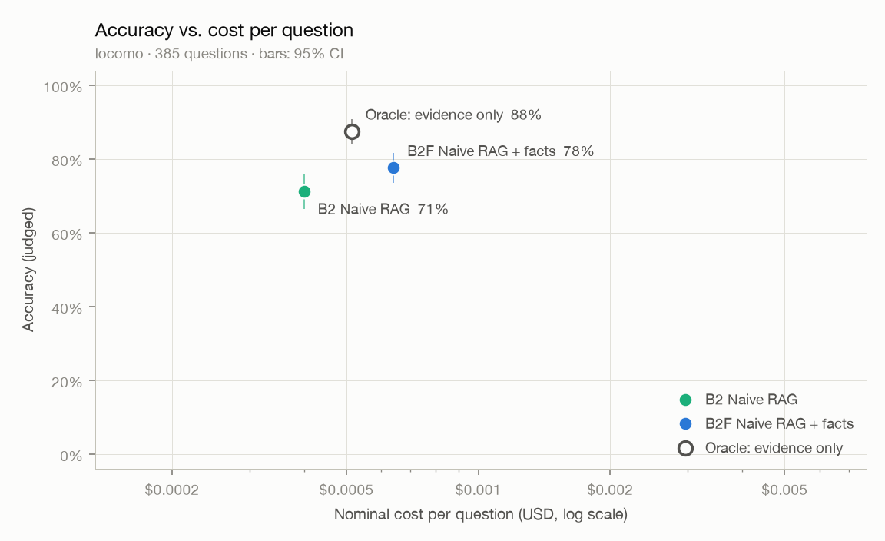

# 评测报告：locomo-3conv-n3

- 数据集：`locomo` · 题数 1540（只跑前 385 题）
- 回答模型：`deepseek-flash` · 判分模型：`qwen3.8-max` · 向量：`text-embedding-v4`（1024 维）
- B2 检索条数 k = 10 · 代码版本 `8c6e1a1-dirty` · 首次运行 2026-10-12T06:34:03

## 总体结果

| 方法 | 题数 | 准确率 | 95% 置信区间 | 平均输入 tokens | 平均输出 tokens | 平均 LLM 调用 | 名义成本 / 题 | 延迟 p50 / p95 |
|---|---|---|---|---|---|---|---|---|
| B2 朴素检索 | 385 | **71.2%** | 66.5% – 75.8% | 1,088 | 61 | 1.00 | $0.00040 | 0.8s / 1.1s |
| B2F 朴素检索 + 事实记忆 | 385 | **77.7%** | 73.5% – 81.6% | 1,877 | 65 | 1.00 | $0.00064 | 0.8s / 1.2s |
| ORACLE 只给证据会话（上限参照） | 385 | **87.5%** | 84.2% – 90.9% | 1,495 | 55 | 1.00 | $0.00051 | 0.7s / 1.1s |

<picture>
  <source media="(prefers-color-scheme: dark)" srcset="pareto-dark.png">
  
</picture>

token F1（LoCoMo 原论文口径）：
- B2：0.196
- B2F：0.238
- ORACLE：0.260

## 分题型准确率

| 题型 | 题数 | B2 | B2F | ORACLE |
|---|---|---|---|---|
| 单跳 | 200 | 78% | 82% | 95% |
| 多跳 | 74 | 42% | 61% | 74% |
| 开放域 | 21 | 38% | 48% | 48% |
| 时间 | 90 | 88% | 88% | 91% |

## 检索质量（前 k = 10 条，不含拒答题）

| 指标 | B2 | B2F | 含义 |
|---|---|---|---|
| 会话召回（任一） | 95.3% | 95.8% | 前 k 条里至少命中一个证据会话的比例 |
| 会话召回（全部） | 91.3% | 92.3% | 证据会话被前 k 条覆盖的平均比例 |
| 发言召回（任一） | 80.4% | 82.0% | 前 k 条里至少有一条包含证据发言的比例 |
| 发言 NDCG | 57.1% | 60.1% | 包含证据发言的轮排得越靠前越高 |

## 错误归因（检索类方法答错的题，不含拒答题）

| 原因 | B2 | B2F |
|---|---|---|
| 检索未命中：前 k 条里没有任何证据发言 | 58 | 40 |
| 命中证据但答错，ORACLE 答对：干扰多或证据不全 | 31 | 28 |
| ORACLE 也答错：阅读与推理问题 | 22 | 18 |

## 写入路径：巩固（N3）

| 项目 | 数值 | 说明 |
|---|---|---|
| 对话历史 / 会话 / 发言 | 3 / 70 / 1,451 | |
| 抽取出的事实 | 601（每会话 8.6 条） | |
| 对账：新增 / 取代 / 合并 / 重放 | 88.4% / 3.2% / 8.5% / 0.0% | 取代 19 次 |
| 由 LLM 裁决的对账 | 88（占 14.6%） | 其余由规则直接判定 |
| 事实：当前有效 / 全部 | 531 / 550 | 被取代的旧事实保留为历史 |
| 实体 | 131 | |
| LLM 调用（抽取 + 对账 + 消歧） | 145 | 含命中缓存的调用 |
| 每千条发言的 token（输入 / 输出） | 133,262 / 59,516 | 抽取时助手回复只保留开头 |
| 每千条发言的名义成本 | $0.0488 | 含向量化 |
| 每份历史的巩固耗时 p50 / p95 | 61.3s / 97.0s | 受供应商并发上限影响 |

## 成本汇总（名义成本，美元）

| 项目 | 名义成本 | 说明 |
|---|---|---|
| 回答 · B2 | $0.1541 | 385 题 |
| 回答 · B2F | $0.2467 | 385 题 |
| 回答 · ORACLE | $0.1980 | 385 题 |
| 写入（向量化） | $0.0026 | 3 份对话历史，37,263 tokens；检索类方法需要，一次写入可服务多次提问 |
| 巩固（抽取、对账、摘要） | $0.0709 | 3 份对话历史；只有 B2F 系列需要，同样是一次性成本 |
| 判分 | $0.4355 | 评测本身的开销，不计入方法成本 |
| **合计** | **$1.1077** | |

## 说明

- 准确率由 LLM 判分得出，使用 LongMemEval 官方模板（逐字照搬）；判分模型与回答模型来自不同家族（D-008）。
- 名义成本按高峰时段、未命中缓存的标价计算，便于不同时间的运行相互比较（D-010）；实际花费因缓存、错峰折扣会更低。
- "名义成本 / 题"只算回答本身；写入与巩固成本是一次性的，单独列出。
- 置信区间为 bootstrap 95%（2000 次重采样，固定种子）。
- 延迟只统计实际调用了模型的题；全部命中本地缓存的方法显示为 —。
