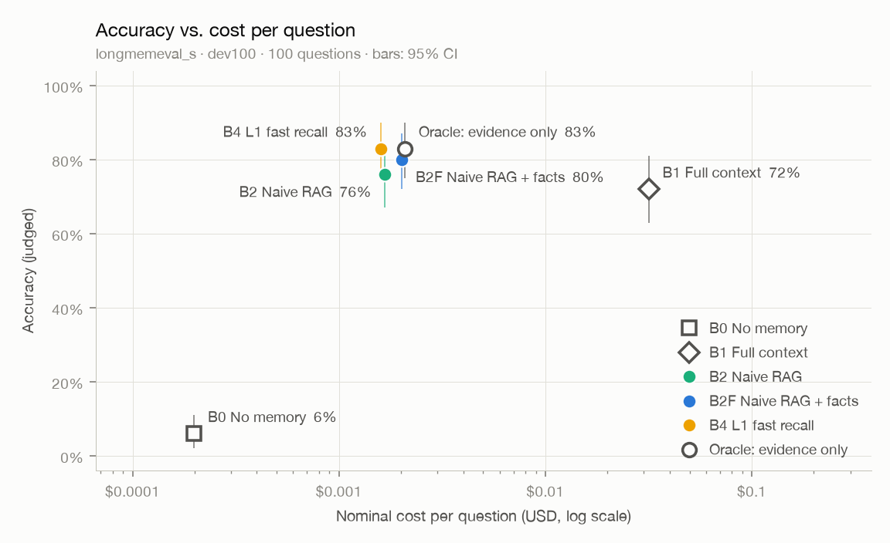

# 评测报告：dev100-n4

- 数据集：`longmemeval_s`（划分 `dev100`） · 题数 100
- 回答模型：`deepseek-flash` · 判分模型：`qwen3.8-max` · 向量：`qwen3.7-text-embedding`（1024 维）
- B2 检索条数 k = 10 · 代码版本 `2e4d8e6-dirty` · 首次运行 2026-10-12T07:55:40

## 总体结果

| 方法 | 题数 | 准确率 | 95% 置信区间 | 平均输入 tokens | 平均输出 tokens | 平均 LLM 调用 | 名义成本 / 题 | 延迟 p50 / p95 |
|---|---|---|---|---|---|---|---|---|
| B0 无记忆 | 100 | **6.0%** | 2.0% – 11.0% | 458 | 51 | 1.00 | $0.00020 | — / — |
| B1 全上下文 | 100 | **72.0%** | 63.0% – 81.0% | 105,262 | 84 | 1.00 | $0.03168 | — / — |
| B2 朴素检索 | 100 | **76.0%** | 67.0% – 84.0% | 5,250 | 81 | 1.00 | $0.00167 | — / — |
| B2F 朴素检索 + 事实记忆 | 100 | **80.0%** | 72.0% – 87.0% | 6,372 | 89 | 1.00 | $0.00202 | — / — |
| B4 L1 快速召回 | 100 | **83.0%** | 75.0% – 90.0% | 4,973 | 87 | 1.00 | $0.00160 | — / — |
| B4-k10 消融：固定取 10 轮 | 100 | **82.0%** | 74.0% – 89.0% | 6,559 | 88 | 1.00 | $0.00207 | — / — |
| B4-k5 消融：固定取 5 轮 | 100 | **82.0%** | 74.0% – 89.0% | 3,908 | 86 | 1.00 | $0.00128 | — / — |
| B4-b2k 消融：预算 2k tokens | 100 | **78.0%** | 70.0% – 85.0% | 3,149 | 83 | 1.00 | $0.00104 | — / — |
| B4-notime 消融：不做时间加分 | 100 | **84.0%** | 76.0% – 91.0% | 4,976 | 87 | 1.00 | $0.00160 | 0.9s / 1.0s |
| B4-norel 消融：不标相对时间 | 100 | **79.0%** | 71.0% – 87.0% | 4,832 | 87 | 1.00 | $0.00155 | 0.9s / 1.7s |
| B4-nobm25 消融：去掉 BM25 | 100 | **81.0%** | 73.0% – 89.0% | 4,977 | 82 | 1.00 | $0.00159 | 0.9s / 1.6s |
| ORACLE 只给证据会话（上限参照） | 100 | **83.0%** | 75.0% – 90.0% | 6,645 | 78 | 1.00 | $0.00209 | — / — |

<picture>
  <source media="(prefers-color-scheme: dark)" srcset="pareto-dark.png">
  
</picture>

## 分题型准确率

| 题型 | 题数 | B0 | B1 | B2 | B2F | B4 | B4-k10 | B4-k5 | B4-b2k | B4-notime | B4-norel | B4-nobm25 | ORACLE |
|---|---|---|---|---|---|---|---|---|---|---|---|---|---|
| 单会话 · 用户说过 | 13 | 0% | 85% | 85% | 100% | 100% | 100% | 100% | 100% | 100% | 100% | 100% | 100% |
| 单会话 · 助手说过 | 11 | 0% | 100% | 100% | 100% | 100% | 100% | 100% | 100% | 100% | 100% | 100% | 100% |
| 单会话 · 偏好 | 6 | 0% | 67% | 67% | 67% | 83% | 67% | 83% | 67% | 83% | 83% | 67% | 67% |
| 多会话推理 | 24 | 0% | 54% | 46% | 54% | 54% | 54% | 58% | 42% | 54% | 42% | 58% | 67% |
| 时间推理 | 25 | 0% | 52% | 72% | 72% | 80% | 80% | 76% | 80% | 84% | 76% | 72% | 72% |
| 知识更新 | 15 | 0% | 93% | 100% | 100% | 100% | 100% | 100% | 100% | 100% | 100% | 100% | 100% |
| 拒答题（应回答"不知道"） | 6 | 100% | 100% | 100% | 100% | 100% | 100% | 83% | 83% | 100% | 100% | 100% | 100% |

## 检索质量（不含拒答题）

检索结果指交给回答模型的全部轮：固定条数的方法取前 k 轮，按 token 预算装入的方法（B4 系列）轮数随每轮的长短变化。轮数不同的方法，召回不能直接比较。

| 指标 | B2 | B2F | B4 | B4-k10 | B4-k5 | B4-b2k | B4-notime | B4-norel | B4-nobm25 | 含义 |
|---|---|---|---|---|---|---|---|---|---|---|
| 平均轮数 | 10.0 | 10.0 | 8.2 | 10.0 | 5.0 | 4.7 | 8.2 | 8.2 | 8.4 | 每题交给回答模型的轮数 |
| 会话召回（任一） | 95.7% | 100.0% | 100.0% | 100.0% | 98.9% | 97.9% | 100.0% | 100.0% | 100.0% | 检索结果里至少命中一个证据会话的比例 |
| 会话召回（全部） | 91.5% | 99.3% | 93.0% | 96.0% | 90.1% | 84.3% | 94.8% | 93.0% | 94.8% | 证据会话被检索结果覆盖的平均比例 |
| 发言召回（任一） | 93.6% | 100.0% | 98.9% | 100.0% | 96.8% | 91.5% | 97.9% | 98.9% | 98.9% | 检索结果里至少有一条包含证据发言的比例 |
| 发言召回（全部） | 87.3% | 96.8% | 90.1% | 92.9% | 86.1% | 77.7% | 89.0% | 90.1% | 91.4% | 包含证据发言的轮被检索结果覆盖的平均比例 |
| 发言 NDCG | 71.9% | 83.0% | 79.2% | 80.6% | 77.4% | 72.7% | 77.8% | 79.2% | 81.8% | 包含证据发言的轮排得越靠前越高 |

## 错误归因（检索类方法答错的题，不含拒答题）

| 原因 | B2 | B2F | B4 | B4-k10 | B4-k5 | B4-b2k | B4-notime | B4-norel | B4-nobm25 |
|---|---|---|---|---|---|---|---|---|---|
| 检索未命中：交给回答模型的轮里没有任何证据发言 | 6 | 0 | 0 | 0 | 2 | 5 | 1 | 1 | 1 |
| 命中证据但答错，ORACLE 答对：干扰多或证据不全 | 7 | 6 | 6 | 7 | 6 | 9 | 6 | 7 | 8 |
| ORACLE 也答错：阅读与推理问题 | 11 | 14 | 11 | 11 | 9 | 7 | 9 | 13 | 10 |

## 写入路径：巩固（N3）

| 项目 | 数值 | 说明 |
|---|---|---|
| 对话历史 / 会话 / 发言 | 100 / 4,806 / 49,831 | |
| 抽取出的事实 | 23,016（每会话 4.8 条） | |
| 对账：新增 / 取代 / 合并 / 重放 | 98.7% / 0.6% / 0.7% / 0.0% | 取代 139 次 |
| 由 LLM 裁决的对账 | 2,893（占 12.6%） | 其余由规则直接判定 |
| 事实：当前有效 / 全部 | 22,707 / 22,848 | 被取代的旧事实保留为历史 |
| 实体 | 15,761 | |
| LLM 调用（抽取 + 对账 + 消歧） | 7,875 | 含命中缓存的调用 |
| 每千条发言的 token（输入 / 输出） | 258,731 / 76,374 | 抽取时助手回复只保留开头 |
| 每千条发言的名义成本 | $0.0770 | 含向量化 |
| 每份历史的巩固耗时 p50 / p95 | 38.0s / 54.2s | 受供应商并发上限影响 |

## 成本汇总（名义成本，美元）

| 项目 | 名义成本 | 说明 |
|---|---|---|
| 回答 · B0 | $0.0199 | 100 题 |
| 回答 · B1 | $3.1679 | 100 题 |
| 回答 · B2 | $0.1672 | 100 题 |
| 回答 · B2F | $0.2019 | 100 题 |
| 回答 · B4 | $0.1597 | 100 题 |
| 回答 · B4-k10 | $0.2073 | 100 题 |
| 回答 · B4-k5 | $0.1276 | 100 题 |
| 回答 · B4-b2k | $0.1044 | 100 题 |
| 回答 · B4-notime | $0.1597 | 100 题 |
| 回答 · B4-norel | $0.1554 | 100 题 |
| 回答 · B4-nobm25 | $0.1592 | 100 题 |
| 回答 · ORACLE | $0.2088 | 100 题 |
| 写入（向量化） | $0.5047 | 100 份对话历史，7,209,712 tokens；检索类方法需要，一次写入可服务多次提问 |
| 巩固（抽取、对账、摘要） | $3.8366 | 100 份对话历史；只有 B2F、B4 系列需要，同样是一次性成本 |
| 判分 | $0.5292 | 评测本身的开销，不计入方法成本 |
| **合计** | **$9.7094** | |

## 说明

- 准确率由 LLM 判分得出，使用 LongMemEval 官方模板（逐字照搬）；判分模型与回答模型来自不同家族（D-008）。
- 名义成本按高峰时段、未命中缓存的标价计算，便于不同时间的运行相互比较（D-010）；实际花费因缓存、错峰折扣会更低。
- "名义成本 / 题"只算回答本身；写入与巩固成本是一次性的，单独列出。
- 置信区间为 bootstrap 95%（2000 次重采样，固定种子）。
- 延迟只统计实际调用了模型的题；全部命中本地缓存的方法显示为 —。
