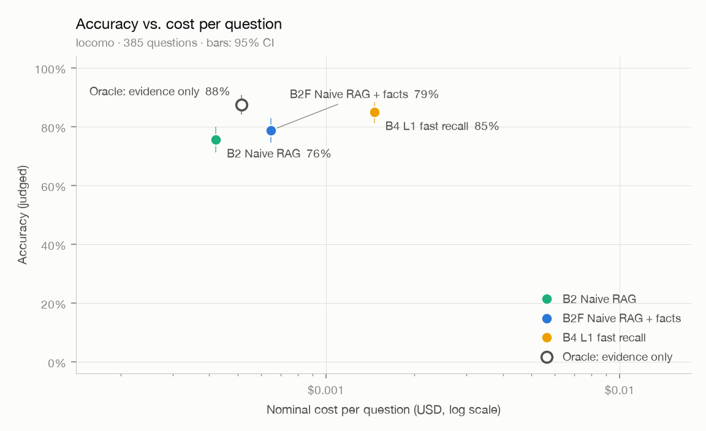

# 评测报告：locomo-3conv-n4

- 数据集：`locomo` · 题数 1540（只跑前 385 题）
- 回答模型：`deepseek-flash` · 判分模型：`qwen3.8-max` · 向量：`qwen3.7-text-embedding`（1024 维）
- B2 检索条数 k = 10 · 代码版本 `2e4d8e6-dirty` · 首次运行 2026-10-12T07:55:37

## 总体结果

| 方法 | 题数 | 准确率 | 95% 置信区间 | 平均输入 tokens | 平均输出 tokens | 平均 LLM 调用 | 名义成本 / 题 | 延迟 p50 / p95 |
|---|---|---|---|---|---|---|---|---|
| B2 朴素检索 | 385 | **75.6%** | 71.2% – 80.0% | 1,152 | 63 | 1.00 | $0.00042 | — / — |
| B2F 朴素检索 + 事实记忆 | 385 | **78.7%** | 74.5% – 82.9% | 1,899 | 65 | 1.00 | $0.00065 | — / — |
| B4 L1 快速召回 | 385 | **84.9%** | 81.3% – 88.3% | 4,586 | 71 | 1.00 | $0.00146 | — / — |
| B4-k10 消融：固定取 10 轮 | 385 | **77.1%** | 73.0% – 81.3% | 2,104 | 66 | 1.00 | $0.00071 | 0.7s / 0.8s |
| B4-b2k 消融：预算 2k tokens | 385 | **85.5%** | 82.1% – 88.8% | 4,378 | 71 | 1.00 | $0.00140 | 0.8s / 0.8s |
| B4-notime 消融：不做时间加分 | 385 | **84.9%** | 81.3% – 88.3% | 4,586 | 70 | 1.00 | $0.00146 | 0.8s / 1.1s |
| B4-norel 消融：不标相对时间 | 385 | **84.9%** | 81.3% – 88.3% | 4,024 | 69 | 1.00 | $0.00129 | 0.9s / 1.3s |
| B4-nobm25 消融：去掉 BM25 | 385 | **86.2%** | 82.9% – 89.4% | 4,574 | 72 | 1.00 | $0.00146 | 0.9s / 1.4s |
| ORACLE 只给证据会话（上限参照） | 385 | **87.5%** | 84.2% – 90.9% | 1,495 | 55 | 1.00 | $0.00051 | — / — |

<picture>
  <source media="(prefers-color-scheme: dark)" srcset="pareto-dark.png">
  
</picture>

token F1（LoCoMo 原论文口径）：
- B2：0.210
- B2F：0.243
- B4：0.235
- B4-k10：0.234
- B4-b2k：0.236
- B4-notime：0.236
- B4-norel：0.239
- B4-nobm25：0.236
- ORACLE：0.260

## 分题型准确率

| 题型 | 题数 | B2 | B2F | B4 | B4-k10 | B4-b2k | B4-notime | B4-norel | B4-nobm25 | ORACLE |
|---|---|---|---|---|---|---|---|---|---|---|
| 单跳 | 200 | 84% | 82% | 88% | 84% | 90% | 88% | 88% | 90% | 95% |
| 多跳 | 74 | 50% | 62% | 81% | 53% | 80% | 81% | 78% | 80% | 74% |
| 开放域 | 21 | 48% | 52% | 57% | 52% | 62% | 57% | 67% | 62% | 48% |
| 时间 | 90 | 84% | 91% | 87% | 87% | 87% | 87% | 87% | 88% | 91% |

## 检索质量（不含拒答题）

检索结果指交给回答模型的全部轮：固定条数的方法取前 k 轮，按 token 预算装入的方法（B4 系列）轮数随每轮的长短变化。轮数不同的方法，召回不能直接比较。

| 指标 | B2 | B2F | B4 | B4-k10 | B4-b2k | B4-notime | B4-norel | B4-nobm25 | 含义 |
|---|---|---|---|---|---|---|---|---|---|
| 平均轮数 | 10.0 | 10.0 | 40.0 | 10.0 | 37.7 | 40.0 | 40.0 | 40.0 | 每题交给回答模型的轮数 |
| 会话召回（任一） | 96.3% | 96.6% | 99.5% | 96.3% | 99.5% | 99.5% | 99.5% | 99.2% | 检索结果里至少命中一个证据会话的比例 |
| 会话召回（全部） | 93.1% | 92.7% | 98.9% | 92.7% | 98.9% | 98.9% | 98.9% | 98.9% | 证据会话被检索结果覆盖的平均比例 |
| 发言召回（任一） | 82.8% | 84.1% | 95.0% | 83.3% | 95.0% | 94.8% | 95.0% | 94.3% | 检索结果里至少有一条包含证据发言的比例 |
| 发言召回（全部） | 77.3% | 77.9% | 91.1% | 76.8% | 90.8% | 90.8% | 91.1% | 91.0% | 包含证据发言的轮被检索结果覆盖的平均比例 |
| 发言 NDCG | 62.3% | 61.3% | 65.6% | 61.8% | 65.5% | 64.9% | 65.6% | 65.8% | 包含证据发言的轮排得越靠前越高 |

## 错误归因（检索类方法答错的题，不含拒答题）

| 原因 | B2 | B2F | B4 | B4-k10 | B4-b2k | B4-notime | B4-norel | B4-nobm25 |
|---|---|---|---|---|---|---|---|---|
| 检索未命中：交给回答模型的轮里没有任何证据发言 | 43 | 34 | 9 | 32 | 8 | 10 | 9 | 11 |
| 命中证据但答错，ORACLE 答对：干扰多或证据不全 | 28 | 27 | 26 | 32 | 23 | 26 | 26 | 18 |
| ORACLE 也答错：阅读与推理问题 | 23 | 21 | 23 | 24 | 25 | 22 | 23 | 24 |

## 写入路径：巩固（N3）

| 项目 | 数值 | 说明 |
|---|---|---|
| 对话历史 / 会话 / 发言 | 3 / 70 / 1,451 | |
| 抽取出的事实 | 601（每会话 8.6 条） | |
| 对账：新增 / 取代 / 合并 / 重放 | 89.0% / 2.0% / 9.0% / 0.0% | 取代 12 次 |
| 由 LLM 裁决的对账 | 93（占 15.5%） | 其余由规则直接判定 |
| 事实：当前有效 / 全部 | 535 / 547 | 被取代的旧事实保留为历史 |
| 实体 | 127 | |
| LLM 调用（抽取 + 对账 + 消歧） | 151 | 含命中缓存的调用 |
| 每千条发言的 token（输入 / 输出） | 135,193 / 59,674 | 抽取时助手回复只保留开头 |
| 每千条发言的名义成本 | $0.0499 | 含向量化 |
| 每份历史的巩固耗时 p50 / p95 | 26.4s / 27.3s | 受供应商并发上限影响 |

## 成本汇总（名义成本，美元）

| 项目 | 名义成本 | 说明 |
|---|---|---|
| 回答 · B2 | $0.1623 | 385 题 |
| 回答 · B2F | $0.2494 | 385 题 |
| 回答 · B4 | $0.5623 | 385 题 |
| 回答 · B4-k10 | $0.2733 | 385 题 |
| 回答 · B4-b2k | $0.5383 | 385 题 |
| 回答 · B4-notime | $0.5622 | 385 题 |
| 回答 · B4-norel | $0.4967 | 385 题 |
| 回答 · B4-nobm25 | $0.5614 | 385 题 |
| 回答 · ORACLE | $0.1980 | 385 题 |
| 写入（向量化） | $0.0053 | 3 份对话历史，75,922 tokens；检索类方法需要，一次写入可服务多次提问 |
| 巩固（抽取、对账、摘要） | $0.0724 | 3 份对话历史；只有 B2F、B4 系列需要，同样是一次性成本 |
| 判分 | $1.3293 | 评测本身的开销，不计入方法成本 |
| **合计** | **$5.0108** | |

## 说明

- 准确率由 LLM 判分得出，使用 LongMemEval 官方模板（逐字照搬）；判分模型与回答模型来自不同家族（D-008）。
- 名义成本按高峰时段、未命中缓存的标价计算，便于不同时间的运行相互比较（D-010）；实际花费因缓存、错峰折扣会更低。
- "名义成本 / 题"只算回答本身；写入与巩固成本是一次性的，单独列出。
- 置信区间为 bootstrap 95%（2000 次重采样，固定种子）。
- 延迟只统计实际调用了模型的题；全部命中本地缓存的方法显示为 —。
