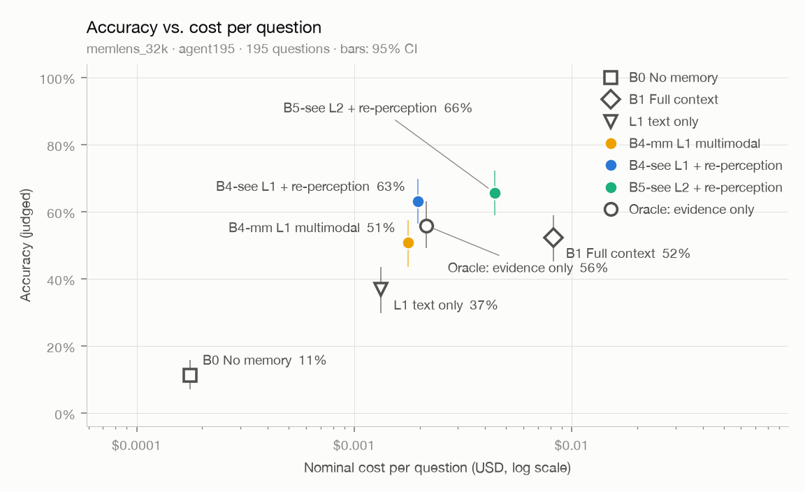

# 评测报告：memlens32-agent195-n6

- 数据集：`memlens_32k`（划分 `agent195`） · 题数 195
- 回答模型：`deepseek-flash` · 判分模型：`qwen3.8-max` · 向量：`qwen3.7-text-embedding`（1024 维）
- B2 检索条数 k = 10 · 代码版本 `c9e3469-dirty` · 首次运行 2026-10-12T18:03:42

## 总体结果

| 方法 | 题数 | 准确率 | 95% 置信区间 | 平均输入 tokens | 平均输出 tokens | 平均 LLM 调用 | 名义成本 / 题 | 延迟 p50 / p95 |
|---|---|---|---|---|---|---|---|---|
| B0 无记忆 | 195 | **11.3%** | 7.2% – 15.9% | 472 | 29 | 1.00 | $0.00018 | 0.7s / 1.0s |
| B1 全上下文 | 195 | **52.3%** | 45.1% – 59.0% | 27,364 | 32 | 1.04 | $0.00825 | 1.7s / 2.2s |
| B4-text 纯文本记忆（图片只留占位） | 195 | **36.9%** | 29.7% – 43.6% | 4,284 | 35 | 1.00 | $0.00133 | 1.0s / 1.2s |
| B4-mm L1：对话 + 图片描述 + 以文搜图 + 事实 | 195 | **50.8%** | 43.6% – 57.4% | 5,738 | 36 | 1.00 | $0.00177 | 0.9s / 1.2s |
| B4-see B4-mm + 再感知原图 | 195 | **63.1%** | 56.4% – 69.7% | 6,412 | 34 | 1.00 | $0.00196 | 1.1s / 1.5s |
| B4-see-novis 消融：B4-see 去掉以文搜图 | 195 | **62.6%** | 55.4% – 69.2% | 5,902 | 35 | 1.00 | $0.00181 | 1.1s / 1.3s |
| B5-see L2 + 再感知原图 | 195 | **65.6%** | 59.0% – 72.3% | 17,009 | 375 | 3.70 | $0.00442 | 7.5s / 11.4s |
| ORACLE 只给证据会话（上限参照） | 195 | **55.9%** | 49.2% – 63.1% | 7,007 | 32 | 1.00 | $0.00214 | 1.1s / 1.6s |

<picture>
  <source media="(prefers-color-scheme: dark)" srcset="pareto-dark.png">
  
</picture>

## 分题型准确率

| 题型 | 题数 | B0 | B1 | B4-text | B4-mm | B4-see | B4-see-novis | B5-see | ORACLE |
|---|---|---|---|---|---|---|---|---|---|
| 信息抽取 | 61 | 0% | 57% | 15% | 41% | 72% | 72% | 80% | 64% |
| 多会话推理 | 35 | 0% | 29% | 29% | 46% | 54% | 60% | 49% | 34% |
| 时间推理 | 48 | 0% | 42% | 40% | 48% | 52% | 48% | 60% | 44% |
| 知识更新 | 29 | 0% | 52% | 41% | 45% | 45% | 41% | 38% | 52% |
| 拒答题（应回答"不知道"） | 22 | 100% | 100% | 100% | 100% | 100% | 100% | 100% | 100% |

## 检索质量（不含拒答题）

检索结果指交给回答模型的全部轮：固定条数的方法取前 k 轮，按 token 预算装入的方法（B4、B5 系列）轮数随每轮的长短变化，B5 的补检索还会再加几轮。轮数不同的方法，召回不能直接比较。

| 指标 | B4-text | B4-mm | B4-see | B4-see-novis | B5-see | 含义 |
|---|---|---|---|---|---|---|
| 平均轮数 | 13.3 | 10.4 | 10.4 | 11.3 | 19.1 | 每题交给回答模型的轮数 |
| 会话召回（任一） | 99.4% | 99.4% | 99.4% | 100.0% | 100.0% | 检索结果里至少命中一个证据会话的比例 |
| 会话召回（全部） | 92.6% | 93.3% | 93.3% | 94.4% | 99.8% | 证据会话被检索结果覆盖的平均比例 |
| 发言召回（任一） | 93.9% | 100.0% | 100.0% | 99.3% | 100.0% | 检索结果里至少有一条包含证据发言的比例 |
| 发言召回（全部） | 54.5% | 87.2% | 87.2% | 61.7% | 98.6% | 包含证据发言的轮被检索结果覆盖的平均比例 |
| 发言 NDCG | 48.2% | 88.9% | 88.9% | 58.8% | 95.5% | 包含证据发言的轮排得越靠前越高 |

## 错误归因（检索类方法答错的题，不含拒答题）

| 原因 | B4-text | B4-mm | B4-see | B4-see-novis | B5-see |
|---|---|---|---|---|---|
| 检索未命中：交给回答模型的轮里没有任何证据发言 | 7 | 1 | 1 | 1 | 0 |
| 命中证据但答错，ORACLE 答对：干扰多或证据不全 | 40 | 24 | 11 | 10 | 11 |
| ORACLE 也答错：阅读与推理问题 | 76 | 71 | 60 | 62 | 56 |
| 其中回答"不知道"（误拒答，按措辞粗略识别） | 88 | 49 | 20 | 20 | 18 |

## L2 检索过程

| 项目 | B5-see |
|---|---|
| 走 L2 的题数 | 195 |
| 查询规划由 LLM 完成 | 100% |
| 平均子查询数 | 1.79 |
| 判为需要穷尽（计数 / 求和 / 列举） | 18% |
| 带时间区间 | 1% |
| 平均充分性检查次数 | 1.71 |
| 至少补检索一次 | 71% |
| 平均证据 tokens（轮） | 7,175 |
| 每题规划与检查的调用次数 | 2.70 |

## 再感知

| 方法 | 平均附图张数 | 附了原图的题 |
|---|---|---|
| B4-see | 3.00 | 100% |
| B4-see-novis | 2.48 | 100% |
| B5-see | 3.00 | 100% |

## 写入路径：巩固（N3）

| 项目 | 数值 | 说明 |
|---|---|---|
| 对话历史 / 会话 / 发言 | 195 / 2,580 / 23,979 | |
| 抽取出的事实 | 10,576（每会话 4.1 条） | |
| 对账：新增 / 取代 / 合并 / 重放 | 99.1% / 0.4% / 0.5% / 0.0% | 取代 41 次 |
| 由 LLM 裁决的对账 | 1,780（占 16.8%） | 其余由规则直接判定 |
| 事实：当前有效 / 全部 | 10,634 / 10,677 | 被取代的旧事实保留为历史 |
| 实体 | 6,543 | |
| LLM 调用（抽取 + 对账 + 消歧） | 8,900 | 含命中缓存的调用 |
| 每千条发言的 token（输入 / 输出） | 421,913 / 102,937 | 抽取时助手回复只保留开头 |
| 每千条发言的名义成本 | $0.1152 | 含向量化 |
| 每份历史的巩固耗时 p50 / p95 | 46.8s / 81.6s | 受供应商并发上限影响 |

## 成本汇总（名义成本，美元）

| 项目 | 名义成本 | 说明 |
|---|---|---|
| 回答 · B0 | $0.0344 | 195 题 |
| 回答 · B1 | $1.6083 | 195 题 |
| 回答 · B4-text | $0.2595 | 195 题 |
| 回答 · B4-mm | $0.3446 | 195 题 |
| 回答 · B4-see | $0.3831 | 195 题 |
| 回答 · B4-see-novis | $0.3534 | 195 题 |
| 回答 · B5-see | $0.8626 | 195 题 |
| 回答 · ORACLE | $0.4174 | 195 题 |
| 写入（向量化） | $0.2355 | 195 份对话历史，3,314,537 tokens；检索类方法需要，一次写入可服务多次提问 |
| 巩固（抽取、对账、摘要） | $2.7624 | 195 份对话历史；只有 B4、B5 系列需要，同样是一次性成本 |
| 判分 | $6.2303 | 评测本身的开销，不计入方法成本 |
| **合计** | **$13.4914** | |

## 说明

- 准确率由 LLM 判分得出，使用 LongMemEval 官方模板（逐字照搬）；判分模型与回答模型来自不同家族（D-008）。
- 名义成本按高峰时段、未命中缓存的标价计算，便于不同时间的运行相互比较（D-010）；实际花费因缓存、错峰折扣会更低。
- "名义成本 / 题"只算回答本身；写入与巩固成本是一次性的，单独列出。
- 置信区间为 bootstrap 95%（2000 次重采样，固定种子）。
- 延迟只统计实际调用了模型的题；全部命中本地缓存的方法显示为 —。
