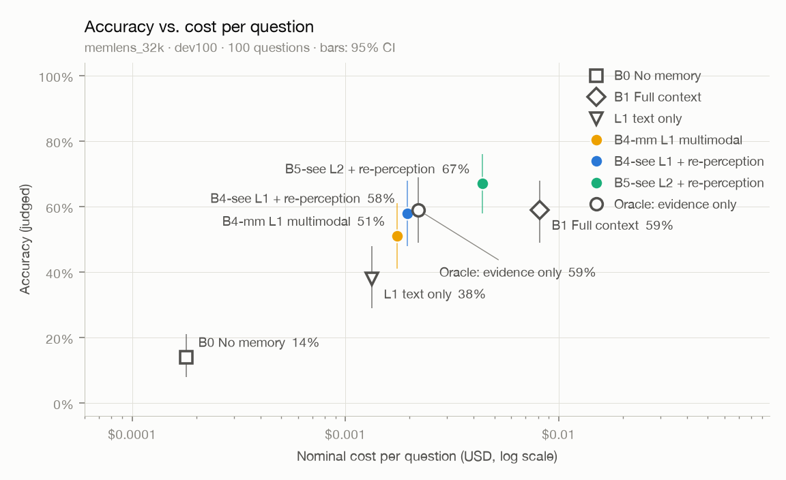

# 评测报告：memlens32-dev100-n6

- 数据集：`memlens_32k`（划分 `dev100`） · 题数 100
- 回答模型：`deepseek-flash` · 判分模型：`qwen3.8-max` · 向量：`qwen3.7-text-embedding`（1024 维）
- B2 检索条数 k = 10 · 代码版本 `c9e3469-dirty` · 首次运行 2026-10-12T18:01:59

## 总体结果

| 方法 | 题数 | 准确率 | 95% 置信区间 | 平均输入 tokens | 平均输出 tokens | 平均 LLM 调用 | 名义成本 / 题 | 延迟 p50 / p95 |
|---|---|---|---|---|---|---|---|---|
| B0 无记忆 | 100 | **14.0%** | 8.0% – 21.0% | 482 | 29 | 1.00 | $0.00018 | 0.7s / 1.0s |
| B1 全上下文 | 100 | **59.0%** | 49.0% – 68.0% | 26,968 | 35 | 1.02 | $0.00813 | 1.7s / 2.2s |
| B4-text 纯文本记忆（图片只留占位） | 100 | **38.0%** | 29.0% – 48.0% | 4,280 | 36 | 1.00 | $0.00133 | 0.9s / 1.3s |
| B4-cap 对话 + 上下文感知的图片描述 | 100 | **48.0%** | 38.0% – 58.0% | 4,665 | 35 | 1.00 | $0.00144 | 0.9s / 1.2s |
| B4-iso 对话 + 孤立的图片描述 | 100 | **51.0%** | 41.0% – 61.0% | 4,603 | 35 | 1.00 | $0.00142 | 0.9s / 1.2s |
| B4-mm L1：对话 + 图片描述 + 以文搜图 + 事实 | 100 | **51.0%** | 41.0% – 61.0% | 5,697 | 37 | 1.00 | $0.00175 | 0.9s / 1.2s |
| B4-see B4-mm + 再感知原图 | 100 | **58.0%** | 48.0% – 68.0% | 6,377 | 36 | 1.00 | $0.00196 | 1.1s / 1.6s |
| B4-novis 消融：B4-mm 去掉以文搜图 | 100 | **52.0%** | 42.0% – 61.0% | 5,284 | 36 | 1.00 | $0.00163 | 0.9s / 1.2s |
| B4-see-novis 消融：B4-see 去掉以文搜图 | 100 | **61.0%** | 51.0% – 70.0% | 5,833 | 37 | 1.00 | $0.00179 | 1.1s / 1.5s |
| B5-see L2 + 再感知原图 | 100 | **67.0%** | 58.0% – 76.0% | 16,699 | 408 | 3.69 | $0.00438 | 7.6s / 11.1s |
| ORACLE 只给证据会话（上限参照） | 100 | **59.0%** | 49.0% – 69.0% | 7,178 | 33 | 1.00 | $0.00219 | 1.1s / 1.6s |

<picture>
  <source media="(prefers-color-scheme: dark)" srcset="pareto-dark.png">
  
</picture>

## 分题型准确率

| 题型 | 题数 | B0 | B1 | B4-text | B4-cap | B4-iso | B4-mm | B4-see | B4-novis | B4-see-novis | B5-see | ORACLE |
|---|---|---|---|---|---|---|---|---|---|---|---|---|
| 信息抽取 | 31 | 0% | 71% | 16% | 42% | 45% | 45% | 71% | 42% | 71% | 81% | 71% |
| 多会话推理 | 18 | 0% | 33% | 22% | 17% | 28% | 28% | 22% | 33% | 28% | 39% | 28% |
| 时间推理 | 25 | 12% | 44% | 36% | 44% | 44% | 40% | 40% | 40% | 44% | 44% | 44% |
| 知识更新 | 15 | 0% | 60% | 60% | 67% | 67% | 73% | 73% | 80% | 80% | 87% | 67% |
| 拒答题（应回答"不知道"） | 11 | 100% | 100% | 100% | 100% | 100% | 100% | 100% | 100% | 100% | 100% | 100% |

## 检索质量（不含拒答题）

检索结果指交给回答模型的全部轮：固定条数的方法取前 k 轮，按 token 预算装入的方法（B4、B5 系列）轮数随每轮的长短变化，B5 的补检索还会再加几轮。轮数不同的方法，召回不能直接比较。

| 指标 | B4-text | B4-cap | B4-iso | B4-mm | B4-see | B4-novis | B4-see-novis | B5-see | 含义 |
|---|---|---|---|---|---|---|---|---|---|
| 平均轮数 | 12.9 | 12.3 | 12.3 | 10.3 | 10.3 | 11.1 | 11.1 | 18.4 | 每题交给回答模型的轮数 |
| 会话召回（任一） | 97.8% | 97.8% | 97.8% | 98.9% | 98.9% | 97.8% | 97.8% | 100.0% | 检索结果里至少命中一个证据会话的比例 |
| 会话召回（全部） | 90.9% | 90.9% | 90.2% | 92.5% | 92.5% | 92.5% | 92.5% | 99.5% | 证据会话被检索结果覆盖的平均比例 |
| 发言召回（任一） | 93.3% | 98.7% | 96.0% | 100.0% | 100.0% | 94.7% | 94.7% | 100.0% | 检索结果里至少有一条包含证据发言的比例 |
| 发言召回（全部） | 51.2% | 65.1% | 60.7% | 86.2% | 86.2% | 57.0% | 57.0% | 97.7% | 包含证据发言的轮被检索结果覆盖的平均比例 |
| 发言 NDCG | 44.9% | 60.7% | 56.2% | 86.3% | 86.3% | 54.6% | 54.6% | 92.9% | 包含证据发言的轮排得越靠前越高 |

## 错误归因（检索类方法答错的题，不含拒答题）

| 原因 | B4-text | B4-cap | B4-iso | B4-mm | B4-see | B4-novis | B4-see-novis | B5-see |
|---|---|---|---|---|---|---|---|---|
| 检索未命中：交给回答模型的轮里没有任何证据发言 | 5 | 2 | 4 | 1 | 1 | 6 | 6 | 0 |
| 命中证据但答错，ORACLE 答对：干扰多或证据不全 | 23 | 13 | 10 | 12 | 6 | 11 | 5 | 7 |
| ORACLE 也答错：阅读与推理问题 | 34 | 37 | 35 | 36 | 35 | 31 | 28 | 26 |
| 其中回答"不知道"（误拒答，按措辞粗略识别） | 48 | 30 | 31 | 25 | 14 | 25 | 14 | 12 |

## L2 检索过程

| 项目 | B5-see |
|---|---|
| 走 L2 的题数 | 100 |
| 查询规划由 LLM 完成 | 100% |
| 平均子查询数 | 1.72 |
| 判为需要穷尽（计数 / 求和 / 列举） | 17% |
| 带时间区间 | 8% |
| 平均充分性检查次数 | 1.69 |
| 至少补检索一次 | 69% |
| 平均证据 tokens（轮） | 7,152 |
| 每题规划与检查的调用次数 | 2.69 |

## 再感知

| 方法 | 平均附图张数 | 附了原图的题 |
|---|---|---|
| B4-see | 3.00 | 100% |
| B4-see-novis | 2.48 | 100% |
| B5-see | 3.00 | 100% |

## 写入路径：巩固（N3）

| 项目 | 数值 | 说明 |
|---|---|---|
| 对话历史 / 会话 / 发言 | 100 / 1,334 / 12,370 | |
| 抽取出的事实 | 5,441（每会话 4.1 条） | |
| 对账：新增 / 取代 / 合并 / 重放 | 99.4% / 0.2% / 0.5% / 0.0% | 取代 9 次 |
| 由 LLM 裁决的对账 | 853（占 15.7%） | 其余由规则直接判定 |
| 事实：当前有效 / 全部 | 5,406 / 5,415 | 被取代的旧事实保留为历史 |
| 实体 | 3,292 | |
| LLM 调用（抽取 + 对账 + 消歧） | 4,642 | 含命中缓存的调用 |
| 每千条发言的 token（输入 / 输出） | 424,576 / 103,075 | 抽取时助手回复只保留开头 |
| 每千条发言的名义成本 | $0.1160 | 含向量化 |
| 每份历史的巩固耗时 p50 / p95 | 66.1s / 105.4s | 受供应商并发上限影响 |

## 成本汇总（名义成本，美元）

| 项目 | 名义成本 | 说明 |
|---|---|---|
| 回答 · B0 | $0.0179 | 100 题 |
| 回答 · B1 | $0.8132 | 100 题 |
| 回答 · B4-text | $0.1327 | 100 题 |
| 回答 · B4-cap | $0.1442 | 100 题 |
| 回答 · B4-iso | $0.1423 | 100 题 |
| 回答 · B4-mm | $0.1753 | 100 题 |
| 回答 · B4-see | $0.1956 | 100 题 |
| 回答 · B4-novis | $0.1628 | 100 题 |
| 回答 · B4-see-novis | $0.1794 | 100 题 |
| 回答 · B5-see | $0.4385 | 100 题 |
| 回答 · ORACLE | $0.2193 | 100 题 |
| 写入（向量化） | $0.1592 | 100 份对话历史，2,235,266 tokens；检索类方法需要，一次写入可服务多次提问 |
| 巩固（抽取、对账、摘要） | $1.4348 | 100 份对话历史；只有 B4、B5 系列需要，同样是一次性成本 |
| 判分 | $4.3957 | 评测本身的开销，不计入方法成本 |
| **合计** | **$8.6111** | |

## 说明

- 准确率由 LLM 判分得出，使用 LongMemEval 官方模板（逐字照搬）；判分模型与回答模型来自不同家族（D-008）。
- 名义成本按高峰时段、未命中缓存的标价计算，便于不同时间的运行相互比较（D-010）；实际花费因缓存、错峰折扣会更低。
- "名义成本 / 题"只算回答本身；写入与巩固成本是一次性的，单独列出。
- 置信区间为 bootstrap 95%（2000 次重采样，固定种子）。
- 延迟只统计实际调用了模型的题；全部命中本地缓存的方法显示为 —。
