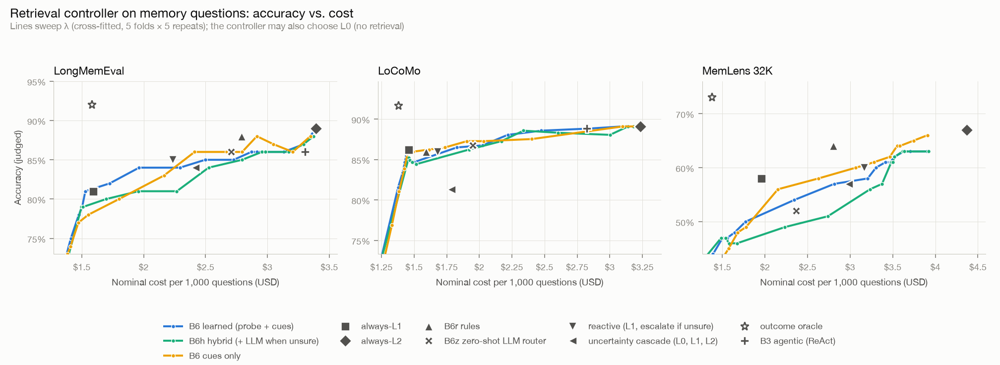

# N7 结果：检索控制器

控制器决定每一问用哪一档检索：L0 只用常驻上下文（核心记忆）、L1 快速召回、L2 深度检索，有图的空间里再决定要不要回看原图（再感知）。本节点做了：

- 记忆探针：一次不调用 LLM 的检索，产出 54 个特征；
- 离线全信息标注：每道题的每个动作都跑过、判过分；
- 两段式控制器：先判"要不要记忆"与推理类型，再查各档在这类题上的准确率，按 P̂(答对) − λ · 成本选动作；
- 混合流：记忆问题与不需要记忆的查询混在一起；
- 对照：规则（B6r）、零样本 LLM 路由（B6z）、模型自主检索（B3）、反应式升级、按不确定度逐级升级；
- 换一个回答模型（qwen3.8-flash）复测（H3）。

**数据**：开发集记忆题 585 道（LongMemEval dev100、LoCoMo 前 3 段对话 385 题、MemLens 32K dev100），加上混合流里 1,170 条与记忆无关的查询。所有数字都是交叉拟合：按对话历史分 5 折、重复 5 次，每道题的预测都来自没见过它的模型。测试集（test400、LoCoMo 其余 7 段对话、MemLens 195 题子集）没有动，留给 N9。回答模型 deepseek-flash，判分 qwen3.8-max，成本是名义成本（D-010）。完整数字在 [results.json](results.json)。

## 结论

1. **控制器的价值在"要不要动用记忆"，不在"L1 还是 L2"。** 在 20% 记忆题、80% 无关查询的混合流里：
   - **总是检索**（always-L1）：每千题 $1.57；
   - **学到的控制器 B6**（默认 λ = 30，不调用 LLM）：每千题 $0.87，便宜 45%；记忆题准确率 81.2%，不低于总是检索的 80.5%；
   - **规则版 B6r**：从不跳过检索，每千题 $1.92。
2. **只看记忆题时，L1 与 L2 之间能挣的很少。**
   - **事后理想路由**（88.5%、每千题 $1.41）大多是在"吃"回答的随机翻转：同一道题 L1、L2 的证据只差一点，回答就可能翻转，585 题里 L2 救回 45 题、又弄错 17 题，单跳题上是 +6 / −5。
   - **已知真实题型的路由**（多会话与时间题走 L2）是更现实的上限：84.4%、每千题 $2.44。也就是说，就算题型判得完全准，也只能比 always-L2（85.3%、$3.46）省 29%、少 0.9 个点。
   - **学到的深度决策没有赢过规则**：B6 81.2% / $2.14，B6r 82.6% / $2.01（配对 +9 / −17，p = 0.17）。
3. **读法比路由重要。** "L1 + 先记笔记再回答"（N5 的 B4-note）在 LongMemEval 上 86% / $1.86，在 LoCoMo 上 88.6% / $1.72，比所有路由策略都更划算。
4. **H1 的结论分两半。**
   - **"要不要记忆"这个决策上**，探针特征是关键。区分记忆题与无关查询的 AUC：只看问题线索 0.79，只看检索反馈 0.96，两者合用 0.98。真实的通用请求上合用版是 0.99，词袋 TF-IDF 只有 0.94。
   - **按模型不确定度逐级升级（L0 → L1 → L2）最差**：77.6%，比总是检索还低。回答模型在 L0 上对 13% 的记忆题"自信地"答了，没有触发升级。
   - **推理类型（决定 L1 / L2）主要看问题怎么问**：词袋 TF-IDF 分得最好（78%），探针特征帮不上忙。
5. **零样本 LLM 路由判"要不要记忆"更准，但每问多一次调用。**
   - B6z 把 99.6% 的无关查询判为不需要记忆，但漏掉 5.3% 的记忆题：偏好类（"我手机电池最近不行，有什么建议？"）和指代已分享图片的问题（"那条消息拼出了什么？"）。
   - B6 不调用 LLM，误召回 19%，漏召回 2.4%。
   - 混合方案 B6h 只在门控拿不准时问 LLM（19% 的查询），误召回降到 10%。
6. **跨数据集泛化不行，但少量目标数据就能补回来。**
   - 只在另外两个数据集上训练时，门控把 LoCoMo 的第三人称问题（"Caroline 上周去了哪？"）当成无关查询：55% 的记忆题被放到 L0，准确率从 86.5% 掉到 43.9%。词袋迁移得好一些（77.1%）。
   - 加上 LoCoMo 里随机的 20 条带标注的样本（加权），准确率回到 85.7%，被放到 L0 的记忆题降到 2.5%。
7. **H3 不成立：换一个回答模型后，模型自主检索反而最好。**
   - 回答模型换成 qwen3.8-flash，固定档位与控制器都掉 2–7 个点。
   - B3 持平或变好：LongMemEval 91%、LoCoMo 90.1%，每千题 $1.57 / $1.41，比 always-L2 更准也更便宜，检索次数还更少。
   - 控制器的选档不随回答模型变，它的结果却随回答模型变；"让模型自己决定"好不好，取决于这个模型会不会用工具。
8. **H2（与 always-L2 准确率相近、成本显著更低）在纯记忆题上不成立**：准确率不低于 always-L2 减 1 个点的 λ 只有 0（84.6%、成本只省 3%）。混合流里相对"总是检索"省 45%，是成立的那一半。

## 记忆题：三个开发集合并（585 题）

| 策略 | 准确率 | 每千题名义成本 | 走 L0 | 走 L2 | 说明 |
|---|---|---|---|---|---|
| always-L0 只用核心记忆 | 11.3% | $0.29 | 100% | 0% | 拒答题与核心记忆里就有答案的题 |
| always-L1 | 80.5% | $1.57 | 0% | 0% | MemLens 上带再感知（下同） |
| always-L2 | 85.3% | $3.46 | 0% | 100% | |
| B6r 规则版（N5） | 82.6% | $2.01 | 0% | 21% | LongMemEval 上 62% 走 L2，LoCoMo 上 8%，MemLens 上 32% |
| B6z 零样本 LLM 路由 | 80.7% | $2.15 | 5.3% | 29% | 含路由那次调用；MemLens 上 24% 的题被判"不需要记忆" |
| 反应式升级（L1 不确定才走 L2） | 81.4% | $2.03 | 0% | 10% | 升级时两档的钱都花了 |
| 按不确定度逐级升级（L0 → L1 → L2） | 77.6% | $2.10 | 13% | 10% | 回答模型在 L0 上就自信作答、停下（13% 的题，其中近一半答错） |
| **B6 学到的控制器（λ = 30）** | **81.2%** | **$2.14** | 2.4% | 31% | 默认 λ：准确率不低于 always-L1 的最省钱的 λ |
| B6h 混合（拿不准时问 LLM） | 80.2% | $2.21 | 3.9% | 35% | 31% 的记忆题问了 LLM |
| B6 + 反应式升级 | 81.7% | $2.35 | 2.4% | 36% | |
| B6（λ = 0，只求准） | 84.6% | $3.36 | 0% | 96% | |
| 已知真实题型的路由（参照） | 84.4% | $2.44 | 0% | 44% | 多会话与时间题走 L2，不可部署 |
| 事后理想路由（参照） | 88.5% | $1.41 | 23% | 8% | 每题选最便宜且答对的动作，"吃"回答的随机翻转 |

<picture>
  <source media="(prefers-color-scheme: dark)" srcset="pareto-dark.png">
  
</picture>

分数据集（准确率 / 每千题名义成本）：

| 策略 | LongMemEval dev100 | LoCoMo 385 题 | MemLens 32K dev100 |
|---|---|---|---|
| always-L1 | 81.0% / $1.59 | 86.2% / $1.46 | 58.0% / $1.96 |
| always-L2 | 89.0% / $3.39 | 89.1% / $3.23 | 67.0% / $4.37 |
| B4-note（L1 + 先记笔记） | 86.0% / $1.86 | 88.6% / $1.72 | — |
| B3 模型自主检索 | 86.0% / $3.30 | 88.8% / $2.82 | — |
| B6r 规则版 | **88.0%** / $2.79 | 86.0% / $1.59 | 64.0% / $2.81 |
| B6z 零样本 LLM 路由 | 86.0% / $2.71 | 86.8% / $1.95 | 52.0% / $2.36 |
| B6（λ = 30） | 84.0% / $2.29 | 86.5% / $1.83 | 58.0% / $3.21 |
| 已知真实题型的路由 | 89.0% / $2.52 | 89.1% / $2.26 | 62.0% / $3.05 |

配对符号检验（B6 对其他策略，三个开发集合并）：对 always-L1 +19 / −15（p = 0.61），对 always-L2 +8 / −32（p < 0.001），对 B6r +9 / −17（p = 0.17），对 B6z +20 / −17（p = 0.74）。

- **规则在 LongMemEval 上最好，换数据集就失灵**：B6r 的线索词（how many、how long、first……）正好覆盖 LongMemEval 的多会话题与时间题。LoCoMo 的多跳题几乎不带这些词，只有 8% 的题触发规则；MemLens 上比 B6 高 6 个点，但对 always-L2 仍少 3 个点。
- **MemLens 上 L2 的增益分散在各类题上**（信息抽取 +3 / −0、知识更新 +2 / −0、多会话 +5 / −2），按题型路由也拿不到（已知真实题型 62%，低于 B6r 的 64%）。

## 混合流：该不该想起

构建方法（`scripts/n7_mixed.py`）：

- **通用请求 585 条**：databricks-dolly-15k（CC BY-SA 3.0）里不带参考材料的四类——开放问答、一般问答、头脑风暴、创作，按类别比例抽取，仓库里只记行号。
- **同话题的难负例 585 条**：对每道记忆题，让 qwen3.8-flash 写一个话题相同、但与用户本人无关的问题（"Gina 的网店是什么时候开的？" → "开一家网上服装店通常要经过哪些步骤？"），提交在 `evals/mixed/topic_negatives.jsonl`。
- **记忆空间**：难负例用它对应那道记忆题的空间（同一个话题，最难分辨），通用请求随机借一道记忆题的空间与提问时间。
- **假设**：无关查询在任何一档都能答好（L0 就够），各档成本取所在数据集记忆题的平均值；回答模型对它们不会自称"不知道"，这是对级联最有利的假设。

| 策略 | 记忆题准确率 | 每千题平均成本（记忆题 20%） | 每千题平均成本（记忆题 50%） | 无关查询走了检索（误召回） | 记忆题被放到 L0 |
|---|---|---|---|---|---|
| always-L1（总是检索） | 80.5% | $1.57 | $1.57 | 100% | 0% |
| always-L2 | 85.3% | $3.46 | $3.46 | 100% | 0% |
| B6r 规则版 | 82.6% | $1.92 | $1.95 | 100% | 0% |
| B6z 零样本 LLM 路由 | 80.7% | $0.72 | $1.25 | 0.4% | 5.3% |
| 按不确定度逐级升级 | 77.6% | $0.66 | $1.20 | 0%（假设） | 13.3% |
| **B6（λ = 30）** | **81.2%** | **$0.87** | **$1.35** | 19.2% | 2.4% |
| B6h 混合（拿不准时问 LLM） | 80.2% | $0.80 | $1.32 | 10.3% | 3.9% |
| B6 只用问题线索 | 81.0% | $1.55 | $1.67 | 89.2% | 1.0% |
| B6 只用探针反馈 | 80.9% | $1.01 | $1.38 | 32.3% | 1.0% |
| B6 词袋 TF-IDF | 80.9% | $1.07 | $1.36 | 43.3% | 1.2% |
| 事后理想路由（参照） | 88.5% | $0.52 | $0.85 | 0% | 22.7% |

<picture>
  <source media="(prefers-color-scheme: dark)" srcset="mixed-dark.png">
  
</picture>

- **B6 与 B6z 各有所长**：B6z 判得更准、更便宜，但每条查询都多一次 LLM 调用（qwen3.8-flash，p50 0.58 秒、p95 0.83 秒），而且看不到记忆，偏好类问题与指代图片的问题会被它判成"不需要记忆"；B6 不调用 LLM（探针 p50 56–271 毫秒，取决于空间大小），漏得更少，代价是 19% 的无关查询仍去检索。
- **B6h** 只在门控拿不准（P(无关) 在 0.1–0.9 之间）时问 LLM：19% 的查询（无关查询 13%、记忆题 31%）多一次调用，误召回 19% → 10%，漏召回 2.4% → 3.9%（LLM 的偏好题误判跟着进来了）。区间与 LLM 判断换算成的概率（0.95）是事先定的，没有在评测数据上调。

## 特征：H1

| 特征 | "要不要记忆"的 AUC：全部 / 难负例 / 通用请求 | 记忆题推理类型的准确率 | 记忆题曲线下面积 |
|---|---|---|---|
| q 只看问题线索（26 个） | 0.787 / 0.829 / 0.745 | 69.7% | 0.824 |
| p 只看探针反馈与记忆规模（28 个） | 0.960 / 0.926 / 0.994 | 51.3% | 0.821 |
| **q + p（默认，54 个）** | **0.983** / 0.972 / **0.994** | 74.4% | 0.820 |
| 词袋 TF-IDF（只看问题文本） | 0.957 / **0.978** / 0.936 | **78.1%** | 0.826 |

"曲线下面积"是记忆题上 λ 曲线的帕累托前沿在 always-L1 到 always-L2 的成本区间里的平均准确率；直接拟合每档答对概率（设计文档 §6.3 原方案）是 0.814，比两段式低。

- 门控里指向"需要记忆"的系数最大的是事实 top-1 相似度（−3.7）、轮 top-1 相似度、摘要的 z 分数与第一人称。特征之间相关（同一次检索的各种分数），单个系数只能看方向，不能当作各自的贡献。
- 推理类型权重最大的特征：时间题看 "when"、时间词、专有名词与实体命中；多会话题看摘要分数、聚合词；偏好题看"推荐 / 建议"与第二人称；知识更新题看前 10 轮的时间跨度与"现在 / 最近"。
- 推理类型分错最多的是多会话 / 多跳题：116 道里 51 道（44%）被当成单点事实（LoCoMo 的 "What activities does Melanie partake in?" 这类不带聚合词的列举）；时间题 140 道分对 129 道。

## 跨数据集：在另外两个数据集上训练

| 测试数据集 | 同数据集交叉拟合 | 跨数据集（q + p） | 跨数据集（只看问题线索） | 跨数据集（词袋） |
|---|---|---|---|---|
| LongMemEval | 84.0%（L0 3%） | 81.0%（L0 10%） | 81.0% | 80.0% |
| LoCoMo | 86.5%（L0 1%） | **43.9%（L0 55%）** | 15.1%（L0 91%） | 77.1% |
| MemLens 32K | 58.0%（L0 6%） | 38.0%（L0 40%） | 52.0% | 51.0% |

"要不要记忆"的 AUC 跨数据集后：LongMemEval 0.986 → 0.960，LoCoMo 0.990 → 0.847，MemLens 0.931 → 0.844。

- LongMemEval 与 MemLens 的问题是第一人称（"我上次买的……"），LoCoMo 是第三人称、点名道姓（"Caroline 什么时候……"）。没见过 LoCoMo 的门控把"没有第一人称"当成"与记忆无关"的强信号。
- 探针的分数分布也随数据集变：LoCoMo 的一轮只有一句话，相似度的尺度与 LongMemEval 的长回复不同。
**加上少量目标场景的数据**：在另外两个数据集上训练时，再加上目标数据集里随机抽的 N 条（记忆题与无关查询都有，总权重是其他数据的一半，事先定的），在目标数据集其余的题上评测，重复 10 次取平均：

| 目标数据集 | N = 0 | N = 10 | N = 20 | N = 50 | N = 100 | 同数据集交叉拟合 |
|---|---|---|---|---|---|---|
| LoCoMo（记忆题准确率 / 被放到 L0） | 43.9% / 55% | 78.4% / 11% | **85.7% / 2.5%** | 86.1% / 2.0% | 86.8% / 1.6% | 86.5% / 1.3% |
| MemLens 32K | 38.0% / 40% | 49.1% / 16% | 49.9% / 15% | 54.9% / 11% | 56.2% / 8.4% | 58.0% / 6.0% |
| LongMemEval | 81.0% / 10% | 80.0% / 10% | 81.7% / 8.0% | 83.4% / 5.5% | 85.2% / 4.2% | 84.0% / 3.0% |

LoCoMo 上只要 20 条（其中约三分之一是记忆题），门控就学会"点名道姓的第三人称问题也要查记忆"。代价是更保守：无关查询判为不需要检索的比例 93% → 82%。

- 结论：控制器不能零样本迁移到新的对话风格，但几十条目标场景的标注就能把大部分损失补回来。上线时可以先用规则或零样本路由，攒几十条带反馈的日志后再校准；更进一步是用线上的部分反馈持续学习（路线图里的 ☆ 上下文 bandit，没有做）。

## 换一个回答模型：H3

同一批开发题（LongMemEval dev100、LoCoMo 385 题）用 qwen3.8-flash 作回答模型，重跑 L0 / L1 / L2 与 B3。B6 的选档用主实验交叉拟合的结果，B6r 的选档由规则决定，两者都只看问题与探针，换了回答模型，只是"这一档答没答对"变了。B3 的检索决定由回答模型自己做，换了模型，决定也跟着变（`scripts/n7_h3.py`，结果在 [h3.json](h3.json)）。

| 方法 | LongMemEval：deepseek-flash → qwen3.8-flash | LoCoMo：deepseek-flash → qwen3.8-flash | qwen3.8-flash 下每千题成本 LongMemEval / LoCoMo |
|---|---|---|---|
| always-L1 | 81.0% → 79.0%（+7 / −9） | 86.2% → 81.8%（+13 / −30，p = 0.014） | $0.83 / $0.80 |
| always-L2 | 89.0% → 82.0%（+5 / −12） | 89.1% → 86.2%（+11 / −22，p = 0.080） | $2.30 / $2.28 |
| B6r 规则版 | 88.0% → 82.0%（+7 / −13） | 86.0% → 81.8%（+13 / −29，p = 0.020） | $1.86 / $0.92 |
| B6 学到的控制器（交叉拟合的选档） | 84.0% → 82.0%（+8 / −10） | 86.5% → 81.8%（+10 / −28，p = 0.005） | $1.40 / $1.11 |
| **B3 模型自主检索** | 86.0% → **91.0%**（+6 / −1） | 88.8% → **90.1%**（+20 / −15） | $1.57 / $1.41 |

qwen3.8-flash 下 B3 对其他方法（配对）：LongMemEval 对 B6、B6r、always-L2 都是 +12 / −3（p = 0.035）；LoCoMo 对 B6 +40 / −8、对 B6r +43 / −11（p < 0.001），对 always-L2 +28 / −13（p = 0.028）。

表与上一段的 p 都没有校正。按数据集分族做 Holm 校正后（[h3-holm.json](h3-holm.json)，`scripts/multiplicity.py`，D-069）：LongMemEval 上 B3 对 B6、B6r、always-L2 的三个 +12 / −3 都只是名义显著（校正后 0.105）；LoCoMo 上换回答模型前后 always-L1（+13 / −30）与 B6r（+13 / −29）的下降也只是名义显著（0.055、0.059），B6 的下降（校正后 0.026）与 B3 对 B6、B6r（p < 0.001）、对 always-L2（0.028）仍显著。下面"H3 不成立"的方向不变，LongMemEval 上的证据只是名义的。

- **H3 不成立**：设想是"控制器在不同回答模型之间更稳定、在小模型上优势更大"。实际是固定档位与控制器在新模型上掉了 2–7 个点，B3 持平或变好。qwen3.8-flash 读一大段静态的检索结果（L1 约 5k tokens、L2 约 12k tokens）不如 deepseek-flash，但在"决定查什么、读几条结果、再决定"的循环里更强：LongMemEval 上平均只检索 1.9 次（deepseek-flash 2.8 次），LoCoMo 上 1.4 次（2.2 次），回答长度相近。
- **"小模型"那一半没有测到**：qwen3.8-flash 与 deepseek-flash 是同一档的便宜模型，不是更小的模型。
- **判分的家族偏差**：qwen3.8-flash 与判分模型 qwen3.8-max 同一家族（D-008 要避开）。同一个回答模型下比较方法之间的差异仍然有效；两个回答模型之间的绝对准确率不能直接比。
- **对设计的含义**：
  - "让模型自己决定检索"并不总是更差，它好不好取决于回答模型会不会用工具。
  - 控制器的价值在它管得住的地方：要不要动用记忆（L0），以及成本的上限。
  - 自主检索应当作为控制器的一档（"交给模型自己查"），由控制器决定什么时候交出去，留到 N9（D-041）。

## 运行时

- 探针就是 L1 的一次打分（`read/probe.py`），不调用 LLM。控制器选了 L1 时直接拿探针的候选打包，不重复检索；选 L2 时原问题的向量命中缓存。
- 探针耗时 p50 / p95：LoCoMo 56 / 95 毫秒，MemLens 169 / 277 毫秒（含以文搜图），LongMemEval 271 / 554 毫秒（每个空间约 250 轮、230 条事实，本地 Qdrant）。
- 控制器本身是两次矩阵乘法，参数在 `src/cuemem/read/controller_model.json`（54 个特征、7 类推理类型 + 门控），运行时只用 numpy；标准化后的特征截断在 ±5 以内，分布外的输入不会外推到极端。
- 核对：最终模型在三个开发集上真实运行（B6、B6h、B6z，回答全部命中缓存），每道题的选择与离线重放逐题一致（585 / 585），答对与否也一致。开发集上 B6、B6h 的真实运行是样本内的（模型用这些题训练），只用来核对代码路径，评测数字以上面的交叉拟合为准。

## 成本

| 项目 | 实际花费 | 说明 |
|---|---|---|
| LoCoMo 补跑 L0、B0、B3 | $0.83 | B3 每题平均检索 2.2 次 |
| MemLens dev100 补跑 L2（不带原图）、L0 | $0.34 | |
| LongMemEval dev100 补跑 L0 | $0.05 | |
| 混合流：生成难负例、探针 | $0.06 | qwen3.8-flash |
| 零样本 LLM 路由（1,755 条） | $0.09 | 每条约 $0.00005 |
| H3：qwen3.8-flash 作回答模型（LongMemEval 100 题、LoCoMo 385 题，4 种方法，含判分） | $2.21 | 只用通义 |
| **合计** | **约 $3.59**（名义 $5.14） | DeepSeek 调用全部在非高峰时段；B6 / B6h / B6z 的真实运行全部命中缓存 |

## 复现

```bash
# 1. 全信息标注：每道题的每个动作（已有的方法命中缓存）
uv run cuemem eval run --dataset longmemeval_s --split dev100 --name dev100-n7 \
  --methods L0,B4-nobm25,B5,B6r,B3,B4-note,ORACLE
uv run cuemem eval run --dataset locomo --split all --limit 385 --name locomo-3conv-n7 \
  --methods L0,B4-nobm25,B5,B6r,B3,B4-note,ORACLE
uv run cuemem eval run --dataset memlens_32k --split dev100 --name memlens32-dev100-n7 \
  --methods L0,B4-mm,B4-see,B5,B5-see,ORACLE
# 2. 探针特征（不调用 LLM）
uv run cuemem eval probe --dataset longmemeval_s --split dev100 --name dev100-n7
uv run cuemem eval probe --dataset locomo --split all --limit 385 --name locomo-3conv-n7
uv run cuemem eval probe --dataset memlens_32k --split dev100 --name memlens32-dev100-n7
# 3. 混合流（只用通义）与控制器的训练、评测、导出
uv run cuemem data download dolly
uv run python scripts/n7_mixed.py
uv run python scripts/n7_controller.py
# 4. H3：换回答模型（只用通义），探针特征复用主实验的
CUEMEM_ROLES__READER__MODEL=qwen3.8-flash uv run cuemem eval run --dataset longmemeval_s \
  --split dev100 --name dev100-n7-qflash --methods L0,B4-nobm25,B5,B3
CUEMEM_ROLES__READER__MODEL=qwen3.8-flash uv run cuemem eval run --dataset locomo --split all \
  --limit 385 --name locomo-3conv-n7-qflash --methods L0,B4-nobm25,B5,B3
uv run python scripts/n7_h3.py
# 5. 真实运行核对（回答命中缓存）
uv run cuemem eval run --dataset longmemeval_s --split dev100 --name dev100-n7 --methods B6,B6h,B6z
```
