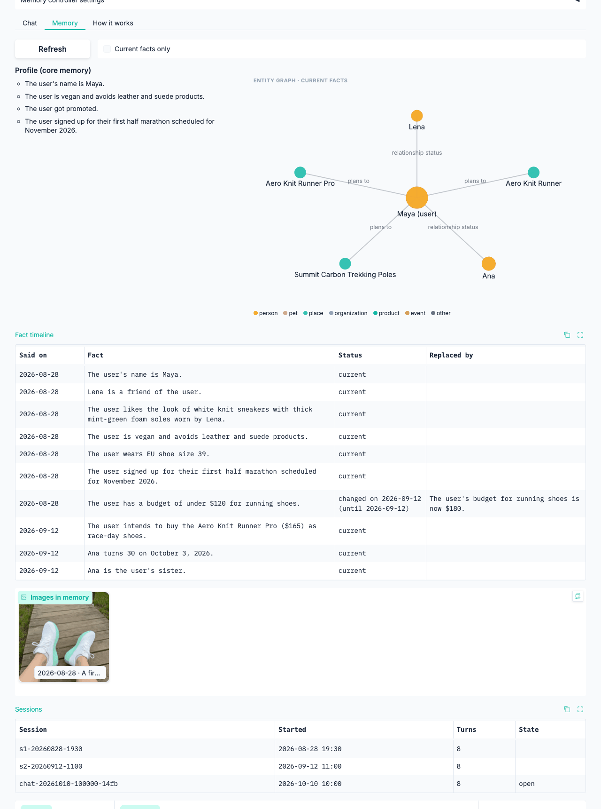

# N8 结果：Agent Runtime 与演示

把前面几个节点的记忆系统接进一个真正的多轮 Agent，并做成可以演示的服务。本节点做了：

- **自研 agent loop**（`src/cuemem/agent/`）：每条消息先由检索控制器（N7）决定想起多少，再按分区预算装配上下文（稳定前缀在前、召回的记忆在最后），模型可以调用工具，回答用 [p2] / [f2] / [m3] 引用记忆；每轮在线写回，会话结束后在后台巩固。
- **服务**（`src/cuemem/api/`）：FastAPI 接口（会话、对话、记忆浏览、遗忘、巩固、只检索不回答），Gradio 界面（对话 + 记忆轨迹面板 + 记忆浏览器），MCP Server（`remember` / `recall` / `forget` / `profile`）。
- **演示**：电商导购助手 Cue（虚构的商店 CueMart，24 件商品，图片由通义生图生成），一份三段会话的剧本，可以自动回放、核对。

**数据与模型**：演示剧本 `demo/shop/script.json`（2026-08-28、09-12、10-10 三段模拟日期的会话，13 条消息 + 1 次遗忘）。Agent 与抽取都用 qwen3.8-flash（D-044），向量 qwen3.7-text-embedding 与 tongyi-embedding-vision-plus。没有用到 DeepSeek，也没有动任何测试集。完整摘要在 [demo.json](demo.json)，上下文布局实验在 [context.json](context.json)。


## 结论

1. **端到端跑通了。** 剧本 14 项检查全部通过（13 条消息 + 1 次遗忘）：
   - 记得名字和更新后的尺码（EU 39 → 40）；
   - 按八月的照片找到同款，照片是从记忆里召回、原图再交给模型看的；
   - 说清预算怎么变的（$120 → $180）；
   - 遗忘之后不再说出妹妹的生日。
2. **控制器在新领域有两处偏差，模型自己补检索把它兜住了**（D-042）。
   - **附原图过于积极。** 有照片的空间里，8 次检索全部选了 L1 + 再感知，连"我穿多大的鞋"也附上了照片。这是从 MemLens 学来的：那里几乎每道题都靠图，再感知的收益在每一类题上都很大。探针里也没有特征能分出"这一问依赖图片"：MemLens 开发集上，附图有帮助的题和没影响的题，以文搜图与描述检索的分数中位数几乎一样（0.149 对 0.155、0.490 对 0.485）；没有视觉词的 80 道题附图照样赚（L1 +5 / −1，L2 +8 / −2）。代价是每轮多一张图的 token（按 800 估算），λ 在 0–100 之间关不掉它。
   - **门控在导购对话里失准。** "How has my shoe budget changed since we first talked?" 被判为 96% 与记忆无关，选了 L0。模型发现画像里只有现在的预算，自己调用 `memory_search("running shoe budget first mentioned")`，找到被取代的 $120 与现在的 $180，带引用答对。13 轮里有 3 轮用了这个逃生通道。
3. **稳定前缀在长对话里才显出价值**（D-043）。
   - **16 轮的长会话（不召回）**：稳定布局下，输入有 70% 由供应商的前缀缓存提供（后 8 轮 73%），每次调用平均要现算的输入是 1,036 个 token；把召回内容放进系统提示的对照布局只有 52%（49%），每次调用 1,461 个 token，多 41%，后 8 轮多 68%（1,969 对 1,175）。对照布局里只调用一次模型的轮次，输入从 1.2k 涨到 3.5k，缓存始终停在 1,024 个 token。
   - **演示剧本（每轮召回约 4k token、历史很短）**：两种布局差不多（54% 对 56%）。这种情况下缓存主要来自工具循环（同一轮的第二次调用与第一次共享前缀）和不变的角色说明。
4. **遗忘要沿引用扩散，只删"出处"不够**（D-046）。
   - 第一次真实回放时，遗忘之后助手仍说出了 "Oct 3"。原因是现场会话开头的问候引用了画像里 Ana 的生日，这一轮不属于事实的出处，留在了工作记忆和日志里。
   - 现在每次回复引用了哪些记忆都记在溯源表里，画像的每一条也可以引用。遗忘时，引用过被删内容的回复所在的轮会一起删掉，并继续往下追。最终回放里遗忘 4 条事实，删掉 6 句发言：出处 4 句，加上引用过它们的问候 2 句。
   - 同时补上了 N3 留下的限制（D-021）：trace 里含被删原话的条目也一并删除。
5. **延迟与成本**：
   - 探针加检索：问题向量没缓存时中位数 167 ms（两次向量请求：文本、以文搜图），缓存命中时约 6 ms；
   - 模型：平均每轮 1.77 次调用、5.6 s（只调一次的轮 2.6–3.7 s）；
   - 写回：中位数 105 ms；
   - 每轮实际花费约 $0.00056。N8 合计约 $0.95，其中生图 $0.75。

## 演示剧本

| 会话 | 消息 | 控制器 | 工具 | 引用 | 耗时 |
|---|---|---|---|---|---|
| 08-28 | Hi! I'm Maya … first half marathon … EU 39 … under $120 | L0（空记忆） | search_products | – | 4.5 s |
| | I'm vegan, so no leather or suede please | L0 | search_products | – | 4.8 s |
| | My friend Lena wears these …（附照片） | L0 | find_similar_products(u1) | – | 7.3 s |
| | Nice. I'll think about it, thanks! | L0 | – | – | 2.7 s |
| 09-12 | I got promoted … budget can go up to $180 | L1 + 再感知 | search_products | f4, f5, f7 | 10.6 s |
| | My sister Ana turns 30 on October 3rd … gift ideas under $60? | L1 + 再感知 | search_products | f5 | 5.7 s |
| | The trekking poles are perfect | L1 + 再感知 | – | f1, f5 | 3.8 s |
| | I've switched to EU 40 … my feet swell on long runs | L1 + 再感知 | memory_search | f6 | 7.0 s |
| 10-10 | Hi Cue, I'm back! | L1 + 再感知 | – | 6 条 | 3.2 s |
| | What size running shoes do I wear now? → EU 40 | L1 + 再感知 | – | f9, f10, m5 | 3.3 s |
| | Find shoes that look like the pair I showed you in August | L1 + 再感知 | find_similar_products(i1) | i1, f10, f9, f4 | 8.4 s |
| | How has my shoe budget changed? → $120 → $180 | **L0**（门控失准） | **memory_search** | f3, f10 | 3.6 s |
| | （遗忘：关于 Ana 的 4 条事实） | | | | 删 6 句 |
| | When is my sister's birthday? → 不知道 | L1 + 再感知 | memory_search × 2 | – | 9.9 s |

检查方式：每条消息可以写"必须出现"的关键词组、"不能出现"的词（支持正则）和希望控制器选的档。档位只报告、不算失败：现场会话写了 4 个希望的档，只有"找同款"一致（L1 + 再感知）；问候希望 L0、实际 L1 + 再感知，问尺码希望 L1、实际多了再感知，问预算变化希望 L2、实际 L0（模型自己补了检索）。素食那一轮的检查只算"作为列表项推荐了皮鞋"，回答里说"跳过了皮鞋"不算违规。

回放可以复现：每条消息的时间固定、会话 ID 固定，同一空间里重放全部命中本地缓存（只回放前两段时）。整段剧本以遗忘结束，遗忘会按设计清掉这个空间的回答缓存，下一次完整回放从第二段起重新调用。

## 上下文：分区与稳定前缀

一轮请求的结构（`src/cuemem/agent/context.py`）：

| 分区 | 内容 | 预算（token） | 何时变化 |
|---|---|---|---|
| 系统提示 | 角色、记忆规则、引用格式、导购说明 | – | 不变 |
| 工具说明 | memory_search、date_diff、search_products、find_similar_products | – | 不变 |
| 画像 | 核心记忆快照，每条带编号 [p1]… | 600 | 会话开始时取一次 |
| 工作记忆 | 本会话最近几轮的原话（含图片） | 3,000 | 只在末尾追加；超出预算时一次淘汰到一半 |
| 召回 | 控制器取回的事实、对话片段、图片（再感知时附原图） | 4,000（L2 6,000） | 每轮重算，只放在最后一条消息里 |
| 当前消息 | 日期 + 用户的话 + 图片 | – | 每轮 |

- 前四个分区组成稳定前缀：同一会话里每一轮的请求都以上一轮请求开头。
- 已经在工作记忆里的轮与图片不参与检索，探针也看不到它们，召回的名额留给上下文里没有的内容。
- 被淘汰出工作记忆的轮已经写进长期记忆，之后可以检索到。

上下文布局实验（`scripts/n8_context.py`，两遍都关掉本地缓存、每次真实调用；qwen3.8-flash 的缓存命中价约为原价的 1/9）：

| | 稳定布局 | 对照：召回放进系统提示 |
|---|---|---|
| 演示剧本：缓存命中 | 54%（输入成本 $0.0122 → $0.0063） | 56%（$0.0131 → $0.0066） |
| 16 轮长会话：缓存命中 | 70%（后 8 轮 73%） | 52%（后 8 轮 49%） |
| 长会话：每次调用要现算的输入 | 1,036（后 8 轮 1,175） | 1,461（后 8 轮 1,969） |

两遍的回答不同，工具调用次数也不同（长会话 35 次对 24 次），所以按每次调用比较；同一轮里的第二次调用在两种布局下都与第一次共享前缀，调用多的一边略占便宜。最干净的对照是只调用一次的轮次：对照布局里这样的轮有 10 个，输入从 1,203 涨到 3,546，缓存始终是 1,024。缓存命中数是供应商报的，以块为单位。

## 遗忘

- **单位是整轮**：删一条事实或一张图，删的是它出自的那一轮对话（用户的话与助手的回复）。助手在同一轮里常常复述了同样的信息（"Happy early birthday to Ana!"），只删用户那句，之后照样检索得到。
- **沿引用扩散**：后来的回复引用过要删的记忆（事实、对话片段、图片，或画像里的条目），那一轮也删，并继续往下追。没有引用、只是转述的回复追不到，这是已知限制。
- **重建与清理**：剩下的日志重放派生记忆（N3 的做法）；清掉相关的抽取、对账、回答缓存，以及不再出现的文本的向量；trace 里含被删原话的条目一并删除；进行中的会话同步去掉工作记忆里被删的轮，并重取画像快照。

## 界面



- **对话**：文字与图片；回答里的引用显示成上标，讲到的商品附商品图。
- **记忆轨迹**：控制器选了哪一档、为什么（推理类型、"与记忆无关"的概率）、各档的预期准确率与扣成本后的效用；上下文各分区的 token；被引用的记忆展开、其余折叠；工具调用；用量（含供应商前缀缓存命中）与各阶段耗时。L2 时另列规划出的子查询与每次充分性检查。
- **记忆浏览器**：画像、事实时间线（被取代的旧版本与取代它的新事实）、实体图、图库、会话；可以遗忘一条事实、一张图或一个会话。

界面文字与演示剧本用英文，文档仍是中文。

## 复现

```bash
# 演示素材（已提交，不必重跑；约 $0.75）
uv run python scripts/n8_assets.py

# 整段剧本回放与核对（只用通义；约 $0.02）
uv run cuemem demo demo/shop/script.json --fresh --report runs/demo/final-full.json
uv run python scripts/n8_summary.py runs/demo/final-full.json

# 上下文布局实验（关掉本地缓存，约 $0.1）
uv run python scripts/n8_context.py

# 现场演示：先建好前两段会话，再打开界面
uv run cuemem demo demo/shop/script.json --fresh --until 2
uv run cuemem serve        # http://127.0.0.1:7860/ ，接口文档 /docs
```

## 局限与下一步

- **演示只有一份剧本**，回答对不对靠关键词核对，不是大规模评测。Agent 的端到端准确率留到 N9：在测试集上把"控制器先选、模型兜底"作为一种方法评测（D-041、D-042）。
- **控制器的跨领域问题在这里再次出现**：门控失准、附图过于积极。N7 的结论是需要少量目标领域的标注来校准；导购对话的标注与在线学习没有做。
- **没有被引用、只是转述的回复，遗忘时追不到。**
- **录屏还没做**：剧本与演示指南在 [demo/README.md](../../../demo/README.md)，按指南操作约 3 分钟，视频留到 N10 与英文文档一起做。
